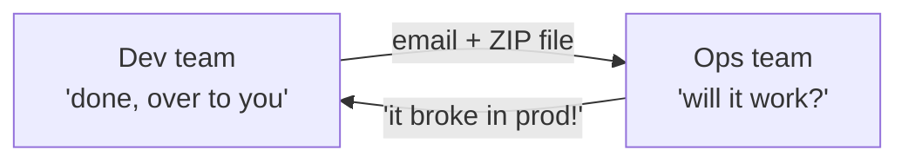

import Callout from '@components/Callout.astro';
import Quiz from '@components/Quiz.astro';

## Let's start with a scenario

Picture a typical software company in the mid-2000s. Two teams, sitting on two different floors:

- **Dev:** “Let's ship this feature ASAP!”
- **Ops:** “Every deployment breaks the system. Slow down!”

Dev wants **speed**, Ops wants **stability**. Both are right — but they optimize for different goals, and they even communicate over different media: while Dev writes code, Ops fills out change request forms. Every release is a risk operation, not a celebration.

**DevOps was born precisely to tear down this wall.**

## What is DevOps?

DevOps is a culture, set of practices and toolchain that lets development and operations teams work **as a single team**. The goal: shipping software **faster**, **more reliably** and **sustainably**.

The one-sentence definition:

> DevOps turns “you write it, we run it” into “you write it, you run it.”

Amazon codified this back in 2006: **“You build it, you run it.”** The engineer who wrote the service is also responsible when it pages at 3 AM.

### It has three legs

1. **Culture** — collaboration, shared ownership, learning from failure
2. **Practices** — CI/CD, Infrastructure as Code, monitoring
3. **Tools** — Git, GitHub Actions, Docker, Terraform, Prometheus...

The order is intentional: tools come last. Culture without tools is impossible, but **tools don't fix culture**.

## What DevOps is not

This part is a favorite of job interviews:

| DevOps ❌ is not | DevOps ✅ is |
| --- | --- |
| Just a tool (Jenkins, Docker...) | The culture and practices behind the tools |
| A “DevOps Engineer” title solving it alone | Shared responsibility across the whole team |
| “Automating the ops work away” | Removing the wall between Dev and Ops |
| Only setting up a CI/CD pipeline | The whole measure-improve loop, including the pipeline |
| A “project” (it ends) | A continuously improving process |

<Callout type="tip" title="Remember this">
  “DevOps Engineer” is a real title, but DevOps being a one-person job is usually an
  anti-pattern. DevOps is a **verb**: something everyone practices, not something
  delegated away.
</Callout>

## Why does it matter? (DORA metrics)

DevOps' impact isn't anecdote — it's backed by years of research. The **DORA** (DevOps Research and Assessment) team, owned by Google, surveys thousands of organizations every year and defines **elite performers** as:

- **Deployment frequency:** how often do you ship to production? (elite: multiple times per day)
- **Lead time for changes:** commit → production (elite: under a day)
- **Change failure rate:** what fraction of deployments cause incidents? (elite: below ~5%)
- **Failed deployment recovery time:** how fast do you restore service? (elite: under an hour)

The good news: these metrics don't trade off against each other. Teams that deploy fast are also the ones **with the fewest failures** — because each change is small and observable.

## What awaits you on this journey?

This repo teaches all of DevOps — from culture to Kubernetes, from monitoring to GitOps — level by level. And there's a twist: **this site is itself a DevOps project.** In the coming levels you will:

- Set up its real CI pipeline (Level 2),
- Turn it into a Docker image (Level 3),
- Put it under monitoring (Level 4),
- Ship it end-to-end to production (Level 5).

So every concept gets practiced **on this very site**. That's called dogfooding — one of the most effective ways to learn.

<Quiz
  id="s0-devops-nedir-en"
  title="Knowledge Check"
  questions={[
    {
      q: 'What is the core goal of DevOps?',
      options: [
        'Fully automating ops work and shutting down the ops team',
        'Removing the wall between dev and ops and creating shared ownership',
        'Making developers stop managing servers',
        'Reducing deployments to once a month',
      ],
      answer: 1,
      explain:
        'DevOps is not a tool or a team to be dissolved; it is a way of working that unites Dev and Ops around shared goals.',
    },
    {
      q: 'What does “You build it, you run it” advocate?',
      options: [
        'The team that writes the code is also responsible for its production behavior',
        'Every team should use separate tooling',
        'Ops engineers should not write code',
        'Only architects may deploy',
      ],
      answer: 0,
      explain:
        'Formulated at Amazon, this principle carries ownership into code quality and production stability.',
    },
    {
      q: 'What does the DORA metric “change failure rate” measure?',
      options: [
        'Deployment frequency',
        'Time from commit to production',
        'The fraction of deployments that cause incidents',
        'Team size',
      ],
      answer: 2,
      explain:
        'Change failure rate measures what percentage of production changes cause incidents; elite teams stay below ~5%.',
    },
    {
      q: 'Which of the following belongs on the “what DevOps is not” list?',
      options: [
        'A culture of continuous improvement',
        'CI/CD practices',
        'Setting up a toolchain and calling the job done',
        'Monitoring and feedback loops',
      ],
      answer: 2,
      explain:
        'Tools are only the third leg; installing tools without culture and practices is not DevOps.',
    },
  ]}
/>
