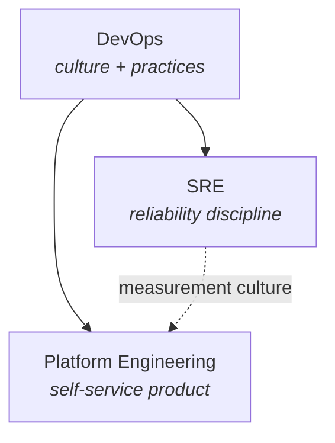

import Callout from '@components/Callout.astro';
import Quiz from '@components/Quiz.astro';

## Roles: similar but different

Job posts mix these three titles constantly. Knowing the difference helps your career plan — and your interviews.

### DevOps Engineer

- **Focus:** accelerating and automating the software delivery pipeline
- **Does:** CI/CD pipelines, IaC, container platforms, tooling that improves developer experience
- **Typical partners:** feature teams

### SRE (Site Reliability Engineering)

- **Focus:** system **reliability**, managed through measurable objectives
- **Does:** SLO/error budgets, incident management, capacity planning, chaos testing
- **Origin:** Google, 2003 (Ben Treynor Sloss): “SRE is what happens when you ask a software engineer to design an operations function”
- Think of it as the **metric-driven, engineering-forward** incarnation of DevOps culture

### Platform Engineer

- **Focus:** the internal developer **platform** — a “product” offering everything developers need as self-service
- **Does:** internal developer portals, template repos, standard deployment paths
- Their motto: *“The platform is a product; developers are its customers.”*



<Callout type="tip" title="Career advice">
  Whichever title you pick, the common ground is identical: Linux, networking, Git,
  containers and one cloud platform. Levels 1–3 of this repo are exactly that ground —
  you can postpone the title choice, but not the foundations.
</Callout>

## The DevOps engineer's skill tree

```
DevOps Skill Tree
├── Foundations (Level 1)
│   ├── Linux & terminal — the language of servers
│   ├── Networking — how services find each other
│   └── Git — the traceable story of change
├── Automation (Level 2)
│   ├── CI/CD concepts + GitHub Actions
│   └── Test automation
├── Platform (Level 3)
│   ├── Docker & Kubernetes
│   ├── Cloud concepts (vendor-neutral)
│   └── Terraform & Ansible
├── Reliability (Level 4)
│   ├── Observability (log/metric/trace)
│   ├── SRE practices (SLO, incident, postmortem)
│   └── DevSecOps
└── Mastery (Level 5)
    ├── GitOps & deployment patterns
    └── Capstone: end-to-end production project
```

Each level builds on the previous one. Skipping the order (say, starting Kubernetes without Linux) makes every concept feel twice as hard, because it stacks on an unfound foundation.

## What kind of learning experience does this repo offer?

1. **Small doses:** every lesson fits in one session (10–25 min).
2. **Active recall:** a quiz per lesson; flashcards for terms.
3. **Learning by doing:** labs on your own machine + a browser terminal simulator.
4. **One project, all the tools:** this site is itself an Astro project; from its CI to its Docker image to its monitoring, it's a **living lesson artifact**.

<Callout type="warn" title="A common mistake">
  Don't fall into “watch tutorials now, apply later on my own project”. Do the labs —
  by actually doing them. Otherwise you'll notice by Level 3 that Levels 1–2 evaporated.
</Callout>

Up next we tour the site's own internals: how the repo is structured, what the pipeline does. Then Level 1 puts you in front of a terminal. Ready?

<Quiz
  id="s0-kariyer-en"
  questions={[
    {
      q: 'What is SRE\'s most distinguishing approach?',
      options: [
        'They don\'t write code',
        'They manage reliability with measurable objectives — SLOs and error budgets',
        'They only use cloud',
        'They don\'t write tests',
      ],
      answer: 1,
      explain:
        'SRE replaces subjective ops decisions with measurements: define an SLO, manage an error budget, freeze features when it runs out.',
    },
    {
      q: 'Platform Engineering\'s core philosophy?',
      options: [
        'Restricting developers',
        'Treating the internal platform as a product whose customers are developers',
        'Monopolizing everyone\'s tooling',
        'Outsourcing ops work',
      ],
      answer: 1,
      explain:
        'The internal platform is treated like a product: developer experience is measured and improved with feedback.',
    },
    {
      q: 'Why does the order of this curriculum matter?',
      options: [
        'Order doesn\'t matter, skip freely',
        'Each level builds on the previous one — skipping makes concepts twice as hard',
        'Only to match certification order',
        'To increase the lesson count',
      ],
      answer: 1,
      explain:
        'Learning Kubernetes without Linux stacks every concept on an unfound foundation.',
    },
  ]}
/>
