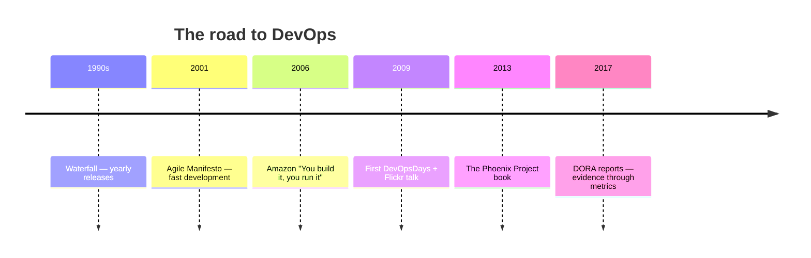

import Callout from '@components/Callout.astro';
import Quiz from '@components/Quiz.astro';
import Flashcards from '@components/Flashcards.astro';

## Where the problem was born: the Waterfall era

The 1990s and earlier: software projects ran on the **waterfall** model. First all requirements were gathered, then designed, then coded for months, and only then came “the testing phase”. Production releases happened once or twice a year.

Two deadly problems:

1. **Delayed feedback:** customers saw the product at the very end; a misunderstood requirement went unnoticed for months.
2. **Risk piling up at the end:** “integration” and “testing” always took longer than planned, and release day was a tragedy.

## The Agile revolution (2001)

In 2001, seventeen practitioners wrote the **Agile Manifesto**, built on four value preferences:

> Individuals and interactions over processes and tools
> Working software over comprehensive documentation
> Customer collaboration over contract negotiation
> Responding to change over following a plan

Agile revolutionized **development**: two-week sprints, daily standups, iterative delivery. But most organizations kept a critical blind spot: **code still waited on the way to production.** Features “done” in a sprint could wait months in the release queue. That's the *deployment bottleneck*.

## The birth of DevOps (2009)

In 2009, in Belgium, Patrick Debois organized the first **DevOpsDays** conference to fill exactly that gap. The same year, John Allspaw and Paul Hammond's **“10+ Deploys Per Day: Dev and Ops Cooperation at Flickr”** talk proved that 10+ deployments a day were possible — and safe.

DevOps' intellectual roots go deeper:

- **Lean** (Toyota Production System): reduce waste, improve flow, work in small batches
- **The Phoenix Project / The Goal**: bottleneck theory — a system's throughput equals its slowest step

## The CALMS framework

A popular model that breaks DevOps into five measurable components:

| Letter | Component | What it means |
| --- | --- | --- |
| **C** | Culture | Shared goals, collaboration over distrust |
| **A** | Automation | Automate everything repetitive (build, test, deploy...) |
| **L** | Lean | Small batches, flow, WIP limits, less waste |
| **M** | Measurement | Track deployment frequency, lead time, error rate... |
| **S** | Sharing | Knowledge sharing, shared tools, transparent postmortems |

<Callout type="info" title="Why CALMS?">
  Instead of telling a team “do DevOps”, asking “where are we on these five axes?”
  produces a concrete improvement map. Most teams jump straight to Automation, but
  automation without culture just produces faster chaos.
</Callout>

## Blameless culture: humans err, systems must prevent

Every incident has a human behind it — but human error is a **trigger, not a root cause**. The real question: *why did the system allow that error to take down production?*

**Blameless postmortems** say: after an incident, ask “what made it possible?”, not “who did it?”. In a blaming culture people hide mistakes; hidden mistakes come back as bigger incidents.

GitLab's 2017 data-loss incident — publicly documented in a live document while it happened — remains the textbook example of transparent, blameless handling. You'll dissect it in Level 5's archive.

## DevOps today

DevOps principles have spread into three waves:

- **SRE (Site Reliability Engineering):** Google's engineering-flavored take on operations (Level 4)
- **Platform Engineering:** self-service internal platforms for developers (Level 5)
- **AI-Assisted Operations:** machine learning and LLMs in log analysis and incident detection

The journey covers all of them — but first, the foundations: Linux, networking and Git.

<Flashcards
  id="s0-kultur-flash-en"
  cards={[
    { front: 'CALMS framework', back: 'Five dimensions of DevOps: Culture, Automation, Lean, Measurement, Sharing. Culture comes before automation.' },
    { front: 'Blameless postmortem', back: 'A no-blame incident review asking “what made it possible?” instead of “who did it?”.' },
    { front: 'Deployment bottleneck', back: 'Code written quickly with Agile still waiting to reach production. DevOps targets exactly this.' },
    { front: 'Waterfall', back: 'The classic sequential model that leaves feedback until the end; DevOps\' predecessor.' },
    { front: 'Lean', back: 'Toyota\'s production philosophy: small batches, flow, waste reduction. One of DevOps\' intellectual roots.' },
  ]}
/>

<Quiz
  id="s0-kultur-en"
  questions={[
    {
      q: 'What bottleneck remained after the Agile Manifesto?',
      options: [
        'Developers not writing tests',
        'Releases still being slow — code reached production late',
        'Sprints being too short',
        'Customers giving feedback too fast',
      ],
      answer: 1,
      explain:
        'Agile sped up development but deployment stayed old: the deployment bottleneck. DevOps targets it.',
    },
    {
      q: 'What does the “L” in CALMS stand for?',
      options: ['Leadership', 'Learning', 'Lean', 'Logging'],
      answer: 2,
      explain: 'CALMS = Culture, Automation, Lean, Measurement, Sharing.',
    },
    {
      q: 'The key question in a blameless postmortem?',
      options: [
        'Who made this mistake?',
        'Why did the system allow this mistake to hit production?',
        'How many hours did we lose?',
        'Why wasn\'t this person trained?',
      ],
      answer: 1,
      explain:
        'Blaming makes people hide errors. The goal is the systemic weakness that enabled them.',
    },
    {
      q: 'Which movement inspired the Lean side of DevOps?',
      options: [
        'NASA\'s space program',
        'Toyota Production System — flow and waste reduction',
        'The Linux kernel',
        'The Manhattan Project',
      ],
      answer: 1,
      explain: 'Lean thinking (small batches, flow, bottleneck analysis) is DevOps\' theoretical foundation.',
    },
  ]}
/>
