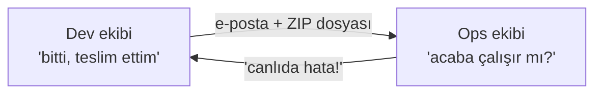

import Callout from '@components/Callout.astro';
import Quiz from '@components/Quiz.astro';

## Bir senaryo ile başlayalım

2000'lerin ortasındaki tipik bir yazılım şirketini hayal et. İki ekip var, iki ayrı katta oturuyorlar:

- **Geliştirme (Dev):** “Yeni özelliği bir an önce canlıya alalım!”
- **Operasyon (Ops):** “Her deploy sonrası sistem çöküyor. Değişiklikleri yavaşlatın!”

Dev **hız** ister, Ops **istikrar**. İkisi de haklı — ama ayrı hedefler için çalışıyorlar, hatta farklı bileşenlerde yazıyorlar: Dev rap yazarken, Ops `change request` formu dolduruyor. Her release bir kutlama değil, bir risk operasyonu.

**DevOps tam olarak bu duvarı yıkmak için doğdu.**

## DevOps nedir?

DevOps, geliştirme (Development) ve operasyon (Operations) ekiplerinin **tek bir ekip gibi çalışması** için kullanılan bir kültür, uygulama ve araç setidir. Amaç: yazılımı **daha hızlı**, **daha güvenilir** ve **sürdürülebilir** bir şekilde teslim etmek.

Tek cümlelik tanım:

> DevOps; “sen yaz, ben çalıştırırım” anlayışını “sen yaz, sen çalıştır” anlayışına dönüştüren bir çalışma biçimidir.

Amazon bunu 2006 gibi erken bir tarihte şöyle formüle etti: **“You build it, you run it.”** Servisini yazan mühendis, servisin gece 3'te uyarı vermesinden de sorumludur.

### Üç bacağı var

1. **Kültür** — işbirliği, ortak sorumluluk, hatadan öğrenme
2. **Uygulamalar (practices)** — CI/CD, Infrastructure as Code, monitoring
3. **Araçlar (tools)** — Git, GitHub Actions, Docker, Terraform, Prometheus...

Sıralama kasıtlı: araçlar en sonda. Araçsız kültür olmaz ama **araç kültürü çözmez**.

## DevOps ne değildir?

Bu kısım mülakatların da gözdesi:

| DevOps ❌ değildir | DevOps ✅ dir |
| --- | --- |
| Sadece bir araç (Jenkins, Docker...) | Araçların arkasındaki kültür ve uygulama |
| Bir unvan olarak “DevOps Engineer”ın tek başına çözdüğü iş | Tüm ekibin paylaştığı sorumluluk |
| “Ops işlerini otomatikleştiren kişi” | Dev ve Ops arasındaki duvarı kaldıran çalışma biçimi |
| Sadece CI/CD pipeline’ı kurmak | Pipeline dahil, ölçüm–iyileştirme döngüsünün tamamı |
| Bir “proje” (bitince biter) | Sürekli iyileşen bir süreç |

<Callout type="tip" title="Akılda kalsın">
  “DevOps Engineer” unvanı gerçek, ama bir şirkette DevOps’u tek kişinin yapması genellikle
  anti-pattern’dir. DevOps bir **fiil**dir: birilerine devredilen değil, herkesin uyguladığı bir şey.
</Callout>

## Neden bu kadar önemli? (DORA metrikleri)

DevOps’un etkisi rastgele söylentiler değil, yıllara dayanan araştırma verileriyle destekleniyor. Google’ın sahip olduğu **DORA** (DevOps Research and Assessment) ekibi her yıl binlerce organizasyonu ölçüyor ve **elit performans gösteren** ekipleri şöyle tanımlıyor:

- **Deployment frequency:** kod değişikliğini production’a ne kadar sık alıyorsun? (elit: günde birden fazla)
- **Lead time for changes:** commit’ten production’a ne kadar geçiyor? (elit: bir günden az)
- **Change failure rate:** deploy’ların yüzde kaçı olaya yol açıyor? (elit: ~%5’in altı)
- **Failed deployment recovery time:** bir olaydan ne çabuk dönersin? (elit: bir saatin altı)

İyi haber: bu metrikler birbirine zarar vermez. Hızlı deploy eden ekipler aynı zamanda **en az hata yapan** ekiplerdir — çünkü her değişiklik küçük ve izlenebilirdir.

## Bu yolculukta seni ne bekliyor?

Bu repo, DevOps’un tamamını — kültürden Kubernetes’e, monitoring’den GitOps’a — seviye seviye öğretir. Ve ince bir detay: **bu site de bir DevOps projesi.** İlerleyen seviyelerde:

- Kendisine CI pipeline’ı kuracak (Seviye 2),
- Docker imajına dönüşecek (Seviye 3),
- Monitoring’e alınacak (Seviye 4),
- Uçtan uca production’a taşınacak (Seviye 5).

Yani öğrendiğin her kavramı **bu sitenin kendisi üzerinde** uygulayacaksın. Buna “dogfooding” denir — en etkili öğrenme biçimlerinden biri.

<Quiz
  id="s0-devops-nedir"
  title="Bilgi Kontrolü"
  questions={[
    {
      q: 'DevOps’un temel amacı nedir?',
      options: [
        'Ops işlerini tamamen otomatikleştirip Ops ekibini kapatmak',
        'Geliştirme ve operasyon arasındaki duvarı kaldırıp ortak sorumluluk yaratmak',
        'Kod yazanların artık sunucu yönetmemesi',
        'Deploy sürecini ayda bire indirmek',
      ],
      answer: 1,
      explain:
        'DevOps bir araç veya kapanacak bir ekip değil; Dev ve Ops’u ortak hedef ve sorumluluk etrafında birleştiren bir çalışma biçimidir.',
    },
    {
      q: '“You build it, you run it” ilkesi neyi savunur?',
      options: [
        'Kodu yazan ekip, o kodun production’daki davranışından da sorumludur',
        'Her ekip ayrı araç kullanmalıdır',
        'Ops ekibi kod yazmamalıdır',
        'Sadece mimarlar deploy yapabilir',
      ],
      answer: 0,
      explain:
        'Amazon’un formüle ettiği bu ilke, sahiplik duygusunu (ownership) kodun kalitesine ve production istikrarına taşır.',
    },
    {
      q: 'DORA metriklerinden “change failure rate” neyi ölçer?',
      options: [
        'Deploy sıklığını',
        'Commit’ten production’a geçen süreyi',
        'Bir deploy’un olaya yol açma oranını',
        'Ekip büyüklüğünü',
      ],
      answer: 2,
      explain:
        'Change failure rate, production’a giden değişikliklerin yüzde kaçının hata/olay ürettiğini ölçer; elit ekiplerde ~%5’in altındadır.',
    },
    {
      q: 'Aşağıdakilerden hangisi DevOps’un “ne değildir” listesine girer?',
      options: [
        'Sürekli iyileştirme kültürü',
        'CI/CD uygulamaları',
        'Sadece bir araç seti kurup işin bittiğini düşünmek',
        'Monitoring ve geri bildirim döngüleri',
      ],
      answer: 2,
      explain:
        'Araçlar DevOps’un yalnızca üçüncü ayağıdır; kültür ve uygulamalar olmadan araç kurmak DevOps değildir.',
    },
  ]}
/>
