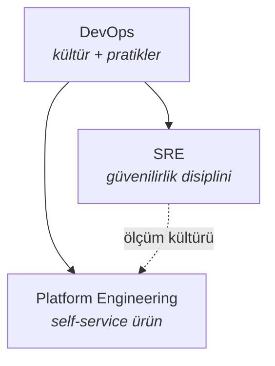

import Callout from '@components/Callout.astro';
import Quiz from '@components/Quiz.astro';

## Roller: benzer ama farklı

İş ilanlarında bu üç unvan sık sık birbirine karışır. Aradaki farkı bilmek hem kariyer planın hem mülakatların için değerlidir.

### DevOps Engineer

- **Odak:** yazılım teslim hattının (delivery pipeline) hızlandırılması ve otomatikleştirilmesi
- **Yapar:** CI/CD pipeline’ları, IaC, container altyapıları, geliştirici deneyimini iyileştiren araçlar
- **Tipik müttefik:** özellik ekipleri

### SRE (Site Reliability Engineering)

- **Odak:** sistemin **güvenilirliği** — ölçülebilir hedeflerle (SLO) yönetilir
- **Yapar:** SLO/error budget tanımlama, incident yönetimi, capacity planning, chaos testleri
- **Kökeni:** Google, 2003 (Ben Treynor Sloss): “SRE, operasyon problemini yazılım mühendisliğiyle çözmektir”
- DevOps kültürünün **metrik odaklı, mühendisliği ileri seviyeye taşınmış** hali gibi düşünülebilir

### Platform Engineer

- **Odak:** iç geliştirici **platformu** — geliştiricilerin ihtiyacı olan her şeyi self-service olarak sunan bir “ürün” inşa etmek
- **Yapar:** internal developer portal’lar, şablon repo’lar, standart deploy yolları
- Sloganları: *“Platform bir üründür, müşterisi geliştiricilerdir.”*



<Callout type="tip" title="Kariyer tavsiyesi">
  Bu unvanlardan hangisini seçersen seç, hepsinin ortak zemini aynıdır: Linux, ağ, Git,
  container’lar ve bir bulut platformu. Bu reponun Seviye 1–3’ü tam bu zemindir — unvan
  seçimini erteleyebilirsin, temelleri erteleyemezsin.
</Callout>

<Callout type="info" title="Gerçek dünyadan: SRE bir sıfat değil, 2003'ten kalma bir ekip">
  “SRE” unvanı 2003'te Google'da **Ben Treynor Sloss**'un kurduğu yedi kişilik ekiple
  başladı; bugün sektörün en çok aranan rollerinden. Ama unutma: sektörde “DevOps
  Engineer” yazan ilanların bir kısmı klasik ops işini yeni isimle sunar. İlan
  okurken ölçüt şudur: “pipeline'ı kim yazıyor, on-call kimde, otomasyon kararı
  kime ait?” — bu üç cevap gerçek rolü söyler.
</Callout>

## DevOps mühendisinin beceri ağacı

```
DevOps Beceri Ağacı
├── Temeller (Seviye 1)
│   ├── Linux & terminal — sunucuların dili
│   ├── Ağ — servislerin birbirini bulma yolu
│   └── Git — değişikliğin izlenebilir hikayesi
├── Otomasyon (Seviye 2)
│   ├── CI/CD kavramları + GitHub Actions
│   └── Test otomasyonu
├── Platform (Seviye 3)
│   ├── Docker & Kubernetes
│   ├── Bulut kavramları (vendor-neutral)
│   └── Terraform & Ansible
├── Güvenilirlik (Seviye 4)
│   ├── Observability (log/metric/trace)
│   ├── SRE pratikleri (SLO, incident, postmortem)
│   └── DevSecOps
└── Ustalık (Seviye 5)
    ├── GitOps & deployment desenleri
    └── Capstone: uçtan uca production projesi
```

Her seviye bir öncekinin üzerine kurulur. Sırayı atlarsan (örneğin Linux bilmeden Kubernetes’e başlarsan) her kavram, öğrenmediğin bir temelin üstüne kurulduğu için iki kat zor hissettirir.

## Bu repo nasıl bir öğrenme deneyimi sunar?

1. **Küçük dozlar:** Her ders tek bir oturumda (10–25 dk) bitirilebilir.
2. **Aktif hatırlama:** Her ders sonunda quiz; terimler için flashcards.
3. **Yaparak öğrenme:** Gerçek makinende uygulanacak lab’lar + tarayıcıda çalışan terminal simülatörü.
4. **Tek proje, bütün araçlar:** Bu sitenin kendisi de bir Astro projesi; CI’ından Docker imajına, monitoring’ine kadar **canlı bir ders malzemesi**.

<Callout type="warn" title="Sık yapılan hata">
  “Tutorial izleyeyim, sonra kendi projemde uygularım” tuzağına düşme. Lab’ları okuyarak
  değil **yaparak** geç; aksi halde üçüncü seviyede ilk ikisinin bilgisini buharlaştırdığını
  fark edersin.
</Callout>

Sıradaki derste bu sitenin kendi iç organlarına bakacağız: repo nasıl kurgulandı, pipeline neler yapıyor? Sonrasında Seviye 1 ile terminalin karşısına geçiyoruz. Hazır mısın?

<Quiz
  id="s0-kariyer"
  questions={[
    {
      q: 'SRE’nin en ayırt edici yaklaşımı nedir?',
      options: [
        'Kod yazmaması',
        'Güvenilirliği SLO ve error budget gibi ölçülebilir hedeflerle yönetmesi',
        'Sadece cloud kullanması',
        'Test yazmaması',
      ],
      answer: 1,
      explain:
        'SRE, operasyonu öznel kararlar yerine ölçümlerle yönetir: SLO tanımlanır, error budget tükenirse feature yerine reliability çalışılır.',
    },
    {
      q: 'Platform Engineering’in temel felsefesi nedir?',
      options: [
        'Geliştiricilere kısıtlama getirmek',
        'İç platformu, müşterisi geliştiriciler olan bir ürün olarak tasarlamak',
        'Tüm ekiplerin araçlarını tekelleştirmek',
        'Ops işlerini dışsourcing’e devretmek',
      ],
      answer: 1,
      explain:
        'Internal platform bir ürün gibi ele alınır: geliştirici deneyimi ölçülür, geri bildirimle geliştirilir.',
    },
    {
      q: 'Bu reponun önerdiği öğrenme sırası neden önemlidir?',
      options: [
        'Sıra şart değil, istediğin gibi atlayabilirsin',
        'Her seviye bir öncekinin üzerine kurulu olduğu için temelsiz atlama kavramları iki kat zorlaştırır',
        'Sadece sertifikasyon sırasına uymak için',
        'Derslerin sayısını artırmak için',
      ],
      answer: 1,
      explain:
        'Kubernetes’i Linux bilmeden öğrenmek gibi atlamalar, her yeni kavramı öğrenmediğin bir temelin üstüne kurman demektir.',
    },
  ]}
/>
