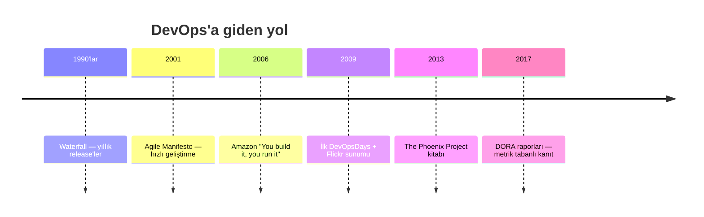

import Callout from '@components/Callout.astro';
import Quiz from '@components/Quiz.astro';
import Flashcards from '@components/Flashcards.astro';

## Sorunun doğuşu: Waterfall dönemi

1990’lar ve öncesi: yazılım projeleri **waterfall** (şelale) modeliyle yönetiliyordu. Önce tüm gereksinimler toplanır, sonra tasarlanır, aylarca kodlanır, en sonda “test aşamasına” geçilirdi. Production’a ise yılda bir ya da birkaç kez çıkılırdı.

Bu modelin iki ölümcül sorunu vardı:

1. **Gecikmiş geri bildirim:** Müşteri ürünü en sonda görüyordu; yanlış anlaşılmış bir gereksinim aylarca fark edilmiyordu.
2. **Riskin sona yığılması:** “Integration” ve “test” her zaman planlandığından uzun sürer, release günü trajediler yaşanırdı.

## Agile devrimi (2001)

2001’de on yedi praktisyen **Agile Manifesto**’yu yazdı. Özü şu dört değer önceliğiydi:

> Bireyler ve etkileşimler &gt; süreçler ve araçlar
> Çalışan yazılım &gt; kapsamlı dokümantasyon
> Müşteri işbirliği &gt; sözleşme pazarlığı
> Değişime açıklık &gt; plana bağlılık

Agile, **geliştirme tarafında** devrim yarattı: iki haftalık sprint’ler, günlük standup’lar, iteratif teslim. Ama çoğu organizasyonda kritik bir kör nokta kaldı: **kod production’a giderken beklemeye devam etti.** Sprint’te “biten” özellik, aylarca “release kuyruğunda” bekleyebiliyordu. Buna *deployment bottleneck* denir.

## DevOps’un doğuşu (2009)

2009’da Belçika’da Patrick Debois, Agile konferanslarındaki bu boşluğu doldurmak için ilk **DevOpsDays** etkinliğini düzenledi. Aynı yıl Flickr’den John Allspaw ve Paul Hammond’un **“10+ Deploys Per Day: Dev and Ops Cooperation at Flickr”** sunumu, günde 10+ deploy yapmanın mümkün ve güvenli olduğunu kanıtladı.

DevOps’un düşünce kökleri ise daha eskilere dayanır:

- **Lean** (Toyota Production System): israfı azalt, akışı iyileştir, küçük parçalarla çalış
- **The Phoenix Project / The Goal** kitapları: darboğaz (bottleneck) teorisi — sistemin genel çıktısı, en yavaş adımın hızına eşittir

## CALMS çerçevesi

DevOps’u ölçülebilir beş bileşene ayıran popüler bir model:

| Harf | Bileşen | Ne demek? |
| --- | --- | --- |
| **C** | Culture | Ortak hedefler, güvensizlik yerine işbirliği |
| **A** | Automation | Tekrarlayan her işin otomatikleştirilmesi (build, test, deploy...) |
| **L** | Lean | Küçük parçalarla akış, WIP (iş sürekliliği) limitleri, israfın azaltılması |
| **M** | Measurement | Deployment sıklığı, lead time, error rate gibi metriklerin izlenmesi |
| **S** | Sharing | Bilgi paylaşımı, ortak araçlar, şeffaf postmortem’ler |

<Callout type="info" title="Neden CALMS?">
  Bir ekibe “DevOps’u uygulayın” demek yerine bu beş eksende “neredeyiz, ne eksik?” diye
  sormak, somut bir iyileştirme haritası çıkarır. Çoğu ekip Automation’a hemen atlar ama
  Culture’suz otomasyon, sadece daha hızlı dağıtan bir kaos üretir.
</Callout>

## Blameless kültür: insanlar hata yapar, sistemler bunu önlemeli

Bilgi işlem dünyasında her olayın arkasında bir insan hatası vardır — ama insan hatası **sonuç değil, tetikleyicidir**. Asıl soru şudur: *sistem, bu hatanın production’ı düşürmesine neden izin verdi?*

**Blameless (suçlamasız) postmortem** yaklaşımı şunu söyler: olaydan sonra “kim yaptı?” değil, “neden mümkün oldu?” sorulur. Suçlayan bir kültürde insanlar hatalarını saklar; saklanan hata, iki kat büyük bir olay olarak geri döner.

Google’ın SRE ekiplerinin kullandığı postmortem formatını Seviye 4’te derinlemesine öğreneceksin.

<Callout type="info" title="Gerçek dünyadan: GitLab’ın radikal şeffaflığı">
  GitLab, Ocak 2017’deki büyük veri kaybı olayını olay **sürerken canlı bir Google
  Doc’ta** herkese açık şekilde belgeledi: denenen her şey, yanlış giden her adım,
  dakika dakika. Bugün hâlâ “blameless ve transparent postmortem” denince ilk akla
  gelen örneklerden biridir. İroni: olayın kendisi yedekleme + yetki hatalarından
  doğmuştu, ama şeffaf müdahalesi güveni korudu. Seviye 5 arşivinde detaylarıyla
  inceliyoruz.
</Callout>

## DevOps'un bugünü

DevOps ilkeleri bugün üç dalgaya yayıldı:

- **SRE (Site Reliability Engineering):** Google’ın DevOps’u mühendislikle “üretime çeviren” disiplini (Seviye 4)
- **Platform Engineering:** geliştiricilere kendi kendine yeterli (self-service) iç platformlar sunmak (Seviye 5)
- **AI-Assisted Operations:** log analizi ve olay tespitinde yapay zeka destekli araçlar

Yolculuk boyunca bu katmanların hepsine değineceğiz — ama önce temeller: Linux, ağ ve Git.

<Flashcards
  id="s0-kultur-flash"
  cards={[
    { front: 'CALMS çerçevesi', back: 'DevOps’un beş boyutu: Culture, Automation, Lean, Measurement, Sharing. Kültür otomasyondan önce gelir.' },
    { front: 'Blameless postmortem', back: 'Olay sonrası “kim yaptı?” yerine “sistem neden buna izin verdi?” sorusunun sorulduğu, suçlamasız analiz toplantısı.' },
    { front: 'Deployment bottleneck', back: 'Agile ile hızla yazılan kodun, release süreçleri nedeniyle production’a gecikmesi. DevOps bu darboğazı kaldırır.' },
    { front: 'Waterfall', back: 'Aşamaları sırayla ilerleyen, geri bildirimi en sona bırakan klasik yazılım modeli; DevOps’tan önceki ana yaklaşım.' },
    { front: 'Lean', back: 'Toyota’dan gelen üretim felsefesi: küçük parçalar, akış, israfın azaltılması. DevOps’un düşünce köklerinden biri.' },
  ]}
/>

<Quiz
  id="s0-kultur"
  questions={[
    {
      q: 'Agile Manifesto çıktıktan sonra hâlâ var olan temel darboğaz neydi?',
      options: [
        'Geliştiricilerin test yazmaması',
        'Kodun production’a çıkış sürecinin (release) hâlâ yavaş olması',
        'Sprint’lerin çok kısa olması',
        'Müşteri geri bildiriminin hızlı gelmesi',
      ],
      answer: 1,
      explain:
        'Agile geliştirmeyi hızlandırdı ama deployment süreçleri eski halindeydi: “deployment bottleneck”. DevOps tam bu darboğazı hedefler.',
    },
    {
      q: 'CALMS’teki “L” hangi kavramı temsil eder?',
      options: ['Leadership', 'Learning', 'Lean', 'Logging'],
      answer: 2,
      explain: 'CALMS = Culture, Automation, Lean, Measurement, Sharing.',
    },
    {
      q: 'Blameless postmortem’de ana soru hangisidir?',
      options: [
        'Bu hatayı kim yaptı?',
        'Sistem bu hatanın production’ı etkilemesine neden izin verdi?',
        'Kaç saat kaybettik?',
        'Bu kişi neden eğitimsiz?',
      ],
      answer: 1,
      explain:
        'Suçlayıcı sorular insanları hata saklamaya iter. Asıl hedef, hatayı tekrar mümkün kılan sistemik zayıflığı bulmaktır.',
    },
    {
      q: 'The Phoenix Project ve Toyota Production System hangi DevOps bileşenine ilham vermiştir?',
      options: ['Lean akış ve darboğaz teorisi', 'Container teknolojisi', 'Load balancing', 'Şifreleme'],
      answer: 0,
      explain:
        'Lean felsefesi (küçük parçalar, akış, bottleneck analizi) DevOps’un teorik temelidir.',
    },
  ]}
/>
