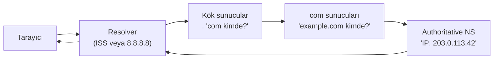

import Callout from '@components/Callout.astro';
import Quiz from '@components/Quiz.astro';
import Flashcards from '@components/Flashcards.astro';
import LabBox from '@components/LabBox.astro';

## Tarayıcıya adres yazınca ne olur?

`devops.example.com` yazdın ve sayfa geldi. Arkada dört adım oldu:

1. **DNS çözümleme:** alan adı → IP adresi çevrilir
2. **TCP bağlantısı:** o IP'nin 443 portuna bağlanılır
3. **TLS el sıkışması:** şifreli kanal kurulur
4. **HTTP isteği/yanıtı:** sayfa verisi gelir

Bu dersin konusu 1–2. adımlar; HTTP ve TLS bir sonraki ders.

## IP adresleri: ağdaki ev adresleri

Her makinenin ağda bir adresi vardır:

- **IPv4:** `192.168.1.20` — 4 sayı (0–255), ~4.3 milyar adres (bitti!)
- **IPv6:** `2001:db8::1` — sonsuza yakın adres havuzu, giderek yaygınlaşıyor

Özel (private) aralıklar — iç ağlarda kullanılır, internetten doğrudan erişilemez:

| Aralık | Tipik kullanım |
| --- | --- |
| `10.0.0.0/8` | Bulut VPC'leri (AWS default VPC vb.) |
| `172.16.0.0/12` | Docker varsayılan ağları |
| `192.168.0.0/16` | Ev/ofis router'ları |

`/8, /12, /16` **subnet maskesi** gösterimidir (CIDR): kaç bitin “ağ kısmı” olduğunu söyler. `192.168.1.0/24` = aynı alt ağda 254 cihaz sığar. Bulut dünyasında (VPC, security group) her gün bu gösterimi göreceksin — Seviye 3'te pratikleştireceğiz.

Özel adresler: `localhost` / `127.0.0.1` = **bu makine**. “Site localhost'ta açılmıyor” = sorun ağda değil, makinende.

## DNS: internetin telefon rehberi

DNS, alan adını IP'ye çevirir. Çözümleme zinciri:



DevOps için kritik kayıt türleri:

| Kayıt | Ne yapar | Örnek |
| --- | --- | --- |
| `A` | Alan adı → IPv4 | `app.example.com → 203.0.113.42` |
| `AAAA` | Alan adı → IPv6 | — |
| `CNAME` | Takma ad → diğer alan adı | `www → app.example.com` |
| `MX` | Mail sunucusu | — |
| `TXT` | Serbest metin (doğrulama, SPF...) | sahiplik doğrulamaları |

**TTL (Time To Live):** kaydın kaç saniye önbelleklenip geçerli kaldığı. Deploy derslerinde klasik olay: “DNS değiştirdim ama hâlâ eski IP'ye gidiyor” → TTL beklenmedi.

<Callout type="info" title="Gerçek dünyadan: Facebook (2021) — DNS her şeydi">
  Ekim 2021'de Facebook/Instagram/WhatsApp ~6 saat erişilemez oldu: bir bakım komutu
  BGP reklamını geri çekti, DNS ile birlikte **her şey** çözülemez hale geldi —
  dahili araçlar ve kapı rozetleri bile ağa bağımlı olduğu için mühendislerin veri
  merkezine fiziksel gitmesi gerekti. Tek bir bağımlılık noktasının, milyarlarca
  kullanıcılı şirketi nasıl durdurabildiğinin en çarpıcı örneği. Tam vaka Seviye 5
  arşivinde.
</Callout>

## Portlar: aynı IP'de binlerce kapı

IP makineyi bulur; **port** makinedeki doğru programı bulur. `IP:port` çifti = adres + daire numarası.

Yaygın portlar:

| Port | Servis |
| --- | --- |
| 22 | SSH |
| 80 | HTTP |
| 443 | HTTPS |
| 3306 | MySQL |
| 5432 | PostgreSQL |
| 6379 | Redis |

Klasik hata: “site erişilemiyor” → uygulama 3000'de çalışıyor ama 80/443 bekleniyor. Çözüm ya reverse proxy (nginx, Seviye 1'in ileri konusu) ya da doğru portu bilmektir.

```bash
# Ağ araçları — hızlı tanışma
ping 8.8.8.8                 # erişilebilirlik (ICMP)
nslookup app.example.com     # DNS sorgusu
ss -tlnp                     # hangi portlar dinliyor? (sudo ile süreç adları da)
```

<LabBox
  id="s1-ag-temelleri-lab"
  title="Kendi ağınla tanış"
  verify={['ping -c 2 1.1.1.1', 'nslookup astro.build', 'ss -tln | head -5']}
>
  1. `ping -c 2 1.1.1.1` — internete çıkışın var mı?
  2. `nslookup astro.build` (veya `dig astro.build`) — hangi IP'ye çözümleniyor?
  3. `ss -tln` — makinende hangi portlar dinliyor? Sürpriz bir şey var mı?
  4. `curl -I https://astro.build` — yanıt başlıklarına bak (bir sonraki dersin provası).
</LabBox>

<Callout type="info" title="Seviye 3 bağlantısı">
  Bulut'ta “security group / firewall” mantığı = port bazlı izinler. Docker'ın
  `172.17.0.0/16` ağları ve Kubernetes'in service DNS'i (`servis.namespace.svc.cluster.local`)
  bu derste öğrendiklerinin üstüne kurulur.
</Callout>

<Flashcards
  id="s1-ag-flash"
  cards={[
    { front: 'CIDR (/24)', back: 'Subnet gösterimi: ağ kısmının bit sayısı. 192.168.1.0/24 = 254 kullanılabilir adres.' },
    { front: 'A kaydı', back: 'DNS kaydı: alan adını IPv4 adresine çevirir. AAAA ise IPv6 için.' },
    { front: 'CNAME', back: 'Bir alan adının başka bir alan adına yönlendirilmesi (takma ad). IP değişse bile CNAME sabit kalır.' },
    { front: 'TTL', back: 'DNS kaydının önbellekteki geçerlilik süresi (saniye). TTL kısa = değişiklikler hızlı yayılır.' },
    { front: '127.0.0.1', back: 'localhost: “bu makinenin kendisi”. Hata ayıklamada ilk kontrol: servis gerçekten dinliyor mu?' },
    { front: 'ss -tln', back: 'Dinlenen TCP portlarını listeler. “Uygulama erişilemiyor” durumunun klasik ilk komutu.' },
  ]}
/>

<Quiz
  id="s1-ag-temelleri"
  questions={[
    {
      q: 'Tarayıcı “app.example.com”a giderken ilk adım nedir?',
      options: [
        'HTTP isteği göndermek',
        'DNS ile alan adını IP’ye çözmek',
        'TLS sertifikası indirmek',
        'Port 443’ü kapatmak',
      ],
      answer: 1,
      explain: 'Önce adres çözülür (DNS), sonra TCP bağlantısı, sonra TLS, en son HTTP.',
    },
    {
      q: '192.168.1.0/24 ağındaki en fazla kaç cihaz adreslenebilir (yaklaşık)?',
      options: ['24', '254', '1024', '65 bin'],
      answer: 1,
      explain: '/24 → son 8 bit host kısmı → 2^8-2 (ağ ve broadcast hariç) = 254 cihaz.',
    },
    {
      q: 'Uygulaman 3000 portunda çalışıyor ama site 80’den bekleniyor. Hızlı çözüm ne olabilir?',
      options: [
        'Uygulamayı silmek',
        'Reverse proxy (nginx) ile 80 → 3000 yönlendirmek',
        'DNS’i değiştirmek',
        'Sunucuyu yeniden başlatmak',
      ],
      answer: 1,
      explain:
        'Reverse proxy standart çözümdür: 80/443’ü nginx dinler, trafiği uygulamaya aktarır (Seviye 1 ileri konusu).',
    },
    {
      q: '“DNS değişikliğim yayılmadı” şikâyetinde ilk kontrol edilecek şey?',
      options: ['Sunucu CPU’su', 'Kaydın TTL değeri', 'Disk kullanımı', 'SSH izinleri'],
      answer: 1,
      explain:
        'Eski cevap önbellekte TTL süresi kadar yaşamaya devam eder. TTL’i kontrol et, süreyi bekle.',
    },
  ]}
/>
