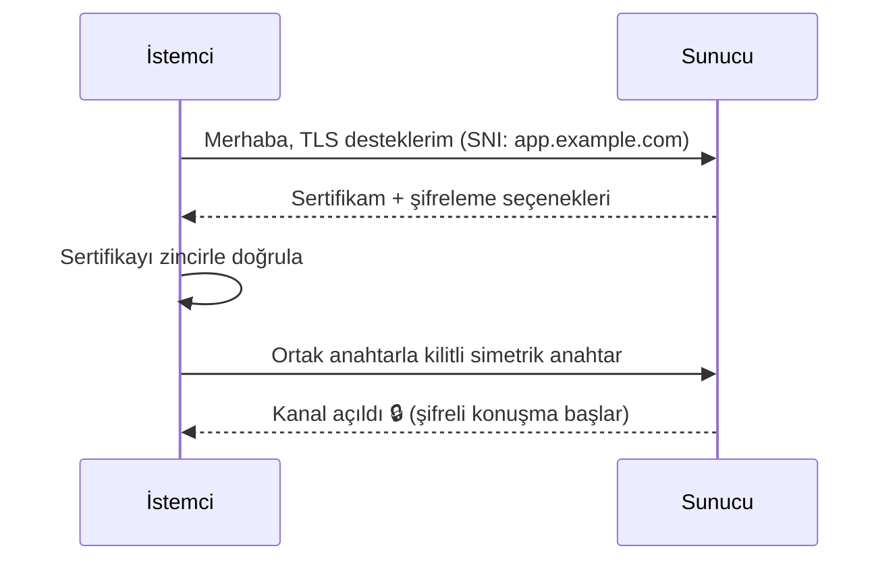

import Callout from '@components/Callout.astro';
import Quiz from '@components/Quiz.astro';

## HTTP: istek-yanıt dili

HTTP, istemci (tarayıcı/curl) ile sunucu arasındaki **istek-yanıt** protokolüdür. Bir istek üç parçadan oluşur: **metot + yol**, **başlıklar**, **gövde** (gerekirse).

### Metotlar

| Metot | Anlamı | Örnek |
| --- | --- | --- |
| `GET` | Oku (gövdesiz) | `GET /api/urunler` |
| `POST` | Oluştur / işlem yap | `POST /api/siparis` |
| `PUT` | Tam değiştir | `PUT /api/urun/5` |
| `PATCH` | Kısmi güncelle | `PATCH /api/urun/5` |
| `DELETE` | Sil | `DELETE /api/urun/5` |

**Idempotency** önemli bir kavram: aynı isteği tekrarlamak sonucu değiştiriyorsa idempotent değildir. `GET`, `PUT`, `DELETE` idempotent'tir; `POST` değildir. Retry (yeniden deneme) mantıkları bu ayrıma dayanır — deploy ve mesaj kuyruklarında kritik.

### Durum kodları: sunucunun kısa cevabı

| Sınıf | Anlamı | Sık karşılaşılanlar |
| --- | --- | --- |
| **2xx** | Başarı | `200 OK`, `201 Created`, `204 No Content` |
| **3xx** | Yönlendirme | `301 kalıcı`, `302 geçici`, `304 önbellek güncel` |
| **4xx** | İstemci hatası | `400 bozuk istek`, `401 kimlik yok`, `403 yasak`, `404 yok`, `429 çok fazla istek` |
| **5xx** | Sunucu hatası | `500 iç hata`, `502 upstream ölü`, `503 meşgul`, `504 upstream yavaş` |

<Callout type="tip" title="Incident dilinde durum kodları">
  `502/503` görüyorsan: uygulama ya kapalı ya da proxy'nin arkasında yanıt vermiyor.
  `429` görüyorsan: rate limit — trafik patlaması ya da saldırı. Loglara gitmeden önce
  durum kodu sana neyin nerede arızalı olduğunu büyük oranda söyler.
</Callout>

### Başlıklar: metadata katmanı

```http
GET /api/urunler HTTP/1.1
Host: app.example.com
Authorization: Bearer eyJhbGciOi...
Accept: application/json
Cache-Control: max-age=3600
```

DevOps'un sık işaret ettiği başlıklar:

- `Content-Type` — gövde formatı (`application/json`, `text/html`)
- `Authorization` — kimlik doğrulama (token'lar)
- `Cache-Control` — önbellek politikası (CDN davranışını buradan yönetirsin)
- `Set-Cookie` — oturum verisi
- `X-Forwarded-For` — proxy arkasındaki gerçek istemci IP'si (loglar için kritik!)

## HTTPS = HTTP + TLS

TLS (Transport Layer Security), HTTP trafiğini **şifreler** ve iki şeyi garanti eder:

1. **Gizlilik:** araya giren biri trafiği okuyamaz
2. **Bütünlük + kimlik:** veri yolda değiştirilemez; sunucu gerçekten iddia edilen kişidir

### Sertifika zinciri

Tarayıcı “bu sertifika güvenilir mi?” sorusunu zincirle cevaplar:

```
app.example.com sertifikası
   └─ imzalayan: Let's Encrypt R3 (Intermediate CA)
        └─ imzalayan: ISRG Root X1 (Root CA — işletim sisteminde gömülü)
```

**Root CA'lar** tarayıcı/OS içinde hazır gelir. Sertifikayı Let's Encrypt gibi bir CA imzalar. **Sertifika süresi** klasik olay kaynağıdır: süresi biten sertifika = tüm dünyada `SEC_ERROR_EXPIRED`. Çözüm: otomatik yenileme (Let's Encrypt + `certbot`, 90 günlük sertifikalar).

<Callout type="info" title="Gerçek dünyadan: tek süresi dolan sertifika, iki kıta">
  Aralık 2018'de bir Ericsson sertifikasının süresi dolunca İngiltere'de O2 ve
  Japonya'da SoftBank ağlarında milyonlarca kullanıcı internete bağlanamadı — mobil
  operatörlerin altyapısındaki bir bileşen, süresi dolan tek sertifikaya bağımlıydı.
  “Sertifika yenileme otomasyonu” bu derste öğrendiğin küçük bir pratik gibi görünse
  de, operatör ölçeğinde ulusal kesinti önleyicidir.
</Callout>

### TLS el sıkışması (basitleştirilmiş)



Modern versiyonlar: TLS 1.2 hâlâ yaygın; **TLS 1.3** el sıkışmayı tek tur indirir, eski şifrelemeleri keser. HTTP/2 ve HTTP/3 yalnızca HTTPS üzerinde yaygındır.

## DevOps'un HTTPS ile ilişkisi

- **Reverse proxy sonlandırması:** TLS’i nginx/CADLoadBalancer sonlandırır, iç trafik HTTP kalabilir (ya da end-to-end şifreli).
- **Sertifika otomasyonu:** certbot/ACME ile sertifika bir IaC kaynağıdır — elle PDF'ten kopyalanan dosya değil.
- **HSTS başlığı:** tarayıcıya “bu siteye daima HTTPS ile gel” der.

<Quiz
  id="s1-http-tls"
  questions={[
    {
      q: '502 Bad Gateway tipik olarak neyi işaret eder?',
      options: [
        'İstemcinin DNS’i bozuk',
        'Proxy’nin arkasındaki uygulamanın yanıt vermediğini',
        'Sertifikanın süresinin bittiğini',
        'Rate limit aşıldığını',
      ],
      answer: 1,
      explain:
        '502 = gateway (nginx vb.) upstream’e ulaşamadı/yanıt alamadı. Uygulama süreçlerine bakılır.',
    },
    {
      q: 'Hangi HTTP metodu idempotent değildir?',
      options: ['GET', 'PUT', 'DELETE', 'POST'],
      answer: 3,
      explain:
        'POST her çağrıda yeni kaynak/efekt üretebilir; bu yüzden retry stratejileri POST’ta daha dikkatli kurulur.',
    },
    {
      q: 'TLS sertifikası doğrulanırken zincirin tepesinde ne bulunur?',
      options: [
        'Sunucunun kendi sertifikası',
        'İşletim sisteminde gömülü güvenilir Root CA',
        'Tarayıcının IP adresi',
        'Domain registrar',
      ],
      answer: 1,
      explain:
        'Root CA’lar OS/tarayıcı ile önceden dağıtılır; intermediate CA’lar kökünden imzalanır.',
    },
    {
      q: 'Sertifika süresinin bitmesi türü olayları kalıcı çözmek için en iyi yaklaşım?',
      options: [
        'Her ay takvim hatırlatıcısı koymak',
        'Sertifika süresini 10 yıla çıkarmak',
        'ACME/Let’s Encrypt ile otomatik yenileme kurmak',
        'HTTPS’i kapatmak',
      ],
      answer: 2,
      explain:
        'Otomasyon refleksi: sertifika yönetimi de koda/otomasyona devredilir (certbot, cloud native ACME).',
    },
    {
      q: 'X-Forwarded-For başlığı neden loglarda kritiktir?',
      options: [
        'Sertifika bilgisini taşır',
        'Proxy arkasındaki gerçek istemci IP’sini gösterir',
        'Sayfa boyutunu bildirir',
        'Cache süresini belirler',
      ],
      answer: 1,
      explain:
        'Trafik reverse proxy’den geçerse sunucu yalnızca proxy IP’sini görür; gerçek istemci bu başlıkta taşınır.',
    },
  ]}
/>
