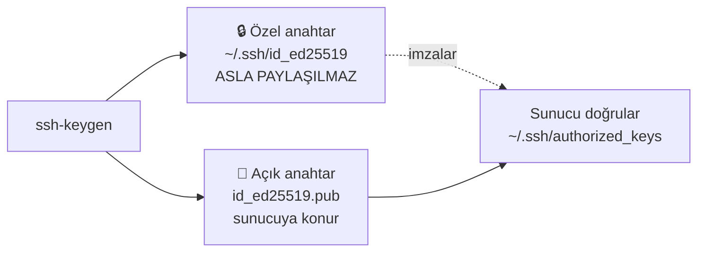

import Callout from '@components/Callout.astro';
import Quiz from '@components/Quiz.astro';
import LabBox from '@components/LabBox.astro';

## SSH nedir, neden her yerde?

SSH (Secure Shell), uzak makinede **şifreli** olarak komut çalıştırmanın standardıdır. Bulut sunucuna, CI'a, git uzaktan erişimine... hepsi SSH konuşur. SSH 22 portunu dinler.

## Şifre değil, anahtar

Şifreyle giriş hem zayıf (brute force) hem pratik değil. SSH'ın yolu **asimetrik şifreleme**:



- **Özel anahtar (private key):** makinenizde kalır, dosya izni `600` olmalı
- **Açık anahtar (public key):** sunucudaki `~/.ssh/authorized_keys` dosyasına eklenir
- Sunucu “kolye ile kilit açma” mantığıyla: açık anahtarın doğrulayabileceği bir imza ister

Anahtar üretimi:

```bash
ssh-keygen -t ed25519 -C "ben@ornek.com"
# Enter Enter (passphrase tavsiye: evet!)
cat ~/.ssh/id_ed25519.pub
```

<Callout type="warn" title="Özel anahtar = kimliğin">
  Özel anahtar dosyasını asla Slack'te/e-postada gönderme, repoya koyma (gitignore!),
  iznini 600'den bırakma. Kaybolduğunu düşünüyorsan sunuculardan authorized_keys'ten
  hemen temizle.
</Callout>

## Sunucuya ilk bağlantı

```bash
ssh kullanici@203.0.113.42
# ilk kez bağlanınca fingerprint sorar → doğrula, 'yes'
```

Her bağlantıda `kullanici@ip` yazmamak için **`~/.ssh/config`**:

```
Host sunucu-1
    HostName 203.0.113.42
    User deploy
    IdentityFile ~/.ssh/id_ed25519
    Port 22

Host *.ornek.com
    User deploy
    ProxyJump bastion.ornek.com
```

Artık `ssh sunucu-1` yeter. `ProxyJump` satırı da kurumsal gerçeklik: dışarıya doğrudan açılan tek kapı **bastion/jump host**tur; diğer sunuculara onun üzerinden gidilir.

## SSH agent: passphrase'i bir kez yaz

Anahtarına passphrase verdiysen her bağlantıda sorulur. **Agent** bunu oturum boyunca aklında tutar:

```bash
eval "$(ssh-agent -s)"
ssh-add ~/.ssh/id_ed25519
```

## Port forwarding: iki klasik numara

```bash
# Uzak sunucudaki 3000 portunu kendi makinemde 3000'e taşı
ssh -L 3000:localhost:3000 sunucu-1
# → tarayıcıda http://localhost:3000 artık sunucudaki uygulamayı gösterir

# Ters yönde: yereldeki bir servis için sunucudan erişim
ssh -R 8080:localhost:80 sunucu-1
```

Bulut geliştirmede çok kullanılır: veritabanı management UI, staging uygulaması vb. — portu internete açmak yerine SSH tüneliyle güvenli eriş.

<Callout type="info" title="Gerçek dünyadan: Target (2013) — üçüncü taraf uzaktan erişimin bedeli">
  2013'te ABD perakende devi Target'a sızma, **ikmal/havalandırma tedarikçisinin
  uzaktan erişim bilgileriyle** başladı; tedarikçi ağı ile ödeme ağı arasında
  segmentasyon olmadığı için saldırı ~40 milyon kart verisine ulaştı. Ders: her
  uzaktan erişim (SSH dahil) bir “kim, nereden, hangi ağa?” kararıdır ve
  tedarikçi/jump host kısıtları ile segmentasyon bu sorunun cevabını kodda
  tutar.
</Callout>

## Sunucu tarafı sağlamlaştırma (özet)

Production sunucusunda standart ayarlar (`/etc/ssh/sshd_config`):

```
PasswordAuthentication no     # sadece anahtar
PermitRootLogin no            # root'a direkt giriş yok
```

Sonra: `sudo systemctl restart sshd`. SSH anahtar yönetimi çok kullanıcılı ekiplerde büyür; Seviye 4'te secret yönetimi dersinde bu konuya döneriz.

<LabBox
  id="s1-ssh-lab"
  title="SSH akışını uygula"
  verify={['ls -l ~/.ssh/id_ed25519 2>/dev/null || echo "önce ssh-keygen"']}
>
  Henüz sunucun yoksa bile yerelde şunları yapabilirsin:

  1. `ssh-keygen -t ed25519 -C "test@local"` — anahtar çifti üret (passphrase koymayı dene).
  2. `ls -l ~/.ssh/` — izinlere bak: özel anahtar `600`, `.pub` `644` olmalı.
  3. `~/.ssh/config` dosyasına sahte bir Host bloğu yaz (ör. `Host test-vm → HostName 127.0.0.1`).
  4. `ssh test-vm` çalıştır — bağlantı denemesini ve hata türünü gözlemle (bağlantı reddi normal).
</LabBox>

<Quiz
  id="s1-ssh"
  questions={[
    {
      q: 'SSH açık anahtarı nereye konur?',
      options: [
        'İstemcinin ~/.ssh/id_ed25519 dosyasına',
        'Sunucunun ~/.ssh/authorized_keys dosyasına',
        '/etc/passwd dosyasına',
        'Sunucunun 22 portuna',
      ],
      answer: 1,
      explain:
        'authorized_keys, hangi açık anahtarların hangi kullanıcı olarak giriş yapabileceğini tutar; özel anahtar asla sunucuya kopyalanmaz.',
    },
    {
      q: '~/.ssh/id_ed25519 için doğru dosya izni?',
      options: ['777', '664', '644', '600'],
      answer: 3,
      explain: 'Özel anahtar yalnızca sahibine açık olmalı; SSH açık izinli anahtarı reddeder.',
    },
    {
      q: 'ssh -L 5432:localhost:5432 sunucu-1 komutu ne yapar?',
      options: [
        'Sunucudaki Postgres portunu internete açar',
        'Sunucudaki 5432’yi kendi makinendeki 5432’ye tüneller',
        'SSH servisini yeniden başlatır',
        '5432 portunu kapatır',
      ],
      answer: 1,
      explain:
        'Local forwarding: yereldeki bağlantılar tünel üzerinden uzak servise gider; internete port açmaya gerek kalmaz.',
    },
    {
      q: 'Production SSH sağlamlaştırmasında tipik iki ayar?',
      options: [
        'PasswordAuthentication no + PermitRootLogin no',
        'Port 80 + root evet',
        'MaxSessions 1000 + şifre evet',
        'Compression yes + verbose yes',
      ],
      answer: 0,
      explain:
        'Şifre girişini ve root girişini kapatmak brute force ve yetki genişlemesinin ana kapılarını keser.',
    },
  ]}
/>
