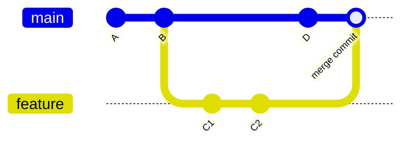
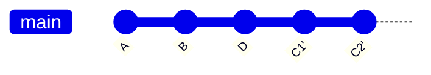
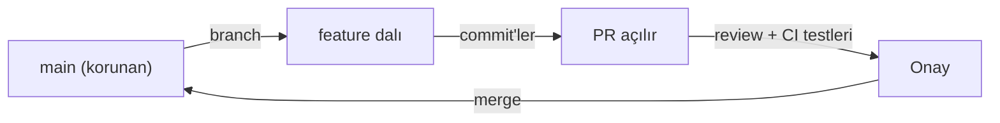

import Callout from '@components/Callout.astro';
import Quiz from '@components/Quiz.astro';
import Mermaid from '@components/Mermaid.astro';

## Branch: alternatif bir gerçeklik

Bir branch (dal), commit'lerin üzerine konan hareketli bir etikettir. Ana dalı bozmadan yeni fikirler dener, deneysel işleri izole edersin:

```bash
git branch ozellik-arama        # dal oluştur
git switch ozellik-arama        # dala geç (eski stil: git checkout)
git switch -c ozellik-arama     # oluştur + geç (tek komut)

git branch -a                   # tüm dalları listele
git switch main                 # ana dala dön
git branch -d ozellik-arama     # birleştirilmiş dalı sil
```

## Merge: iki gerçekliği birleştir

`feature` dalında işin bitince `main`e taşırsın. Git iki yolla yapabilir:

**Merge:** iki dalın tarihçelerini birleştiren bir “merge commit” yaratır.



**Rebase:** `feature` commit'lerini `main`in ucuna “nakleder”; tarihçe lineer görünür.



| | Merge | Rebase |
| --- | --- | --- |
| Tarihçe | Gerçek ama dallanmış | Lineer, temiz |
| Geçmişi değiştirir mi? | Hayır | Evet (commit'ler yeniden yazılır) |
| Tipik kullanım | `main`e birleştirme | Feature dalını güncel tutma |

<Callout type="danger" title="Altın kural">
  **Herkese açık (push edilmiş) dalları rebase etme.** Rebase commit'leri yeniden yazar;
  başkalarının kopyaları ile çakışır. Kural: kendi feature dalını `main`e güncellemek için
  rebase yapabilirsin ama `main`i rebase etmezsin.
</Callout>

## Çakışma (conflict) çözümü

İki dal aynı satırı değiştirdiyse Git karar veremez, senin kararına bırakır:

```
<<<<<<< HEAD
const timeout = 30;
=======
const timeout = 60;
>>>>>>> feature-timeout
```

Çözüm akışı:

```bash
git switch feature-timeout
git rebase main   # ya da merge main
# çakışan dosyaları elle düzenle: doğru satırı seç, işaretçileri sil
git add cakisan-dosya.ts
git rebase --continue
```

Çakışma kötü bir şey değil — iki insanın aynı yeri düşünüp farklı yazdığının habercisidir. Küçük, sık PR'lar çakışma sayısını ciddi azaltır.

## Modern ekip akışı: PR (Pull Request)



- **main korunur:** direkt push yasak; her değişiklik PR'dan geçer
- **PR = kod incelemesi + otomatik testler** (Seviye 2'de CI'ı bu akışa bağlayacağız)
- **Squash merge:** feature'ın 7 dağınık commit'i, `main`de tek temiz commit olur — çoğu ekipte standart

## Branch stratejileri (kısa tur)

- **GitHub Flow:** main + kısa ömürlü feature dalları → en yaygın, sürekli deploy dostu
- **Trunk-Based Development:** herkes main'e küçük parçalarla push'lar; feature flag'lerle (Seviye 5) gizlenir — elit performans ekiplerin deseni
- **GitFlow:** release/hotfix dalları — planlı sürüm yapan büyük ürünlerde hâlâ görülür

DevOps perspektifinden: deploy pipeline'ın varsa kısa ömürlü dallar + sık merge idealdir; dal ne kadar uzun yaşarsa, birleştirme acısı o kadar büyür.

<Callout type="info" title="Gerçek dünyadan: Google'ın monorepo'su ve trunk-based gerçekliği">
  Google, on milyonlarca satırlık **tek bir monorepo**'da çalışır ve trunk-based
  modelin en olgun uygulayıcılarındandır: dallar saatlerle ölçülen kısa ömürlüdür,
  tamamlanmamış özellikler feature flag ile gizlenir. Mesaj net: ekip ve otomasyon
  ölçeği büyüdükçe “uzun yaşayan feature branch” değil, **küçük parça + hızlı
  doğrulama** modeli sürdürülebilir hale gelir.
</Callout>

<Quiz
  id="s1-git-branch"
  questions={[
    {
      q: 'Merge ile rebase arasındaki temel fark?',
      options: [
        'Merge yalnızca sunucuda çalışır',
        'Merge birleştirme commit’i ekler, rebase commit’leri yeniden yazar',
        'Rebase yalnızca çakışmalarda kullanılır',
        'İkisi aynıdır',
      ],
      answer: 1,
      explain:
        'Rebase tarihçeyi lineerleştirmek için commit’leri yeniden yazar; bu yüzden paylaşılmış dallarda tehlikelidir.',
    },
    {
      q: 'Feature dalını güncel main ile senkron tutmanın tipik yolu?',
      options: [
        'main’i feature’a rebase etmek',
        'feature dalına main’i rebase/merge etmek',
        'main’i silip yeniden oluşturmak',
        'Çakışma çıkana kadar beklemek',
      ],
      answer: 1,
      explain:
        'Kendi feature dalını güncel tutmak güvenlidir; ana dali yeniden yazmak ekipte kaos yaratır.',
    },
    {
      q: 'PR akışının CI/CD açısından en büyük getirisi?',
      options: [
        'Commit sayısını artırması',
        'Her değişikliğin otomatik test ve incelemeden geçmesi',
        'Dokümantasyon yazmayı zorunlu kılması',
        'Branch sayısını azaltması',
      ],
      answer: 1,
      explain:
        'Korunan main + PR = hiçbir değişiklik doğrulanmadan (test + review) ana hatta giremez. Seviye 2’de buna CI ekleyeceğiz.',
    },
    {
      q: 'Squash merge ne yapar?',
      options: [
        'Çakışmaları otomatik çözer',
        'Feature’ın tüm commit’lerini tek commit’e indirger',
        'Branch’i uzak depodan siler',
        'Tag oluşturur',
      ],
      answer: 1,
      explain:
        'main’in tarihçesi temiz kalır; detay geçmiş feature dalında/PR’da korunur.',
    },
  ]}
/>
