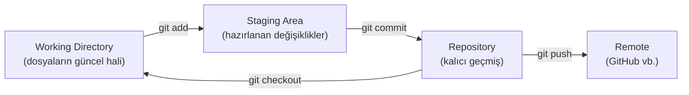

import Callout from '@components/Callout.astro';
import Quiz from '@components/Quiz.astro';
import LabBox from '@components/LabBox.astro';

## Neden versiyon kontrolü?

`final.zip`, `final-final.zip`, `final-GERCEK-final.zip`... Herkes oradan geçti. Git, değişikliklerin **izlenebilir, geri alınabilir ve paylaşılabilir** bir hikayesini tutar. DevOps için Git özel önemlidir: CI/CD, IaC, GitOps — hepsi “gerçeğin kaynağı olarak Git” ilkesi üstüne kuruludur. **Repoda olmayan yapılandırma, var sayılmaz.**

## Kurulum ve ilk repo

```bash
git config --global user.name "Adın"
git config --global user.email "ben@ornek.com"
git config --global init.defaultBranch main

mkdir proje && cd proje
git init          # .git klasörü oluşur — repoların kalbi
```

## Üç alan: değişikliğin yolculuğu



Bu modeli kavramak, Git'in yarısını çözer:

- **Working directory:** üzerinde çalıştığın dosyalar
- **Staging area:** “bu değişiklikler bir sonraki commit'e girecek” hazırlığı — mantıksal gruplama burada yapılır
- **Repository:** commit'lenmiş, kalıcı geçmiş

## Günlük akış

```bash
git status                 # ne durumdayım? (en çok kullanılan komut!)
git add dosya.md           # tek dosyayı staging'e al
git add -A                 # tüm değişiklikleri al
git commit -m "feat: arama kutusu ekle"
git push                   # uzak depoya gönder
git pull                   # uzak değişiklikleri al
```

<Callout type="tip" title="Commit disiplini">
  Bir commit = tek mantıksal değişiklik. “Arayüz düzeltmesi” ve “config hatası fix'i”
  aynı commit'e girmemeli. Küçük ve net commit'ler = kolay code review, kolay revert.
</Callout>

## Geçmişi okumak

```bash
git log --oneline --graph --all   # kompakt grafik görünümü
git show abc1234                  # belirli bir commit'in detayı
git diff                          # çalışma alanı vs staging
git diff --staged                 # staging vs son commit
git diff main..feature-x          # iki dal arası
```

“Dün çalışan şey bugün neden bozuldu?” sorusunun cevabı neredeyse her zaman `git log` + `git diff` içindedir.

## Geri alma: korkmadan

| Durum | Komut |
| --- | --- |
| Commit mesajını düzelt (henüz push etmediysen) | `git commit --amend` |
| Staging'den çıkar (dosyayı silmeden) | `git restore --staged dosya` |
| Dosyayı son commit'e döndür | `git restore dosya` |
| Son commit'i geri al, değişiklikleri koru | `git reset --soft HEAD~1` |
| Yayınlamış bir commit'i güvenle geri al | `git revert abc1234` |

`revert` vs `reset` klasik sorudur: **reset** geçmişi yeniden yazar (paylaşılmış dallarda tehlikeli); **revert** “ters değişiklik” commit'i ekler — geçmiş bozulmaz, ekipte güvenli yöntem budur.

## .gitignore: repoya girmemesi gerekenler

```gitignore
node_modules/
dist/
.env
*.log
.DS_Store
```

Secret'ların (`API_KEY=...` içeren `.env` gibi) repoya girmesi, “kaydı silsem de geçmişte kalır” gerçeği yüzünden telafisi en zor hatalardan biridir (Seviye 4'te DevSecOps dersinde tekrar).

<LabBox
  id="s1-git-temelleri-lab"
  title="Bu repoyu Git'e bağla"
  verify={['git log --oneline | wc -l']}
>
  1. Bu reponun kökünde `git init` çalıştır.
  2. `git status` — hangi dosyalar izlenmiyor? (node_modules gitignore sayesinde yok!)
  3. `git add -A` → `git commit -m "chore: initial commit"` → `git log --oneline` ile doğrula.
  4. Bir derse küçük bir düzeltme yaz (ör. bir yazım hatası), `git diff` ile değişikliği gör, sonra commit'le.
  5. GitHub'da boş bir repo oluşturup `git remote add origin <url>` ve `git push -u origin main` ile yükle (isteğe bağlı).
</LabBox>

<Quiz
  id="s1-git-temelleri"
  questions={[
    {
      q: '`git add` ne yapar?',
      options: [
        'Değişiklikleri uzak depoya gönderir',
        'Değişiklikleri staging alanına hazırlar',
        'Değişiklikleri siler',
        'Yeni bir branch açar',
      ],
      answer: 1,
      explain:
        'add, working directory’den staging area’ya taşır; commit ise staging’i kalıcı geçmişe yazar.',
    },
    {
      q: 'Paylaşılmış bir dalda yanlış commit’i güvenle geri almanın yolu?',
      options: ['git reset --hard', 'git revert', 'git rm -rf', 'Dosyayı elle düzeltip uğraşmamak'],
      answer: 1,
      explain:
        'revert ters commit ekler, geçmişi yeniden yazmaz. reset --hard geçmişi yeniden yazar ve takım arkadaşlarının kopyalarını bozar.',
    },
    {
      q: '.env dosyasının .gitignore’da olmasının ana nedeni?',
      options: [
        'Dosya çok büyük',
        'Secret’ların geçmişe girmemesi — silinse bile geçmişte kalır',
        'Editor karışıklığı',
        'Build hızını artırmak',
      ],
      answer: 1,
      explain:
        'Git geçmişinde secret kalıcıdır; repoyu silmeden temizlenemez. Önlem: gitignore + secret yönetimi (Seviye 4).',
    },
    {
      q: '“Dün çalışan şey bugün bozuldu” sorusunun ilk kanıt kaynağı?',
      options: ['Sunucu yeniden başlatmak', 'git log + git diff', 'DNS değiştirmek', 'Bellek artırmak'],
      answer: 1,
      explain:
        'Değişiklikler önce geçmişte aranır: son commit’lerde ne değişti? diff iki durumun farkını gösterir.',
    },
  ]}
/>
