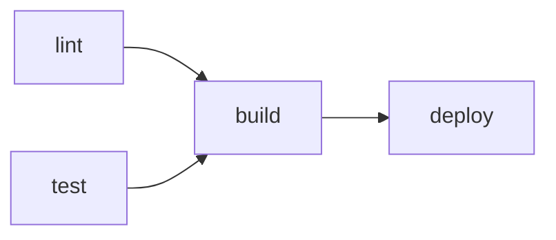

import Callout from '@components/Callout.astro';
import Quiz from '@components/Quiz.astro';

## İki farklı şey: cache ve artifact

| | **Cache** | **Artifact** |
| --- | --- | --- |
| Ne saklar? | Yeniden üretilebilir veri (node_modules, derleyici cache) | İşin **sonucu** (dist/, imaj, rapor) |
| Neden? | Hız — yeniden indirmeme/derlememe | Taşıma — başka job/deploy kullanır |
| Ömrü | Anahtar değişene kadar | Yapılandırdığın süre (gün) |

## Cache: node_modules'ı yeniden indirmemek

Her koşumda ~200 paketi internetten indirmek, pipeline'ın klasik zaman hırsızıdır:

```yaml
- uses: actions/setup-node@v5
  with:
    node-version: 22
    cache: npm          # lockfile hash'ini cache anahtarı yapar
```

`setup-node`'un `cache: npm` satırı otomatik şunu yapar: **package-lock.json'ın hash'ini** cache anahtarı alır. Lockfile değişmediyse cache isabet eder → node_modules paket deposu yerine cache'ten gelir.

Elle cache de yazılabilir:

```yaml
- uses: actions/cache@v4
  with:
    path: ~/.npm
    key: npm-${{ runner.os }}-${{ hashFiles('**/package-lock.json') }}
    restore-keys: npm-${{ runner.os }}-
```

`restore-keys` fallback anahtarıdır: tam eşleşme yoksa benzer önekiyle başlayan en güncel cache kullanılır.

<Callout type="warn" title="Cache = optimizasyon, doğruluk kaynağı değil">
  Cache bozulabilir/eski kalabilir. Kurulumun her koşumda `npm ci` ile lockfile’a
  sadık kalması gerekir; cache bunun yerine geçmez, üstüne hız katar. Cache’i
  “doğru sürüm” garantisi sayma.
</Callout>

## Artifact: işin sonucunu paketle

`dist/` klasörü build job'ında üretilir; deploy job'ı başka makinede. Arada taşıyıcı lazım:

```yaml
jobs:
  build:
    runs-on: ubuntu-latest
    steps:
      - uses: actions/checkout@v5
      - uses: actions/setup-node@v5
        with: { node-version: 22, cache: npm }
      - run: npm ci && npm run build
      - uses: actions/upload-artifact@v4
        with:
          name: site-dist
          path: dist/

  deploy:
    needs: build
    runs-on: ubuntu-latest
    steps:
      - uses: actions/download-artifact@v4
        with:
          name: site-dist
          path: dist/
      - run: echo "dist/ hazır, deploy burada"
```

Bu desen — *build → artifact → deploy* — Seviye 3'te Docker imajına, Seviye 5'te GitOps commit'ine dönüşecek. Mimari hep aynıdır: **üretilen şey bir kez üretilir, kimliklenir, taşınır.**

## Job mimarisi: paralel mi, zincir mi?

```yaml
jobs:
  lint:    { runs-on: ubuntu-latest, steps: [...] }
  test:    { runs-on: ubuntu-latest, steps: [...] }
  build:
    needs: [lint, test]        # ikisi de yeşilse başla
  deploy:
    needs: build               # build artifact'ını alır
```



`lint` ve `test` paralel koşar (hız), `build` ikisine de bağımlı (güven), `deploy` sonucu taşır (tekrar üretmez). Bu üçgen, çoğu production pipeline'ının iskeletidir.

## Ölçüm refleksi

İyileştirmeden önce ölç: workflow koşum sayfasında her step'in süresi yazar. Tıp kuralı:

- Kurulum uzun → cache
- Derleme uzun → matrix ile paralelleştir / derleyici cache'i
- Test uzun → paralel shard'lara böl
- Deploy elle adımlarla → otomatikleştir

<Quiz
  id="s2-cache-artifact"
  questions={[
    {
      q: 'Cache ile artifact arasındaki fark?',
      options: [
        'Aynı şeyin iki adı',
        'Cache hız için yeniden üretilebilir veri; artifact işin taşınacak sonucudur',
        'Cache yalnızca Docker’da kullanılır',
        'Artifact daha yavaştır',
      ],
      answer: 1,
      explain:
        'Cache “yeniden kazanmak” için, artifact “sonucu taşımak” içindir; ömür ve amaçları farklıdır.',
    },
    {
      q: 'npm cache anahtarı olarak lockfile hash’inin kullanılması neden doğrudur?',
      options: [
        'Daha kısa anahtar olduğu için',
        'Bağımlılık seti değişmediyse cache geçerli; değiştiyse otomatik yeni anahtar',
        'GitHub bunu zorunlu kılar',
        'Anahtar şifreleme için',
      ],
      answer: 1,
      explain:
        'hashFiles(’**/package-lock.json’) içerik bazlı anahtar üretir: içerik aynı → isabet, değişti → yeni cache.',
    },
    {
      q: '“build → artifact → deploy” deseninin temel getirişi?',
      options: [
        'Deploy job’ının yeniden derlememesi — tek üretim, kimlikli taşıma',
        'YAML dosyasını kısaltması',
        'Testleri atlatması',
        'Secret sayısını azaltması',
      ],
      answer: 0,
      explain:
        'Aynı artifact staging ve prod’a gider: “test edilen şey ile deploy edilen şey aynıdır” garantisi.',
    },
    {
      q: 'lint ve test job’larını paralel koşturup build’i ikisinden sonra başlatmak için?',
      options: [
        'build: needs: [lint, test]',
        'lint: needs: build',
        'workflow_dispatch',
        'Aynı job’da sıralamak yeterli',
      ],
      answer: 0,
      explain:
        'needs listesi = “hepsi yeşil olana kadar bekle”; listelenmeyen job’lar varsayılan paraleldir.',
    },
  ]}
/>
