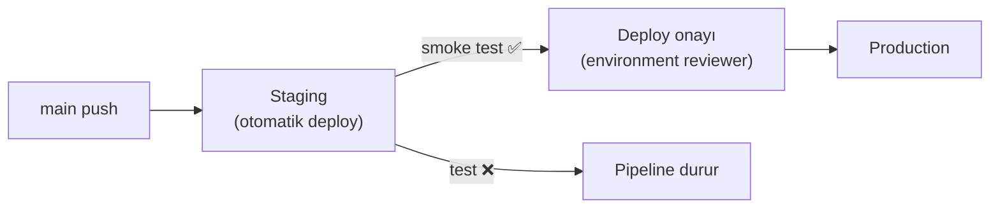

import Callout from '@components/Callout.astro';
import Quiz from '@components/Quiz.astro';
import Mermaid from '@components/Mermaid.astro';

## Statik site = en kolay deploy problemi

Bu sitenin ürettiği şey saf HTML/CSS/JS — sunucu tarafı işlem yok. Bu, deploy'un en mutlu hali: dosyaları bir yere koy, trafik oraya girsin. Seçenekler:

| Seçenek | Nasıl? | Artı | Eksi |
| --- | --- | --- | --- |
| **GitHub Pages** | `actions/deploy-pages` | Ücretsiz, repo ile entegre | Kök dizin/temel özelleştirme sınırlı |
| **Cloudflare Pages / Netlify / Vercel** | GitHub entegrasyonu | Global CDN, PR preview'ları | Satıcıya bağımlılık |
| **Kendi sunucu (nginx)** | `rsync`/SCP + systemd | Tam kontrol, öğrenme değeri | Tüm operasyon senin (Seviye 3) |
| **Object storage + CDN** | S3/Cloudflare R2 | Ucuz, ölçekli | Kurulum adımı fazla |

DevOps perspektifi: seçenekler değişir, **desenler değişmez** — build artifact'ını bir hedefe kimlikli aktar, doğrula, gerekirse geri al.

## Ortam ayrımı: staging ve prod



- **Staging:** prod'un küçük kopyası; her merge otomatik gelir. Sorumluluk: “prod'a gitmeden neler bozuldu?” cevabını ucuz vermek.
- **Production:** korumalı environment (önceki dersten) — onay kapılı ya da tam otomatik (olgunluk seçimi).

Küçük projelerde staging'i “preview deploy” yerine koyabilirsin: her PR kendi geçici URL'ini alır (Netlify/Vercel/CF Pages'in en sevilen özelliği budur).

## Deploy step'i örneği (GitHub Pages)

```yaml
deploy:
  needs: build
  if: github.ref == 'refs/heads/main'
  runs-on: ubuntu-latest
  environment:
    name: production
    url: ${{ steps.deployment.outputs.page_url }}
  permissions:
    pages: write
    id-token: write
  steps:
    - uses: actions/download-artifact@v4
      with: { name: site-dist, path: dist }
    - uses: actions/configure-pages@v5
    - uses: actions/upload-pages-artifact@v3
      with: { path: dist }
    - id: deployment
      uses: actions/deploy-pages@v4
```

Aynı desen kendi sunucuna da uyar:

```yaml
- name: Sunucuya yükle
  run: |
    rsync -avz --delete dist/ deploy@sunucu:/var/www/html/
    curl -fsS https://ornek.com/health || exit 1
  env:
    SSH_KEY: ${{ secrets.SSH_KEY }}
```

Son satıra dikkat: **deploy = yükleme + doğrulama**. Yükleyip arkana yaslanmak yarım iştir.

## Smoke test: deploy'un nabzı

Deploy sonrası 30 saniyelik kontrol seti — “site gerçekten açılıyor mu?”:

```bash
curl -fsS -o /dev/null -w "%{http_code}" https://ornek.com   # 200 bekleriz
curl -fsS https://ornek.com | grep -q "DevOps Yolculuğu"    # içerik kontrolü
```

İkisi de script'te `exit 1` ile bağlıysa: boş ya da hatalı deploy, pipeline'ı kırmızı yapar ve seni gece 3'te kullanıcı SMS'iyle değil, CI mailiyle uyandırır. Bu, Seviye 4'te kuracağımız monitoring'in CI içindeki mikro versiyonudur.

## Rollback: geri dönüş planı önceden

Deploy stratejisinin sorusu yalnızca “nasıl çıkar?” değil, “nasıl dönerim?”dir:

- **Statik site:** önceki artifact'ı sakla; geri almak = eski klasörü geri koy (dakikalar)
- **Versionlu deploy klasörü:** `/releases/2026-11-12-a/` + `/current` symlink — geri alma bir symlink swap'ı (capistrano deseni)
- **Imaj tabanlı (Seviye 3+):** önceki imaj tag'ini çalıştır

Kural: **rollback'i deploy'dan önce kurgula.** Olay anında plan aramak, olayın kendisinden pahalıdır (Seviye 4, incident yönetimi).

<Quiz
  id="s2-deploy-stratejileri"
  questions={[
    {
      q: 'Staging ortamının temel görevi nedir?',
      options: [
        'Daha hızlı site sunmak',
        'Prod’a gitmeden değişiklikleri ucuz ve güvenli doğrulamak',
        'Backup tutmak',
        'DNS yönetmek',
      ],
      answer: 1,
      explain:
        'Staging, prod koşullarına yakın bir alanda test etmektir; hata maliyetini prod’dan önce alır.',
    },
    {
      q: 'Deploy step’inin sonundaki smoke testin amacı?',
      options: [
        'Deploy süresini ölçmek',
        'Deploy edilen sitenin gerçekten çalıştığını doğrulayıp bozuksa pipeline’ı kırmak',
        'Cache temizlemek',
        'Domain satın almak',
      ],
      answer: 1,
      explain:
        'Yükleme + doğrulama = deploy. Doğrulamasız deploy, “yükledim sanıyorum” durumu yaratır.',
    },
    {
      q: 'Rollback planının deploy’dan önce kurgulanmasının nedeni?',
      options: [
        'Gereksiz adımları silmek için',
        'Olay anında plan bulmak yavaş ve hataya açıktır; geri dönüş yolu önceden hazır olmalı',
        'Depolama maliyeti',
        'CI hızını artırmak',
      ],
      answer: 1,
      explain:
        'Incident yönetiminin ilkesi: karar kataloğu önceden hazırlanır. Rollback “acil çıkış kapısı”dır, planlanmadan kapı açılmaz.',
    },
    {
      q: 'Her PR için otomatik geçici önizleme URL’i üreten modelin adı?',
      options: ['Staging model', 'Preview deploy', 'Canary release', 'Blue-green'],
      answer: 1,
      explain:
        'Preview deploy: her PR kendi izole ortamını alır; review’da görsel doğrulama hızlanır.',
    },
  ]}
/>
