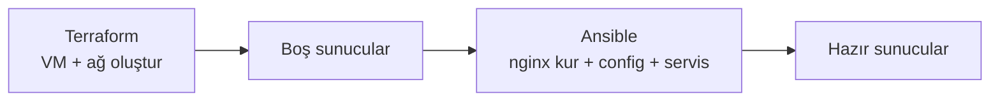

import Callout from '@components/Callout.astro';
import Quiz from '@components/Quiz.astro';

## İki ayrı problem, iki ayrı araç

IaC dünyasında iki soru farklıdır:

1. **“Kaynaklar nereden gelsin?”** — VM, ağ, bucket oluştur → **Provisioning** → Terraform
2. **“Kaynakların İÇİ nasıl olsun?”** — paket kur, config yaz, servis başlat → **Configuration Management** → Ansible



## Ansible: SSH + YAML

Ansible agent kurmaz: SSH üzerinden bağlanır (Seviye 1'deki SSH bilgisi!) ve YAML "playbook"ları çalıştırır.

**Envanter** (`hosts.ini`):

```ini
[web]
sunucu-1 ansible_host=203.0.113.10
sunucu-2 ansible_host=203.0.113.11

[web:vars]
ansible_user=deploy
```

**Playbook** (`nginx.yml`):

```yaml
- name: Web sunucularını hazırla
  hosts: web
  become: yes            # sudo (Seviye 1!)
  tasks:
    - name: nginx kur
      apt:
        name: nginx
        state: present   # “kurulu olsun” — tekrar çalışsa da zararı yok

    - name: yapılandırmayı kopyala
      copy:
        src: nginx.conf
        dest: /etc/nginx/nginx.conf
      notify: restart nginx

    - name: servisi başlat ve açılışta çalışsın
      systemd:
        name: nginx
        enabled: yes
        state: started

  handlers:
    - name: restart nginx
      systemd:
        name: nginx
        state: restarted
```

```bash
ansible-playbook -i hosts.ini nginx.yml
```

## Idempotency: kural değil, zorunluluk

**Idempotent** = aynı playbook'u 10 kez çalıştırmak, 1. çalıştırmayla aynı sonucu verir. İlk çalıştırma değişiklik yapar (`changed`); ikincisi hiçbir şey yapmaz (`ok`).

Bu özellik otomasyonun güvenini üretir: *playbook'u her gece koşturursun; sürünme (configuration drift) kendini düzelir.* Elle yapılmış müdahaleler (“birinin panikleyip elle kurduğu paketler”) bir sonraki koşumda normale döner.

| Idempotent ✅ | Idempotent olmayan ❌ |
| --- | --- |
| `state: present` / `state: started` | `shell: apt install nginx` (her seferinde çalışır) |
| `copy` (dosya zaten aynıysa atlar) | `echo "..." >> file` (her seferinde ekler) |

Modül kullan; kaçınmak gerekirse `creates:`/`when:` koşuluyla koru.

## Değişkenler ve şablonlar

```yaml
# varsayım: inventory'de env: prod tanımlı
- name: Yapılandır
  template:
    src: app.conf.j2
    dest: /etc/app/app.conf
```

`app.conf.j2` (Jinja2 şablonu):

```
server_name {{ domain }};
worker_processes {{ cpu_sayisi | default(2) }};
```

Tek playbook, ortama göre değişkenler — Helm'in values mantığının konfigürasyon tarafındaki kardeşi.

## IaC genel sağlamlık ilkeleri (iki araca birden)

1. **Idempotent ol** — tekrar tekrar koş, sonuç aynı
2. **Declarative yaz** — “nasıl” değil “sonuç ne olsun”
3. **Review'dan geçir** — altyapı PR'ı = kod PR'ı
4. **Secret'ları dışarıda tut** — Vault/env injection (Seviye 4)
5. **Test et** — `terraform plan` diff'i, Ansible için `--check` (dry-run), linter'lar (`tflint`, `ansible-lint`)
6. **Sürümle** — provider/module sürümlerini pin'le; “latest” altyapıda da kaos demek

<Callout type="info" title="Modern realite: imaj yoluna evril">
  Çoğu ekip bugün “sunucuyu configure et” yerine “imajı build et, container koştur”
  yoluna gitti (immutable infrastructure). Ansible hâlâ çok yaygın — özellikle VM
  tabanlı sistemlerde ve Kubernetes kümelerinin İÇİNE kurulumlarda (CNI, ingress
  controller) — ama imaj yaklaşımıyla rolleri paylaşır: Terraform altyapıyı, Ansible
  kurulum/başlangıç yapılandırmasını, Docker imajı uygulamayı taşır.
</Callout>

<Quiz
  id="s3-ansible"
  questions={[
    {
      q: 'Idempotent playbook’un işareti nedir?',
      options: [
        'Daha hızlı çalışır',
        '2. koşumda hiçbir değişiklik yapmaz (hepsi “ok”)',
        'Her seferinde servisi yeniden başlatır',
        'Log üretmez',
      ],
      answer: 1,
      explain:
        'Aynı koşum = aynı sonuç. Bu, drift düzeltme ve güvenli tekrar koşumların temelidir.',
    },
    {
      q: 'Terraform + Ansible iş bölümü?',
      options: [
        'İkisi aynı işi yapar',
        'Terraform kaynakları kurar (provisioning); Ansible içerisini yapılandırır (config mgmt)',
        'Ansible bulut kaynaklarını yaratır',
        'Terraform sadece monitoring',
      ],
      answer: 1,
      explain:
        'Provisioning (ne var?) / configuration management (içi nasıl?) ayrımı modern IaC’nin standart katmanlarıdır.',
    },
    {
      q: 'Ansible’ın agent kurmaması neyi kolaylaştırır?',
      options: [
        'Faturayı azaltır',
        'SSH erişimi olan her makineyi hedef alabilir; bakım yükü minimumdur',
        'YAML yazmayı gereksizleştirir',
        'Secret yönetimini',
      ],
      answer: 1,
      explain:
        'Push tabanlı model: hedefte ekstra daemon yok; SSH + Python (çoğu Linux’ta hazır) yeterlidir.',
    },
    {
      q: '`shell: apt install nginx` yerine `apt: state: present` kullanmanın nedeni?',
      options: [
        'Daha kısa yazım',
        'Modül idempotenttir; paket kuruluysa dokunmaz',
        'Hata mesajları güzel',
        'Sadece Ubuntu’da çalışır',
      ],
      answer: 1,
      explain:
        'Ham shell komutları her koşumda çalışır (idempotent değil); modüller durum farkına bakar.',
    },
  ]}
/>
