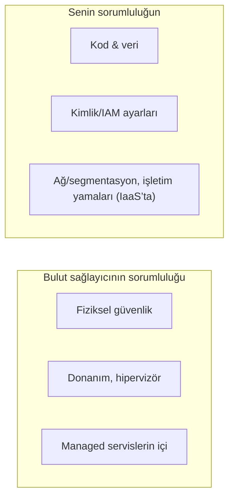

import Callout from '@components/Callout.astro';
import Quiz from '@components/Quiz.astro';

## Bulut bir araç seti değil, bir soyutlama katmanı

Bulut öğrenmek “AWS konsolunu ezberlemek” değildir. Her bulut aynı dört soyutlamayı sunar — isimler farklı, mantık aynı:

### 1. Compute (işlem gücü)

| Model | Ne verir? | Sen yönetirsin |
| --- | --- | --- |
| **VM (IaaS)** | Kiralık makine | OS dahil her şey |
| **Container servisi** | İmaj koşulan platform | İmaj + konfigürasyon |
| **Serverless (FaaS)** | Fonksiyon çağrısı | Yalnızca kod |

### 2. Storage (veri)

- **Object storage** (dosya + metadata, HTTP ile): sitenin statik dosyaları, backup'lar
- **Block storage** (disk): VM'lere takılır
- **Managed database:** kurulum/bakımı buluta devredilmiş PostgreSQL/MySQL/Redis

### 3. Network (ağ)

- **VPC / VNet:** sana özel sanal ağ; subnet'ler (Seviye 1'in CIDR bilgisi!)
- **Load Balancer:** trafiği dağıtan katman
- **CDN:** içerik dünyaya yakın kenar sunuculardan
- **Firewall / Security Group:** port bazlı izinler

### 4. IAM (kimlik ve yetki)

**Identity and Access Management:** kim (kullanıcı/servis) hangi kaynağa ne yapabilir? Her bulutta aynı üçlü:

```
Principal (kim) → Permission (ne yapabilir: read/write/...) → Resource (hangi kaynak)
```

Seviye 1'in least privilege ilkesi burada zorunlu pratik olur: *bir servise tek yetkili rota ver.*

## Karşılık tablosu: aynı kavram, üç isim

| Kavram | AWS | Azure | GCP |
| --- | --- | --- | --- |
| Sanal makine | **EC2** | **Virtual Machines** | **Compute Engine** |
| Object storage | **S3** | **Blob Storage** | **Cloud Storage** |
| Serverless fonksiyon | **Lambda** | **Functions** | **Cloud Functions / Cloud Run** |
| Container servisi | **ECS / EKS** | **AKS / Container Apps** | **GKE / Cloud Run** |
| Managed DB | **RDS** | **Azure Database** | **Cloud SQL** |
| Sanal ağ | **VPC** | **VNet** | **VPC** |
| DNS | **Route 53** | **Azure DNS** | **Cloud DNS** |
| IaC | **CloudFormation** | **ARM/Bicep** | **Deployment Manager** |

<Callout type="tip" title="Mülakat stratejisi">
  Kavramı vendor-neutral öğren, tabloyu sözlük gibi kullan. “S3 ne?” yerine “object
  storage ne, AWS’te karşılığı ne?” şeklinde düşün: bulut değiştirsin, bilgi yanında
  kalsın. (Sertifika yolunda tek buluta derinleşirsin — ama önce kavram.)
</Callout>

<Callout type="info" title="Gerçek dünyadan: pazar payı — üç oyuncu, tek dil">
  Sektör analizlerinde küresel bulut pazarı yaklaşık şöyle seyrediyor: AWS ~%30'lar,
  Azure ~%20'ler, GCP ~%10'lar — kalanı diğer oyuncular. Ama dikkat: bu dersin
  tablosundaki kavramlar (VM/object storage/FaaS/IAM) üçünde de aynı olduğu için
  bilgi alışveriştirilebilir. Mülakatta “hangi bulutu biliyorsun?” sorusu,
  “kavramları biliyor musun?” sorusunun kılık değiştirmişidir.
</Callout>

## Shared responsibility: kim neyin sorumlusu?



Yaygın olay senaryosu: “S3 bucket'ım açıktı!” → bulut sızmadı; **IAM politikası** (senin tarafın) yanlışdı. Managed servis kullanmak sorumluluğu azaltır: **RDS kullanmak = OS yamalarını buluta devretmek.** Servis modeli yükseldikçe senin payın küçülür.

## Pratik yol: ücretsiz katman

- **AWS Free Tier:** 12 ay sınırlı EC2/S3
- **Azure:** 200$ kredi + aylık ücretsiz servisler
- **GCP:** 300$ kredi + her zaman ücretsiz katman (e2-micro, Cloud Run)

Bu reponun lab'ları vendor-neutral yazıldı; kendi hesabında en az yetkili kullanıcı + bütçe uyarısıyla (bir sonraki derslerden biri!) çalış.

<Quiz
  id="s3-bulut-temelleri"
  questions={[
    {
      q: 'Object storage’ın ayırt edici özelliği?',
      options: [
        'VM diskine takılır',
        'HTTP üzerinden dosya+metadata erişimi; statik site, backup için idealdir',
        'Yalnızca ilişkisel veri',
        'Yalnızca lokal',
      ],
      answer: 1,
      explain:
        'S3/Blob/Cloud Storage aynı model: anahtar (key) ile HTTP erişimli düz depo; statik hosting ve backup klasik kullanım.',
    },
    {
      q: 'Shared responsibility modelinde S3 bucket’ın public olması kimin sorunu?',
      options: [
        'Bulut sağlayıcısının — altyapı onların',
        'Senin — IAM/bucket politikası müşteri tarafındadır',
        'Hiç kimsenin',
        'Domain registrar’ın',
      ],
      answer: 1,
      explain:
        'Altyapı bulutun, yapılandırma senindir. Açık bucket’ların kök nedeni neredeyse hep müşteri tarafındaki IAM hatalarıdır.',
    },
    {
      q: 'Managed database kullanmak (RDS) seni hangi işten kurtarır?',
      options: [
        'Veri modellemeden',
        'OS yamalama, backup, failover gibi operasyonel işlerden',
        'SQL yazmaktan',
        'Faturadan',
      ],
      answer: 1,
      explain:
        'Servis modeli yükseldikçe (IaaS→managed) operasyon yükü buluta geçer; sen uygulama ve erişim politikasına odaklanırsın.',
    },
    {
      q: 'IAM’de “least privilege” uygulaması ne demektir?',
      options: [
        'Tüm servislere admin rolü verip izlemek',
        'Her kullanıcı/servise yalnızca görevi için gerekli izinleri vermek',
        'Hiç izin vermemek',
        'Sadece root hesap kullanmak',
      ],
      answer: 1,
      explain:
        'İzleme/audit için geniş yetki vermek en sık ihlal kaynağı; dar yetki + ihtiyaç anında geçici yükseltme doğrudur.',
    },
  ]}
/>
