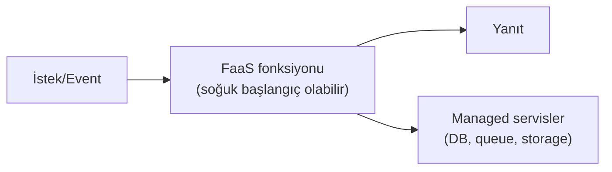
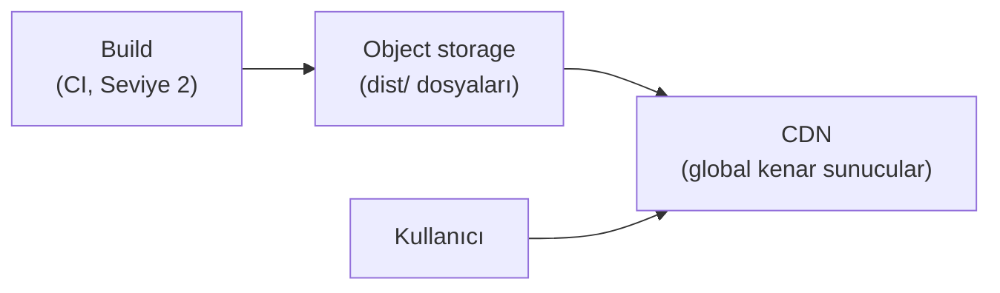

import Callout from '@components/Callout.astro';
import Quiz from '@components/Quiz.astro';
import Mermaid from '@components/Mermaid.astro';

## Serverless: sunucu yok değil, sunucu senin işin değil

**Function-as-a-Service (FaaS)**: kodunu bir fonksiyon olarak yüklersin; bulut, çağrı geldiğinde:

1. Fonksiyonu çalıştırır (container'ında)
2. Kullanılan kaynak için **milisaniye bazında** faturalandırır
3. Trafik yoksa maliyet sıfır

| Artı | Eksi |
| --- | --- |
| Trafik 0 → 10k istek/s arasında otomatik ölçek | **Soğuk başlangıç** gecikmesi (ilk çağrı) |
| Bakım yükü minimum | Uzun süreli çalışan görevler için pahalı/kısıtlı |
| Kullandığın kadar öde | Vendor lock-in riski (event sürücüleri, runtime sınırları) |
| Dağıtık sistem "bedavaya" | Local geliştirme/simülasyon zorlaşır |

Kritik ayrım: **serverless ≠ sadece FaaS**. Managed database, queue, storage de serverless'tır — ortak payda: *ölçek ve bakım bulutta, sen kod ve politikada.*

## Statik site + CDN: bu sitenin doğal formu

Bu reponun ürettiği şey statik dosyalar. Bunun için en iyi mimari:

Neden bu form idealdir:

1. **Hız:** dosya kullanıcının kıtasındaki kenar sunucudan gelir (TLS 1.3 + HTTP/2/3)
2. **Maliyet:** trafiğe göre ödeme, sunucu kirası yok — küçük site aylık birkaç sent
3. **Güvenlik:** çalışma zamanı sunucusu yok → hack edilecek süreç yok; saldırı yüzeyi minimum
4. **Ölçek:** patlama trafiğinde senin yapacağın şey yok — CDN nefes alır

Cache davranışı (Seviye 1'in Cache-Control bilgisi) burada belirleyicidir: HTML kısa TTL, hash'li `_astro/*.css` dosyaları uzun TTL (değişmez içerik).

## Astro'nun render modları ve deploy etkisi

| Mod | Ne yapar? | Nereye deploy? |
| --- | --- | --- |
| **Statik (varsayılan)** | Build'de tüm sayfalar HTML olur | Object storage + CDN, Pages, nginx (bu repo!... şimdilik) |
| **Hybrid/SSR** | Bazı sayfalar istek anında sunuculur | Node/edge runtime: Cloudflare Workers, Vercel, Cloud Run |

Bu repo statik modda — çünkü ders içeriği build zamanında bellidir. İleride quiz skoru API'si gibi sunucu tarafı ihtiyaç olursa **hybrid** moda geçilir ve deploy hedefi “imaj/edge fonksiyonu” haline gelir. Mimari karar = render modeli kararı.

<Callout type="info" title="Bu sitenin Capstone rotası">
  Seviye 5’te bu siteyi (1) statik formda CDN’e, (2) konteyner formunda Kubernetes’e
  taşıyacaksın — aynı içerik, iki mimari; farkın somut maliyet/perfans etkisini
  kendin ölçeceksin. Seviye 4’te her ikisini monitoring’e alacağız.
</Callout>

## Hangisi ne zaman?

- **İçerik/doküman/portfolyo → statik + CDN.** Basit, ucuz, hızlı, güvenli. (Bu repo için doğru cevap)
- **Gerçek zamanlı veri/oturum → SSR/container.** Edge fonksiyonlar veya klasik imaj.
- **Trafik değişken + olay tabanlı → serverless** bileşenler karışım olarak girer (upload tetikleyen resize fonksiyonu gibi).

Modern gerçek dünya çoğunlukla **hibrittir**: statik parçalar CDN'de, dinamik API serverless/container'da.

<Quiz
  id="s3-serverless-cdn"
  questions={[
    {
      q: 'Serverless’ın en tipik maliyet avantajı hangi trafik profilinde belirgindir?',
      options: [
        'Sürekli yüksek trafik',
        'Değişken/trafiksiz dönemleri olan düşük-orta trafik',
        'Sabit 7/24 10k RPS',
        'Video streaming',
      ],
      answer: 1,
      explain:
        'Boşta maliyet sıfırdır; kullanım bazlı faturalama düşük/orta ve düzensiz trafikte VM kirasından ucuzdur.',
    },
    {
      q: 'Soğuk başlangıç nedir?',
      options: [
        'İlk deploy süresi',
        'Uzun süredir çağrılmamış fonksiyonun ilk çalıştırma gecikmesi',
        'CDN cache süresi',
        'DNS TTL',
      ],
      answer: 1,
      explain:
        'Platform fonksiyon instance’ını az önce kapatmış olabilir; ilk istek container başlatma gecikmesi yaşar.',
    },
    {
      q: 'Statik site + CDN modelinde çalışma zamanı sunucusu olmamasının güvenlik getirisi?',
      options: [
        'Yoktur',
        'Hack edilecek süreç yok: saldırı yüzeyi dosya sunumuna iner',
        'Sadece DDoS’a karşı korur',
        'Sertifika gerekmez',
      ],
      answer: 1,
      explain:
        'RCE, SQL injection gibi süreç saldırıları statik sunumda tanımsızdır; kalan risk dosya bütünlüğü ve CDN yapılandırmasıdır.',
    },
    {
      q: 'Hash’li asset’ler (_astro/abc123.css) için doğru cache politikası?',
      options: [
        'Kısa TTL (60 sn)',
        'Uzun/ölümsüz TTL — dosya adı içerik değişince değişir',
        'Cache yok',
        'Yalnızca session cache',
      ],
      answer: 1,
      explain:
        'İçerik hash’lendiği için dosya adı = sürüm; immutable içerik uzun TTL alır, HTML kısa TTL alır.',
    },
  ]}
/>
