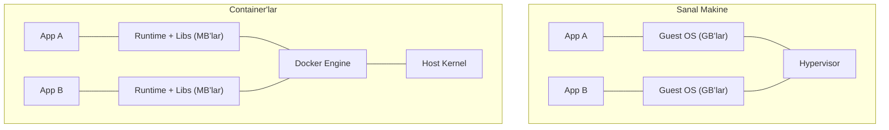

import Callout from '@components/Callout.astro';
import Quiz from '@components/Quiz.astro';
import Mermaid from '@components/Mermaid.astro';

## “Benim makinemde çalışıyordu”

Ekip için klasik trajedi: uygulama senin makinende çalışır, sunucuda çalışmaz. Node sürümü farklı, bir kütüphane eksik, sistem locale'i başka... **Container**, uygulamanın çalışması için gerekli her şeyi — kod, runtime, kütüphaneler, sistem araçları — **tek bir taşınabilir pakete** koyar: imaj.

## Container vs VM

İkisi de izolasyon sağlar ama çok farklı maliyetle:



| | VM | Container |
| --- | --- | --- |
| İzolasyon seviyesi | Donanım düzeyi (kendi OS'u) | OS düzeyi (paylaşılan kernel) |
| Boyut | GB'lar | MB'lar |
| Başlama süresi | Dakikalar | Saniyeler (ms'ler) |
| Yoğunluk | Sunucuda birkaç | Sunucuda onlarca/yüzlerce |

Container, host'un **çekirdeğini paylaşıp** kendi dosya sistemi ve süreç alanıyla çalışır — bu yüzden hızlı ve hafiftir. Karşılığı izolasyonun biraz daha ince olması (kernel paylaşıldığı için host güvenliği kritik).

## Image: salt okunur şablon

**Image** = çalışan paketin durdurulmuş anı; **container** = o imajın çalışmakta olan kopyası. Bir imajdan istediğin kadar container ayağa kalkar.

Image'lar **katmanlıdır (layer)** — Dockerfile'ın her adımı bir katman üretir ve katmanlar **cache'lenir, paylaşılır**:

```
my-site:latest
├── 4. katman: COPY dist ./dist          (3 MB)
├── 3. katman: npm ci                     (180 MB — değişince altı yeniden!)
├── 2. katman: FROM node:22-alpine        (150 MB — paylaşılan taban)
└── 1. katman: base OS dosyaları
```

İki güçlü sonuç:

1. **Cache:** Dockerfile'ın değişmeyen üst adımları yeniden çalışmaz → build saniyeler iner
2. **Paylaşım:** aynı `node:22-alpine` tabanını kullanan tüm imajlar diskte o katmanı **bir kez** tutar

<Callout type="tip" title="Katman sırası = build hızı">
  Sık değişen adımları (kopyaladığın kaynak kod) sona, nadiren değişenleri (bağımlılık
  kurulumu) başa koy. Dockerfile yazmanın %80’i budur — bir sonraki derste uygulayacağız.
</Callout>

## Registry: imajların GitHub'ı

Image'lar registry'lerde saklanır ve sürümlenir:

```bash
docker pull node:22-alpine        # Docker Hub'dan indir
docker push benim-repom/devops-site:1.0.0   # kendi imajını gönder
```

- **Docker Hub** — varsayılan, public
- **GHCR (ghcr.io)** — GitHub'ın registry'si, Actions pipeline'ıyla doğal uyumlu
- **Private registry** — kurumsal ortam standardı

Tag mantığı Semver'la uyumludur: `1.0.0` → `latest` gibi kayan etiketler kullanılabilir ama **production'da `latest` kullanmak bir anti-pattern'dir**: “hangi sürüm koşuyor?” sorusuna cevap vermez. Açık sürüm veya digest (`@sha256:...`) kullanılır.

## Pipeline'daki yeri

CI'dan sonra: *build job'ı imajı üretir → registry'ye push eder → deploy, o imajı çalıştırır.* Artifact mantığının (Seviye 2) container dünyasındaki karşılığı. “Test edilenle deploy edilen aynıdır” garantisi imaj digest'iyle sağlanır.

<Quiz
  id="s3-container-vm"
  questions={[
    {
      q: 'Container’ın VM’den temel farkı?',
      options: [
        'Daha yavaş başlar',
        'Host kernel’ini paylaşır, kendi OS’unu yüklemez',
        'Yalnızca bulutta çalışır',
        'Izolasyon sağlamaz',
      ],
      answer: 1,
      explain:
        'Container OS-düzeyi izolasyondur: çekirdek paylaşılır, kullanıcı alanı izole — hızlı ve hafif.',
    },
    {
      q: 'Dockerfile’ın adımlarını katman olarak saklamanın iki getirisi?',
      options: [
        'Şifreleme ve log',
        'Build cache ve katman paylaşımı',
        'Versiyonlama ve test',
        'Backup ve monitoring',
      ],
      answer: 1,
      explain:
        'Değişmeyen katmanlar cache’lenir; aynı taban katmanı imajlar arasında paylaşılır.',
    },
    {
      q: 'Production’da `latest` tag’i kullanmanın sorunu?',
      options: [
        'Daha yavaş indirilir',
        'Hangi sürümün koştuğu belirsizdir; rollback ve izlenebilirlik zedelenir',
        'Registry’de bulunmaz',
        'Image boyutu büyür',
      ],
      answer: 1,
      explain:
        'latest kayan bir etikettir; açık sürüm veya digest, “ne koşuyor” sorusunun tek doğru cevabıdır.',
    },
    {
      q: 'Container = ?',
      options: [
        'İmajın çalışmakta olan kopyası',
        'İmajın ZIP arşivi',
        'Registry’deki bir sayfa',
        'Dockerfile’ın adı',
      ],
      answer: 0,
      explain:
        'Image salt-okunur şablon; container ondan ayağa kalkan, üzerine ince yazım katmanı alan süreçtir.',
    },
  ]}
/>
