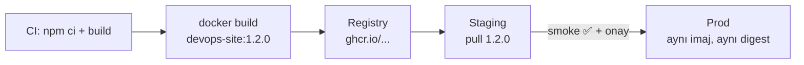

import Callout from '@components/Callout.astro';
import Quiz from '@components/Quiz.astro';

## İmaj bir artifact'tır

Seviye 2'deki kuralı hatırla: *üretilen şey bir kez üretilir, kimliklenir, taşınır.* Container dünyasında bu sözün karşılığı: **CI, imajı üretir ve registry'ye push eder; deploy, o imajı çeker.** Ellerle sunucuda `npm install` dönemi biter.



**Aynı digest** vurgusu kritik: staging'de test edilen imaj ile prod'a giden imaj birebir aynıdır (sha256). “Bende çalışıyordu” cümlesi imaj düzeyinde tanımsız hale gelir.

## Registry'ye push (GHCR örneği)

```bash
# oturum aç (GHCR için PAT: write:packages yetkili)
echo $GITHUB_TOKEN | docker login ghcr.io -u KULLANICI --password-stdin

# isimlendirme: registry/kullanici/adi:surum
docker tag devops-site:1.0.0 ghcr.io/kullanici/devops-site:1.0.0
docker push ghcr.io/kullanici/devops-site:1.0.0
```

CI içinde aynı iş, Actions ile:

```yaml
- uses: docker/login-action@v3
  with:
    registry: ghcr.io
    username: ${{ github.actor }}
    password: ${{ secrets.GITHUB_TOKEN }}   # Actions'ın kendi token'ı — özel secret gerekmez
- uses: docker/build-push-action@v6
  with:
    context: .
    push: true
    tags: ghcr.io/${{ github.repository }}:${{ github.sha }}
```

`${{ github.sha }}` etiketi: imajı **tam commit'e** bağlar — izlenebilirlik altın standarttır.

<Callout type="info" title="Gerçek dünyadan: Docker Hub rate limit'leri ve CI'ların kaderi">
  2020 sonbaharında Docker Hub, anonim pull'lara limit getirdiğinde dünyada
  yüzlerce CI pipeline'ı “toomanyrequests” hatasıyla kırmızıya döndü. Endüstri
  cevabı üç katlıydı: kendi registry'sine geçmek (GHCR), oturum açarak pull
  yapmak ve gereksiz pull'u cache ile azaltmak. Registry seçimi artık altyapı
  kararının bir parçasıdır — bu derste GHCR'ı kullanmamızın arkasındaki neden
  budur.
</Callout>

## Multi-stage: boyut = güvenlik + hız + maliyet

Builder imajı zengindir (Node, npm, tüm dev bağımlılıkları) ama **çalıştırma** imajı sade olmalı:

```dockerfile
FROM node:22-alpine AS builder
WORKDIR /app
COPY package*.json ./
RUN npm ci
COPY . .
RUN npm run build

FROM nginx:1.27-alpine
COPY --from=builder /app/dist /usr/share/nginx/html
EXPOSE 80
```

Faydalar:

- **Boyut:** ~1.2GB yerine ~40MB → pull hızlanır, saldırı yüzeyi küçülür
- **Saldırı yüzeyi:** node_modules'taki 200+ paket, prod'da yok — kuruluk (CVE) alımından sorumluluk da azalır
- **Netlik:** “bu imajda ne var?” sorusunun cevabı kısa: nginx + dosyalar

Kontrol: `docker images` ile boyutları karşılaştır; `docker history <imaj>` ile katmanları gör.

## Etiket stratejisi

| Etiket | Kullanım | Risk |
| --- | --- | --- |
| `latest` | Yalnızca yerel geliştirme | Production'da yasak — kayan etiket |
| `1.0.0` | Release sürümü | İyi; Semver'a bağlanır (Seviye 1) |
| `sha-abc1234` | CI üretimi | İzlenebilirliğin altın standardı |
| `@sha256:...` | Deploy manifest'leri | Değiştirilemez — GitOps'un sevdiği şey |

Kural: **deployment'ta değiştirilemez referans** (digest veya açık sürüm) kullan; kayan etiket “belli bir anın” değil, “her zaman en sonun” referansıdır.

## İmaj hijyeni kontrol listesi

1. Minimal taban (`alpine`, `distroless`) — olmayan paket, açık (vulnerability) üretmez
2. `USER` direktifi ile **root olmayan** kullanıcı (Seviye 1'in least privilege ilkesi!)
3. Secret'lar imajda **asla** taşınmaz (COPY . . ile .env basma — `.dockerignore`!)
4. `HEALTHCHECK` tanımla (Kubernetes, bir sonraki modülde bunu kullanacak)
5. Sabit kurulum (`RUN npm ci`, pin'li sürümler) — tekrarlanabilir build

<Quiz
  id="s3-registry-multistage"
  questions={[
    {
      q: 'CI’nin imajı registry’ye push etmesinin DevOps getirişi?',
      options: [
        'Docker Hub reklam geliri',
        'Test edilen imaj ile deploy edilen imajın birebir aynı olması (digest garantis)',
        'Sunucuda npm install gereksiz kalır ama derleme sunucuda yapılır',
        'Image boyutunu küçültür',
      ],
      answer: 1,
      explain:
        'Imaj = kimlikli artifact. Aynı sha256 ile staging ve prod aynı paketi koşturur.',
    },
    {
      q: 'Multi-stage build’in production imajına katkısı?',
      options: [
        'Build araçlarını da taşımak',
        'Boyutu küçültmek, saldırı yüzeyini daraltmak, kuruluk sayısını azaltmak',
        'Log formatını değiştirmek',
        'Network hızını artırmak',
      ],
      answer: 1,
      explain:
        'Son aşama yalnızca çalışma zamanı ihtiyaçlarını taşır; dev araçları ve bağımlılıkları dışarıda kalır.',
    },
    {
      q: 'Deployment manifest’lerinde en güvenilir referans?',
      options: ['latest', 'main', '@sha256:... digest veya açık sürüm', 'dev'],
      answer: 2,
      explain:
        'Digest değiştirilemez; açık sürüm Semver disipliniyle izlenebilir. Kayan etiketler belirsizlik üretir.',
    },
    {
      q: 'Container’da root olmayan kullanıcıyla çalıştırmak hangi ilkenin devamıdır?',
      options: ['DRY', 'En az yetki (least privilege)', 'Fail fast', 'Loose coupling'],
      answer: 1,
      explain:
        'Seviye 1’de sudo dersinde gördüğün ilke: süreç minimum yetkiyle çalışmalı; container kaçarsa etkisi dar olur.',
    },
  ]}
/>
