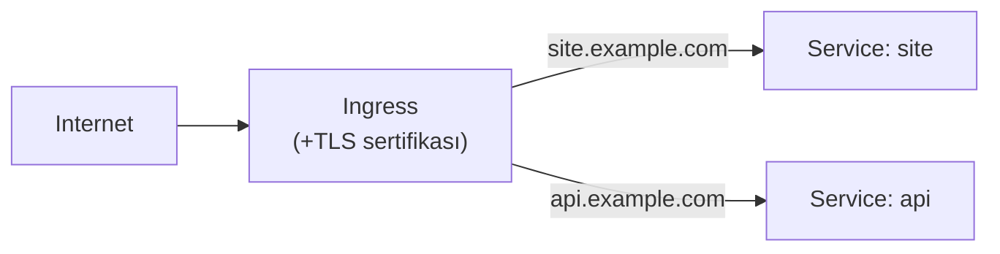

import Callout from '@components/Callout.astro';
import Quiz from '@components/Quiz.astro';
import Mermaid from '@components/Mermaid.astro';

## Ingress: kümeye akıllı giriş kapısı

Service pod'lara içeriden/ham portla ulaşır; **Ingress** ise HTTP düzeyinde routing yapar: “`site.example.com` bu Service'e, `api.example.com` o Service'e” ve **TLS'i burada sonlandırır**:



```yaml
apiVersion: networking.k8s.io/v1
kind: Ingress
metadata:
  name: site-ingress
  annotations:
    cert-manager.io/cluster-issuer: letsencrypt   # sertifika otomasyonu!
spec:
  rules:
    - host: site.example.com
      http:
        paths:
          - path: /
            pathType: Prefix
            backend:
              service:
                name: devops-site
                port: { number: 80 }
```

Ingress **bir tanım**, çalışması için bir **controller** gerekir (nginx-ingress, Traefik, cloud LB...). `cert-manager` eklentisi de Let's Encrypt entegrasyonunu otomatikleştirir — Seviye 1'deki “sertifika otomasyonu” fikrinin K8s karşılığı.

## ConfigMap ve Secret: konfigürasyon imajdan ayrılır

**12-Factor ilkesi:** konfigürasyon, imaja gömülmez; ortama enjekte edilir. K8s'in iki aracı:

```yaml
apiVersion: v1
kind: ConfigMap
metadata:
  name: site-config
data:
  SITE_NAME: "DevOps Yolculuğu"
  DEFAULT_THEME: "light"
---
apiVersion: v1
kind: Secret
metadata:
  name: site-secret
type: Opaque
stringData:
  API_TOKEN: "gizli-deger"
```

Pod'a iki şekilde bağlanır:

```yaml
containers:
  - name: site
    image: ghcr.io/.../devops-site:1.0.0
    envFrom:
      - configMapRef: { name: site-config }
    env:
      - name: API_TOKEN
        valueFrom:
          secretKeyRef: { name: site-secret, key: API_TOKEN }
```

Fark:

| | ConfigMap | Secret |
| --- | --- | --- |
| İçerik | Gizli olmayan yapılandırma | Kimlik bilgileri |
| Kodlama | düz metin | base64 + (RBAC ile) erişim kısıtı |
| Prod pratiği | repoda olabilir | **external secret manager** (Seviye 4) + kümeye senkron |

<Callout type="warn" title="Secret ≠ güvenli sandık (varsayılan)">
  K8s Secret base64 kodlamadır, şifreleme değildir! Kümeye erişen biri decode
  edebilir. Gerçekte: etcd şifreleme ayarı, sıkı RBAC ve tercihen External Secrets
  Operator (Vault/AWS Secrets Manager ile) kombinasyonu — Seviye 4’te derinleşecek.
</Callout>

## Helm: manifest'lerin paket yöneticisi

Problem: 5 ortam × 3 dosya = 15 YAML, %90'ı aynı. **Helm** manifest'leri **şablonlar**:

```
my-chart/
├── Chart.yaml          # paket metadata
└── templates/
    ├── deployment.yaml
    ├── service.yaml
    └── values.yaml     # varsayılan değerler
```

```yaml
# templates/deployment.yaml içinde
image: {{ .Values.image.repository }}:{{ .Values.image.tag }}
replicas: {{ .Values.replicas }}
```

```bash
helm install site ./my-chart --set image.tag=1.2.0 --set replicas=3
helm upgrade site ./my-chart --set image.tag=1.3.0
helm rollback site 1
```

Helm, K8s dünyasının npm/apt'ı gibidir: **paylaşılan chart'lar** kurar (nginx, prometheus, grafana...), kendi uygulamalarını sürümlü paketler. `helm rollback` = sürümlü geri alma.

<Callout type="info" title="Gerçek dünyadan: Helm'in yolu — çatallı başlangıçtan CNCF graduation'a">
  Helm, 2016'da Deis'te doğdu; Kubernetes'in paket yönetimi sorusuna o kadar net
  cevap verdi ki 2020'de **CNCF graduated** (tam üye) statüsüne ulaştı. Ekipler
  artık “nginx'i nasıl kurarım?” yerine “nginx chart'ının values'una ne yazayım?”
  diye sorar — ingress controller'dan monitoring yığınına kadar her şey chart'la
  kurulur. Bu derste gördüğün `--set image.tag` akışı, dünyada milyonlarca
  deployment'ın gerçek sürecidir.
</Callout>

## Bu modülün büyük resmi

Artık uçtan uca bir hikâyen var:

1. **CI** imajı üretir, registry'ye push eder (Seviye 2–3)
2. **Deployment** yeni imajı rolling update ile getirir
3. **Service + Ingress** onu dünyaya açar, TLS'li
4. **ConfigMap/Secret** konfigürasyonu ayırır
5. **Helm** paketler, `helm upgrade` = deploy

Bu hikâyenin elle `kubectl` koşulan kısmını Seviye 5'te **GitOps** ile otomatikleştireceğiz: Git'e commit → küme kendisi güncellenir.

<Quiz
  id="s3-k8s-ingress-config"
  questions={[
    {
      q: 'Ingress ile Service arasındaki fark?',
      options: [
        'Aynı şeydir',
        'Service pod erişimi; Ingress HTTP düzeyi routing + TLS sonlandırma sağlar',
        'Ingress yalnızca TCP port açar',
        'Service dış dünyaya açılmaz',
      ],
      answer: 1,
      explain:
        'Ingress, host/path tabanlı yönlendirme ve sertifika yönetimiyle kümeye “akıllı kapı” olur; arkasındaki Service’lere yönlendirir.',
    },
    {
      q: 'Konfigürasyonu imajdan ayırmanın K8s aracı çifti?',
      options: ['Volume + PV', 'ConfigMap + Secret', 'Helm + Chart', 'Ingress + LB'],
      answer: 1,
      explain:
        'ConfigMap: düz yapılandırma. Secret: kimlik bilgileri (base64; gerçek koruma RBAC+şifreleme ile).',
    },
    {
      q: 'Helm’in çözdüğü temel problem?',
      options: [
        'Container çalıştırmak',
        'Ortamlar arasında değişen manifest’leri şablonlayıp tek komutla sürümlemek',
        'Log toplamak',
        'Image build etmek',
      ],
      answer: 1,
      explain:
        'values ile parametreleşen şablonlar: 15 dosya yerine 1 chart + ortam başına değer seti; upgrade/rollback sürümlüdür.',
    },
    {
      q: 'K8s Secret’ın varsayılan koruması hakkında doğru olan?',
      options: [
        'AES-256 ile şifrelenir her koşulda',
        'Base64 kodlamadır — şifreleme değildir; ek önlemler gerekir',
        'Public olabilir',
        'Yalnızca root okuyabilir',
      ],
      answer: 1,
      explain:
        'Secret düz base64’tür; etcd şifreleme, RBAC ve external managers ile güçlendirilir.',
    },
  ]}
/>
