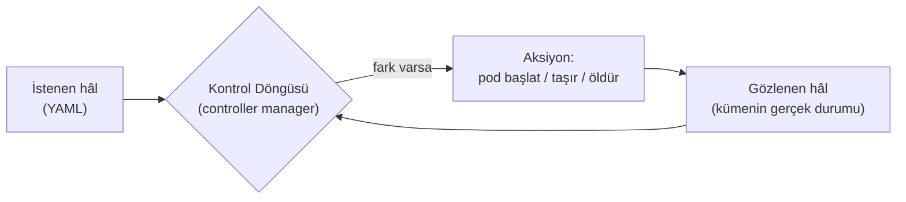

import Callout from '@components/Callout.astro';
import Quiz from '@components/Quiz.astro';
import Mermaid from '@components/Mermaid.astro';

## Tek makinenin tavanı

Compose ile tek sunucuda 3 servis koşturuyordun. Peki:

- Sunucu bozulursa? *(elle yeni sunucu kur, container'ları taşı)*
- Trafik 10 katına çıkarsa? *(elle yeni instance aç, load balancer'a ekle)*
- Deploy sırasında downtime olmasın? *(elle rolling restart scripti yaz)*
- 20 sunucuda versiyon tutarlılığı? *(elle... bir sürü elle)*

“Elle” kelimesi her satırda geçiyorsa artık bir **orkestratör** gerekiyor: sunucular kümesini tek bir mantıksal kaynak gibi yöneten sistem.

## Desired state: “olmasını istediğim hâl”

Kubernetes'in devrimci fikri imperatif değil **deklaratif** olmasıdır. Sistemden “şu komutu çalıştır” istemezsin; **istenen son hali** (desired state) tanımlarsın:

```yaml
# “bu imajdan 3 kopya koşsun” — nasıl yapılacağını K8s bulur
replicas: 3
image: ghcr.io/ben/devops-site:1.2.0
```

K8s'in tüm makinesi, tek bir kontrol döngüsüdür:



- Pod çöktü? → istenen sayıya tamamlanır (**self-healing**)
- Node öldü? → pod'ları sağlıklı node'lara **taşır**
- YAML'da `replicas: 3` → 4 pod varsa fazlalığı siler, 1 varsa tamamlar

Bu desene **reconciliation** (uzlaşma) denir ve GitOps (Seviye 5) bu temel üstüne kurulur: *Git'teki istenen hâl ile kümenin gözlenen hâli sürekli eşitlenir.*

## Mimari tur (sadeleştirilmiş)

- **Control Plane** (beyin):
  - **API Server:** her şeyin kapısı — `kubectl` bununla konuşur
  - **etcd:** kümenin tüm durumu (istenen + gözlenen)
  - **Scheduler:** “bu pod hangi node'a?” kararı
  - **Controller Manager:** kontrol döngülerini çalıştırır
- **Worker Node'lar** (kaslar):
  - **kubelet:** node'daki ajan — API server'dan emir alır, container'ları yönetir
  - **Container runtime:** containerd (Docker'ın altındaki motor da buraya evrildi)
  - **kube-proxy:** servis ağı kuralları

`kubectl get nodes` ile node'ları, `kubectl get pods` ile pod'ları görürsün — hepsi API Server'ın üzerinden.

## K8s neyi senden alır?

| Problem | K8s öncesi | K8s ile |
| --- | --- | --- |
| Süreç ölünce | elle restart / monit script | self-healing (saniyeler) |
| Ölçekleme | elle sunucu ekler | HPA (otomatik, metrik bazlı) |
| Deploy downtime | elle, pencere planla | rolling update (sıfır kesinti) |
| Servis keşfi | elle IP listeleri | service DNS |
| Konfigürasyon | sunucuda dağınık dosyalar | ConfigMap/Secret, versiyonlu |

<Callout type="warn" title="Adil uyarı">
  Kubernetes karmaşıklık ekler: öğrenme eğrisi dik, operasyon derin. 3 container’lık
  bir proje için K8s **overkill** olabilir. Doğru soru: “orkestrasyon problemlerim
  var mı?” yoksa Compose/bulut PaaS’ları yeterlidir. Ama öğrenmek, DevOps kariyeri
  için yüksek değerli bir yatırımdır — mülakatların ana konularından biri.
</Callout>

<Callout type="info" title="Gerçek dünyadan: Spotify'ın göçü">
  Spotify, yıllarca kendi geliştirdiği Helios'u kullanmasına rağmen 2018'de
  Kubernetes'e göç ettiğini duyurdu: gerekçe, kendi aracını geliştirmek yerine
  **ekosistemin ortak diline** katılmak — hazır araçlar, topluluk, işe alım
  kolaylığı. Ders: “kendi orkestratörümüzü yazalım” artık makul bir soru bile değil;
  soru, hazır orkestratörü **ne zaman ve ne kadar** kullanacağımız.
</Callout>

## Lokal küme: kind

Gerçek küme kurmadan öğrenmek için standart araç **kind** (Kubernetes in Docker): Docker container'larıyla mini bir K8s kümesi:

```bash
kind create cluster --name devops-kamp   # ~1 dakika
kubectl get nodes                        # node'ları gör
kubectl run test --image=nginx:alpine    # ilk pod!
kubectl delete cluster --name devops-kamp
```

Bir sonraki derste bu kümeyi gerçekten kullanacağız.

<Quiz
  id="s3-k8s-neden"
  questions={[
    {
      q: 'Kubernetes’in temel çalışma modeli nedir?',
      options: [
        'Elle komut dizisi çalıştırmak',
        'Desired state tanımlayıp kontrol döngüsüyle sürekli eşitlemek (reconcile)',
        'Sunucuları elle gruplamak',
        'Yalnızca monitoring',
      ],
      answer: 1,
      explain:
        'Deklaratif model: istenen hâli tanımlarsın; controller’lar gözlenen hâli buna yaklaştırır.',
    },
    {
      q: 'Bir pod ölündüğünde ne olur?',
      options: [
        'Elle yeniden başlatılır',
        'Kontrol döngüsü fark eder ve istenen replicas sayısına tamamlar (self-healing)',
        'Küme durur',
        'Pod otomatik yedekten döner',
      ],
      answer: 1,
      explain:
        'Deployment controller istenen state’i korur: 3 istendiyse 3 çalışır; eksik hemen tamamlanır.',
    },
    {
      q: 'API Server’ın rolü nedir?',
      options: [
        'Container’ları çalıştırmak',
        'Kümeye yapılan tüm isteklerin (kubectl dahil) tek kapısı',
        'Log saklamak',
        'Image derlemek',
      ],
      answer: 1,
      explain:
        'Her şey API Server üzerinden geçer: kubectl, scheduler, controller’lar — hepsi bu kapıdan konuşur.',
    },
    {
      q: 'Hangi durumda K8s kullanmak overkill olabilir?',
      options: [
        'Yüzlerce mikroservis',
        '3 container’lık küçük bir proje, orkestrasyon ihtiyacı yok',
        'Birden fazla ekip deploy ediyor',
        'Rolling update gerekiyor',
      ],
      answer: 1,
      explain:
        'Araç problemi çözmelidir; Compose/PaaS yeterliyken K8s operasyon maliyeti ekler.',
    },
  ]}
/>
