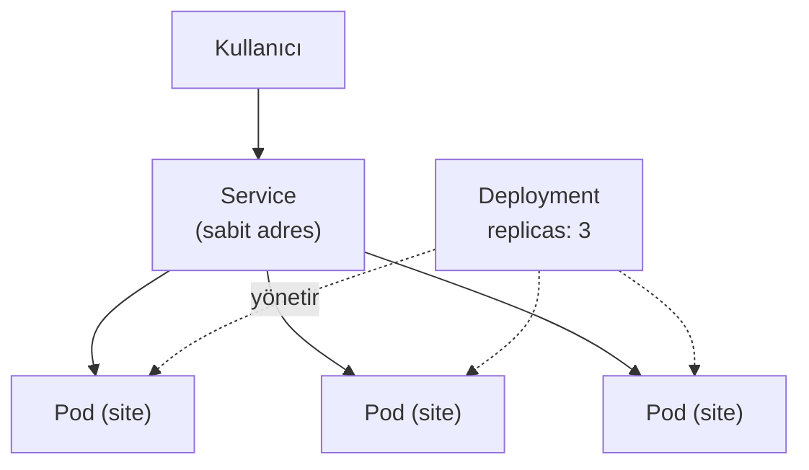

import Callout from '@components/Callout.astro';
import Quiz from '@components/Quiz.astro';
import LabBox from '@components/LabBox.astro';
import TerminalSim from '@components/TerminalSim.astro';

## Üç temel nesne

- **Pod:** K8s'in en küçük birimi — 1 (genelde) container + paylaşılan ağ/storage. Pod'lar ölümlüdür: her an doğar/ölür.
- **Deployment:** pod'ların **istenen hâlini** yönetir (kaç adet, hangi imaj, nasıl güncellensin). Sen Deployment'a bakarsın, pod'ları o yönetir.
- **Service:** pod'ların ölümlü IP'leri yerine sabit bir **sanal IP + DNS adı**; arkasına sağlıklı pod'ları dizer (load balancing).



## Deployment manifest'i

`k8s/deployment.yaml`:

```yaml
apiVersion: apps/v1
kind: Deployment
metadata:
  name: devops-site
spec:
  replicas: 2
  selector:
    matchLabels:
      app: devops-site
  template:
    metadata:
      labels:
        app: devops-site
    spec:
      containers:
        - name: site
          image: ghcr.io/KULLANICI/devops-site:1.0.0
          ports:
            - containerPort: 80
          resources:
            requests:
              memory: "64Mi"
              cpu: "100m"
            limits:
              memory: "128Mi"
```

Yerel test için imajı Docker Hub'daki genel bir imaj veya kind'a yüklediğin imaj kullanabilirsin: `kind load docker-image devops-site:1.0.0 --name devops-kamp`

`k8s/service.yaml`:

```yaml
apiVersion: v1
kind: Service
metadata:
  name: devops-site
spec:
  type: NodePort        # lokal erişim için (prod: Ingress/LB)
  selector:
    app: devops-site
  ports:
    - port: 80
      targetPort: 80
      nodePort: 30080
```

`selector` bağın anahtarı: Service, `app: devops-site` etiketli pod'ları bulur.

## Kümeye deploy et

```bash
kubectl apply -f k8s/deployment.yaml
kubectl apply -f k8s/service.yaml

kubectl get deployments
kubectl get pods -w                    # -w: canlı izle (Ctrl+C çık)
curl http://localhost:30080            # site kümeden geliyor!
```

## Rolling update'i izle

İmajı güncelle (ör. `1.1.0`) ve deployment'ta `image:` satırını değiştir:

```bash
kubectl set image deployment/devops-site site=ghcr.io/KULLANICI/devops-site:1.1.0
kubectl rollout status deployment/devops-site
```

K8s **downtime'sız** günceller: yeni pod ayağa kalkar, sağlıklıysa eskisi alınır — sırayla, her seferinde birkaç pod. `kubectl rollout undo deployment/devops-site` ile bir öncekine geri dönersin: **built-in rollback**.

## Web terminalinde kubectl

<TerminalSim
  id="s3-k8s-lab"
  title="kind-devops-kamp"
  prompt="ogrenci@devops:~$"
  welcome={[
    'kind kümesi hazır. Önce neyin nerede olduğunu gör: kubectl get nodes',
  ]}
  hint="get nodes → get deployments → get pods → describe pod <ad> → rollout undo"
  commands={{
    'kubectl get nodes': { out: ['NAME                    STATUS   AGE', 'devops-kamp-control-plane   Ready    3d'] },
    'kubectl get deployments': { out: ['NAME          READY   UP-TO-DATE   AVAILABLE   AGE', 'devops-site   2/2     2            2           5m'] },
    'kubectl get pods': {
      out: ['NAME                          READY   STATUS    AGE', 'devops-site-7f9c8b-abcde   1/1     Running   5m', 'devops-site-7f9c8b-fghij   1/1     Running   5m'],
    },
    'kubectl describe pod devops-site-7f9c8b-abcde': {
      out: [
        'Name:     devops-site-7f9c8b-abcde',
        'Node:     devops-kamp-control-plane',
        'Status:   Running',
        'Image:    ghcr.io/KULLANICI/devops-site:1.0.0',
        'Events:   Pulled, Created, Started',
        '~describe: pod ile ilgili her şey (event, konfig, limit) tek yerde.',
      ],
    },
    'kubectl scale deployment/devops-site --replicas=4': {
      out: ['deployment.apps/devops-site scaled', '+2 yeni pod açılıyor — get pods -w ile izle!'],
    },
    'kubectl rollout undo deployment/devops-site': {
      out: ['deployment.apps/devops-site rolled back', '+önceki imaj sürümüne döndü — built-in rollback.'],
    },
  }}
/>

<LabBox
  id="s3-k8s-lab"
  title="Kümeni kur ve siteyi deploy et"
  verify={['kubectl get pods -l app=devops-site', 'curl -s -o /dev/null -w "%{http_code}" http://localhost:30080']}
>
  1. `kind` ve `kubectl` kur (resmî kurulum dokümanları).
  2. `kind create cluster --name devops-kamp`
  3. Docker imajını kümele: `kind load docker-image devops-site:1.0.0 --name devops-kamp`
  4. Yukarıdaki manifest'leri yaz (imaj adını kendine göre düzelt) ve `kubectl apply -f` ile uygula.
  5. `kubectl get pods -w` ile Running'e geçişini izle; `curl localhost:30080` ile siteyi doğrula.
  6. `kubectl scale deployment/devops-site --replicas=4` — ölçeklemeyi canlı gör.
  7. Bitirince: `kind delete cluster --name devops-kamp` (kaynak kullanımı).
</LabBox>

<Callout type="info" title="Gerçek dünyadan: K8s bugün fiili standart">
  CNCF’in yıllık anketlerinde kurumların ezici çoğunluğu Kubernetes
  kullanıyor/değerlendiriyor diyor; bulut sağlayıcıların managed K8s servisleri
  (EKS/AKS/GKE) değişikliğin maliyetini düşürerek benimsemeyi hızlandırdı.
  Yani bu derste kind’da öğrendiğin komutlar, iş piyasasının en çok talep edilen
  pratik becerilerinin birebir kendisidir.
</Callout>

<Callout type="tip" title="kubectl’de en değerli üç alışkanlık">
  1) `get pods` yerine `get pods -o wide` (node + IP görürsün). 2) Pod sorunluysa önce
  `describe pod <ad>` — Events kısmı yarı yarıya hata ayıklamayı bitirir. 3) `logs <ad> -f`
  ile uygulama loglarını izle.
</Callout>

<Quiz
  id="s3-k8s-lab"
  questions={[
    {
      q: 'Pod ile Deployment ilişkisi?',
      options: [
        'Pod Deployment’ı yönetir',
        'Deployment pod’ların istenen hâlini yönetir; pod’lar ölümlü çalışan birimlerdir',
        'Aynı şeydir',
        'Service Deployment’ı yaratır',
      ],
      answer: 1,
      explain:
        'Sen Deployment manifest’ine bakarsın; Deployment pod’ları doğurur, takip eder, günceller.',
    },
    {
      q: 'Service’in temel görevi?',
      options: [
        'Image derlemek',
        'Ölümlü pod IP’lerinin önüne sabit sanal adres + load balancing koymak',
        'Secret saklamak',
        'Node eklemek',
      ],
      answer: 1,
      explain:
        'Pod yeniden doğunca IP değişir; Service etiketle pod’ları bulur ve istemciye sabit adres sunar.',
    },
    {
      q: 'Deployment selector/labels bağlantısı neden kritiktir?',
      options: [
        'CPU tahsisi için',
        'Deployment, Service ve pod’lar etiket üzerinden birbirine bağlanır; yanlış etiket = trafik almayan pod',
        'Log formatı için',
        'Image boyutu için',
      ],
      answer: 1,
      explain:
        'K8s tüm eşleşmeyi etiketle yapar: Service selector’u pod template etiketleriyle örtüşmeli.',
    },
    {
      q: 'Rolling update sırasında K8s ne yapar?',
      options: [
        'Tüm pod’ları aynı anda öldürüp yeniler',
        'Sırayla yeni pod açar, sağlıklı gördükçe eskileri alır — kesinti olmadan',
        'Yeni kümeye taşır',
        'Downtime penceresi bekler',
      ],
      answer: 1,
      explain:
        'Surge/unavailable ayarlarıyla adım adım: yeni sürüm sağlıklı doğrulanmadan eskisi gitmez.',
    },
  ]}
/>
