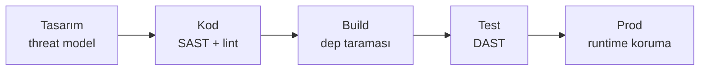

import Callout from '@components/Callout.astro';
import Quiz from '@components/Quiz.astro';

## OWASP: en yaygın yollar

OWASP, en kritik web uygulaması güvenlik risklerini periyodik listeler. DevOps mühendisi bunları **tamir etmek** kadar, altyapı katmanında **zeminde engellemek** için bilir:

| Sınıf | Ne? | DevOps karşılığı |
| --- | --- | --- |
| **Injection (SQL/OS)** | Ham kullanıcı verisi komut/sorgu olarak yorumlanır | Prepared statement (kod) + WAF (altyapı) |
| **XSS** | Kullanıcı verisi sayfada JS olarak çalışır | CSP başlığı, output encoding |
| **Broken Auth** | Zayıf oturum/parola yönetimi | MFA, rate limit, güvenli cookie politikaları |
| **Broken Access Control** | “Yetkisiz ama erişti” | Yetki testleri CI'da, IAM least privilege |
| **Security Misconfig** | Varsayılan ayarlar açık kalır | IaC ile standart, `scan` ile sürekli doğrulama |
| **SSRF** | Sunucunun iç adreslere istek atması | Egress kuralları, allowlist |

**Security Misconfiguration** sınıfı DevOps'un asıl sahasıdır: açık kalmış debug portu, varsayılan admin parolası, gereksiz açık bucket, eski TLS... Bunlar çoğu zaman uygulama değil **altyapı kararıdır** — IaC review'larında yakalanır.

## Shift-left: güvenliği sola taşı



Geleneksel model güvenliği **sonuna** bırakır (penetrasyon testi, release öncesi) — hata bulunursa, bulunduğu her yerden geri alınır. **Shift-left** her aşamaya uygun aracı koyar: hatanın bulunduğu aşama sağa kaydıkça düzeltme maliyeti katlanarak artar.

| Araç sınıfı | Ne yapar? | Nerede koşar? | Örnekler |
| --- | --- | --- | --- |
| **SAST** | Kaynak kodda desen analizi | PR'da, saniyeler-dakikalar | CodeQL, Semgrep |
| **DAST** | Çalışan uygulamaya saldırı denemeleri | Staging'de | ZAP, Nuclei |
| **SCA** | Bağımlılık kuruluk taraması | CI'da | Trivy, Dependabot (önceki ders) |
| **Secret scan** | Sızan kimlik avı | Pre-commit + CI | gitleaks (önceki ders) |

PR'da Semgrep örneği:

```yaml
- name: SAST taraması
  run: semgrep ci --config=p/owasp-top-ten
```

## Zeminde güvenlik: DevOps kararı olan korumalar

- **CSP başlığı:** XSS etkisini dramatik daraltır (`Content-Security-Policy` — sadece güvenilen kaynaklardan script)
- **HSTS + TLS min sürüm:** protokol düzeyinde zorlama
- **Rate limiting (WAF/proxy katmanı):** brute force ve scraping'e temel direnç
- **Egress firewall:** sunucu korsanına çıkmak için serbest olmamalı — SSRF etkisini küçültür
- **Non-root container + readonly filesystem:** runtime'da izin daraltma (Seviye 3 hijyen kurallarının güvenlik tablosu)

## Güvenlik review kültürü

Araçlar sinyal üretir; kültür kararı verir:

1. **Threat model “hızlı” sürümü:** yeni servis açılırken 15 dakikalık liste — “kim, neye, nasıl saldırır? ona neyi biliyoruz?”
2. **PR'da güvenlik etiketi:** auth/IAM/para işine dokunan PR'lar ikinci göz (security buddy) ister
3. **False positive yönetimi:** tarama gürültüsü yok sayılma doğurur; her yanlış pozitif için suppression'ın gerekçesi yazılır (calm, deliberate noise reduction)
4. **Olayla bitişik iyileştirme:** incident sonrası (Seviye 4 postmortem) güvenlik aksiyonları da girer

<Callout type="tip" title="DevSecOps özeti">
  “Güvenlik ekibinin işi” değil, **herkesin pipeline’ında bir adım**. Amaç güvenlik
  ekibini yok etmek değil; rutin kontrolü otomatikleştirip onları mimari/mühendislik
  sorunlarına açmaktır.
</Callout>

<Quiz
  id="s4-owasp"
  questions={[
    {
      q: 'Shift-left ilkesinin ekonomik gerekçesi?',
      options: [
        'Araçlar solda daha ucuzdur',
        'Hata ne kadar sağda bulunursa düzeltme maliyeti o kadar katlanır; erken araçlar pahalı saldırıyı önler',
        'Soldaki araçlar daha hızlı çalışır',
        'Lisans gereği',
      ],
      answer: 1,
      explain:
        'Tasarımda yakalanan zayıflık bir review notu; production’da yakalanan bir olay, föşe + olay müdahalesi + itibar demektir.',
    },
    {
      q: 'SAST ile DAST farkı?',
      options: [
        'Aynı şeyin farklı adları',
        'SAST kaynak kodu statik analiz eder; DAST çalışan uygulamaya gerçek isteklerle saldırır',
        'SAST sadece container’da çalışır',
        'DAST yalnızca lint’dir',
      ],
      answer: 1,
      explain:
        'SAST kodda, DAST staging’de koşar; birbirinin alternatifi değil tamamlayıcısıdır.',
    },
    {
      q: 'Security Misconfiguration sınıfının DevOps’a düşen kısmı?',
      options: [
        'SQL sorguları yazmak',
        'IaC ile standartlaştırılmış ve sürekli taranan yapılandırma: açık port, varsayılan parola, eski TLS yok',
        'UI renk seçimi',
        'A/B testi',
      ],
      answer: 1,
      explain:
        'Yanlış yapılandırma çoğunlukla altyapı katmanının kararıdır — IaC review + sürekli tarama ile zeminde kapatılır.',
    },
    {
      q: 'CSP başlığının XSS’e katkısı nedir?',
      options: [
        'Veriyi şifreler',
        'Hangi kaynaklardan script yüklenip çalışabileceğini kısıtlar — enjekte edilen JS çoğunlukla çalışamaz',
        'Cookie’yi şifreler',
        'DNS’i korur',
      ],
      answer: 1,
      explain:
        'CSP derin savunmadır: kod hatası olsa bile saldırgan script’i güvenilir kaynaktan yükleyemez.',
    },
  ]}
/>
