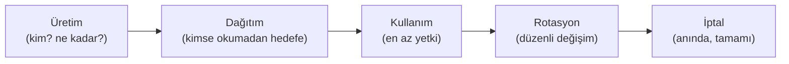

import Callout from '@components/Callout.astro';
import Quiz from '@components/Quiz.astro';

## Secret'ların gerçek dünyadaki yaşamı

Bir API anahtarının yolculuğu genelde şöyle başlar: e-postaya yapıştırılır → Slack'te konuşulur → biri “kolaylık olsun” diye `.env`'e yazar → `.env` gitignore'da unutulur → repoya commit'lenir... ve bir gün public olur.

**Secret:** erişim/kimlik sağlayan her veri — API anahtarları, DB şifreleri, TLS özel anahtarları, SSH anahtarları, token'lar. Yönetim sorusu yalnızca “nerede saklanır?” değil, **yaşam döngüsünün tamamıdır**:



## Hiyerarşi: yerelden merkeze

| Yöntem | Ne zaman yeterli? | Risk |
| --- | --- | --- |
| Environment variable | Tek makine/CI | Process list/dump'ta görünebilir; merkezi kontrol yok |
| CI Secrets (GitHub) | CI pipeline | CI kapsamıyla sınırlı; prod dağıtımı ayrı çözüm ister |
| K8s Secret | Küme içinde | Base64 ≠ şifre; RBAC+etcd şifreleme şart |
| **Secret manager (Vault, AWS SM, Azure KV)** | Prod, ekip ölçeği | Kurulum/operasyon gerektirir — ama tam yaşam döngüsü |

Secret manager'ın katkıları:

1. **Merkezi kasa:** tek doğruluk kaynağı, versiyonlu, audit log'lu (kim ne zaman okudu?)
2. **Dinamik secret'lar:** “5 dakikalık geçici DB parolası üret” — kalıcı parola sıfır
3. **Otomatik rotasyon:** ömürlü token'lar, süre dolunca yenilenir
4. **İnce erişim:** “bu servis yalnızca bu path'i okur” (least privilege — Seviye 1 ve 3'ten beri aynı ilke!)

## CI'dan prod'a güvenli taşıma

CI'ın secret'ı (GitHub Secrets) ile prod'un secret'ı ayrı evlerdir. Prod'a taşımanın modern iki yolu:

1. **CI → secret manager'a yaz:** deploy pipeline'ı yalnızca **kasa referansını** günceller; uygulama açılışta kasadan okur
2. **External Secrets Operator (K8s):** kümedeki Secret objeleri, dış kasa (Vault/AWS SM) ile senkron tutulur — secret değeri Git'e/manifest'e **asla** yazılmaz

```yaml
# kavramsal: External Secrets Operator
apiVersion: external-secrets.io/v1beta1
kind: ExternalSecret
metadata:
  name: site-token
spec:
  secretStoreRef: { name: vault-backend, kind: ClusterSecretStore }
  target: { name: site-token }
  data:
    - secretKey: API_TOKEN
      remoteRef: { key: prod/site, property: api_token }
```

## Kod ve CI'da secret avı

Sızıntıyı **üretim hattında** yakala:

- **pre-commit + CI taraması:** `gitleaks`, `trufflehog` — commit'te ya da PR'da yüksek entropili değerleri yakalar
- **git geçmişi taraması:** eski commit'lerde sızmış değer var mı? (`git log -p` üzerinden tarama)
- **.env şablonu:** repo'da `.env.example` (değerler boş) + `.gitignore`'da gerçek dosya — geliştirici onboarding'inin güvenli hali

<Callout type="warn" title="Sızdıysa: rotate, revert değil">
  Seviye 2’deki kuralı buraya taşı: sızan secret için tek gerçek çözüm **revoke + yeni
  üretim**. “Geçmişi sildik” kimseyi kurtarmaz — geçmiş klonlanmış olabilir.
</Callout>

<Callout type="info" title="Gerçek dünyadan: bir token'ın açtığı kapı (Mercedes-Benz, 2020)">
  2020'de araştırmacılar, Mercedes-Benz'e ait bir GitHub deposunda **kimlik
  doğrulama token'ını** açık buldu; bu token, şirket içi araçlara ve bulut
  kaynaklarına erişim sağlıyordu. Sızan şey “küçük bir anahtar” gibi görünse de,
  yetkisi genişti. Ders: token'ların yetkisi daraltılmazsa, tek bir string yüzlerce
  sunucunun kilidini açabilir — rotasyon + en az yetki birbirinin tamamlayıcısıdır.
</Callout>

## Rotasyon refleksi

- **Kısa ömür varsayılanı:** token'lara TTL ver; sonsuza kadar yaşayan token yok
- **Kişiye değil role bağlı:** çalışan ayrılırken yüzlerce token iptal etmek yerine, roller iptal edilir (IAM grupları + servis hesapları)
- **Deneme rotasyonu:** rotasyonu bir kez prova et — bir gün ihtiyaç olduğunda ilk deneme olay anında olmasın

<Quiz
  id="s4-secret-yonetimi"
  questions={[
    {
      q: 'Secret manager’ın dinamik secret özelliği neyi sağlar?',
      options: [
        'Şifreleri güçlendirmek',
        'Geçici, kısa ömürlü kimlik üretimi — kalıcı parola sıfıra iner',
        'Logları gizlemek',
        'Faturayı düşürmek',
      ],
      answer: 1,
      explain:
        'Dinamik secret istekle üretilir, süresi dolunca geçersiz olur; sızan geçici kimliğin ömrü dakikalardır.',
    },
    {
      q: 'K8s Secret’ın tek başına yetersiz olmasının nedeni?',
      options: [
        'Yavaş çalışır',
        'Base64 kodlamadır — şifreleme değil; RBAC ve etcd şifreleme ile desteklenmeli',
        'Yalnızca dev ortamı içindir',
        'Yedekleyemez',
      ],
      answer: 1,
      explain:
        'Secret objesi erişim kontrolüyle (RBAC) ve etcd şifreleme/external manager entegrasyonuyla gerçek koruma kazanır.',
    },
    {
      q: 'Repoya sızan bir token için doğru müdahale sırası?',
      options: [
        'Geçmişi force-push’la temizle → bekle',
        'Revoke → yeni üret → dağıt → geçmiş taraması + olay kaydı',
        'Yeni repo aç',
        'CI’ı durdur',
      ],
      answer: 1,
      explain:
        'Revoke asıl kapatıcıdır; geçmiş temizliği tamamlayıcıdır. Olay kaydı ise postmortem kültürünün girdisidir.',
    },
    {
      q: '`.env.example` dosyasının amacı?',
      options: [
        'Gerçek secret’ları taşımak',
        'Gerekli değişken adlarını güvenli şekilde dokümante etmek — değerler boş',
        'CI’ı hızlandırmak',
        'Test verisi',
      ],
      answer: 1,
      explain:
        'Geliştirici hangi değişkenlerin gerektiğini görür; gerçek değerler hiçbir zaman repoya girmez.',
    },
  ]}
/>
