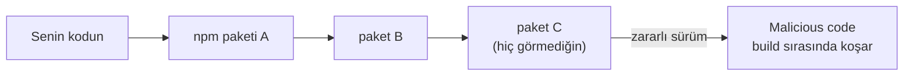

import Callout from '@components/Callout.astro';
import Quiz from '@components/Quiz.astro';
import Mermaid from '@components/Mermaid.astro';

## Bağımlılık zinciri: modern yazılımın ödünç malı

Tipik bir Node uygulaması, transitive bağımlılıklarıyla yüzlerce (binlerce) üçüncü parti paket kullanır. Bu **hız** getirir ama her paket, kodunun içine giren **başkasının güvenlik kararlarıdır**:



Tarihsel saldırı sınıfları:

- **Typosquatting:** popüler paketin yanlış yazılmış adı (`crossenv` vs `cross-env`) — siber suçlunun paketi
- **Dependency confusion:** iç paket adının public registry'de ele geçirilmesi
- **Compromised maintainer:** meşru paketin hesabının ele geçirilip zararlı sürüm yayınlanması (real-world: `event-stream`, `ua-parser-js` olayları)
- **Hijacked CI:** “npm ci” sırasında postinstall script'leri

<Callout type="info" title="Gerçek dünyadan: SolarWinds (2020) ve event-stream (2018)">
  SolarWinds saldırısı (2020), bir yazılım tedarikçisinin **build sistemine** sızan
  saldırganların, binlerce kuruma giden meşru görünen güncellemelere zararlı kod
  koyduğu (bildirilen on binlerce müşteri etkilenen) endüstriyi değiştiren vakadır.
  Bireysel geliştirici ölçeğindeki karşılığı ise event-stream (2018): bakımcısı
  projeyi devreden çıkardı, yeni sürüm zararlıydı ve React dahil geniş bir ekosistem
  etkilendi. İkisinin ortak cevabı bu dersin katmanları: SBOM, tarama, imza ve
  “güncelleme de bir deployment'tır” disiplini.
</Callout>

## Savunma katmanları

### 1. SBOM: ne var nerede?

**SBOM (Software Bill of Materials)** = imajının içindeki her paketin + sürümünün faturası. Araçlar: **Syft**, **Trivy**, **CycloneDX**. Saldırı haberi geldiğinde soru “etkilenen miyiz?”in cevabı 5 saniyede SBOM sorgusuyla verilir — depodaki her imajı elle taramak yerine.

### 2. Dependency taraması — sürekli

- **Dependabot / Renovate:** sürüm ve güvenlik PR'larını otomatik açar
- **`npm audit` / `pip-audit`** CI'da her koşumda
- **Trivy:** hem dosya sistemi hem container imajı tarayıcı

```yaml
# CI'ya imaj taraması ekleme
- uses: aquasecurity/trivy-action@master
  with:
    image-ref: ghcr.io/${{ github.repository }}:${{ github.sha }}
    severity: CRITICAL,HIGH
    exit-code: '1'      # kritik açık varsa pipeline kırmızı
```

### 3. Sürüm kilitlama ve doğrulama

- **Lockfile commit'li ve `npm ci`** — sürüm sürprizi yok (Seviye 2'den beri alışkanlık)
- **Integrity hash'ler** (lockfile'da zaten var) — paket içeriği değişirse kurulum patlar
- **Private registry / allowlist:** kurumsal ortamda yalnızca onaylı kaynaklardan paket

### 4. Build süreç güvenliği

- **SLSA** çerçevesi: build'in izole, reproducible, attestation'lı olmasını kademelendirir
- **Signed images** (`cosign`): imajı imzala; deploy adımı yalnızca imzalı imajı kabul etsin — “bu imaj gerçekten bizim CI'dan mı çıktı?” sorusunun otomatik cevabı

## Pratik öncelik sırası (ekip olarak nereden başlanır?)

1. **Lockfile disiplini + `npm ci`** (0 maliyet, yüksek getiri)
2. **Dependabot aç** (yarım saatlik kurulum)
3. **Trivy'yi CI'ya ekle** (1 saatlik kurulum) — kritik açıklar pipeline'ı kessin
4. **SBOM üret** (birkaç saat) — olay günü için sigorta
5. **İmza + attestation** (olgun aşama)

<Callout type="tip" title="Açık düzeltme refleksi">
  Kritik CVE haberi geldiğinde doğru sıra: SBOM sorgusu (etkilenen miyiz?) →
  yamalı sürüme minör bump PR’ı → CI yeşil → deploy. Riskli şeyi “kişisel bilgisayar
  testinde denerim” aşamasına taşımayın — bunu CI otomatikleştirir.
</Callout>

<Quiz
  id="s4-supply-chain"
  questions={[
    {
      q: 'SBOM’un en pratik getirisi?',
      options: [
        'Imaj boyutunu küçültmek',
        '“X açıklağı etkiliyor mu?” sorusunu saniyeler içinde cevaplamak',
        'Build hızını artırmak',
        'Log formatını düzeltmek',
      ],
      answer: 1,
      explain:
        'SBOM paket faturasıdır; yeni CVE duyurusunda etkilenim analizini elle taramak yerine sorgu ile yapar.',
    },
    {
      q: 'Typosquatting saldırısı nasıl çalışır?',
      options: [
        'Şifre kırma ile',
        'Popüler paketin yanlış yazılmış adıyla zararlı paketin kurulması',
        'DNS yönlendirme ile',
        'TLS downgrade ile',
      ],
      answer: 1,
      explain:
        'Kullanıcı `cross-env` yerine `crossenv` yazarsa zararlı paket kurulur; allowlist ve dikkatli kurulum önlemektir.',
    },
    {
      q: 'CI’da trivy `exit-code: 1` kullanmak neyi sağlar?',
      options: [
        'Taramayı hızlandırır',
        'Kritik/yüksek açıklar pipeline’ı kırmaya çevirir — açık “bilgi” değil “kapı” olur',
        'Logları gizler',
        'Sadece rapor üretir',
      ],
      answer: 1,
      explain:
        'Shift-left ilkesi: açık, merge edilmeden yakalanır; “sonra bakarız” listesi pipeline kapısında durur.',
    },
    {
      q: 'Lockfile + npm ci disiplininin supply chain katkısı?',
      options: [
        'Paketleri günceller',
        'Integrity hash’lerle birebir sürüm/parmak izi garantisi — sürüm sürprizi ve manipülasyon riskini keser',
        'Registry’yi atlar',
        'Lisans kontrolü yapar',
      ],
      answer: 1,
      explain:
        'Lockfile, kurulumun tam hangi tarball’ın (hash) kurulacağını belirler; yukarıdaki değişiklik fark edilir.',
    },
  ]}
/>
