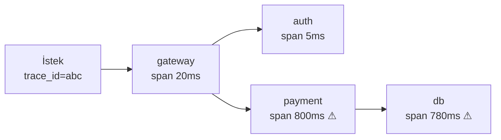

import Callout from '@components/Callout.astro';
import Quiz from '@components/Quiz.astro';
import Mermaid from '@components/Mermaid.astro';

## Monitoring vs Observability

- **Monitoring:** *bildiğin* sorunları izler. “CPU %90'ı geçerse uyar.” Bilinen-kökü-bilinmeyen hatalar için.
- **Observability:** *bilmediğin* sorunları cevabını önceden yazmadan sorabilme yetisi. “Bugün ödeme başarısı neden %12 düştü?” gibi yeni sorulara, sistemde ekstra kod yazmadan cevap verebilmek.

Kısa formül: observability = monitoring + **yeni sorular sorabilme**. Modern dağıtık sistemlerde (mikroservis, serverless) başarısızlık modları önceden kataloglanamayacak kadar çoktur — bu yüzden observability gereklidir.

## Üç sütun

### 1. Log — olayın hikayesi

Zamana damgalı, serbest metin/konumlu kayıt. En zengin, en pahalı veri:

```
2026-11-12T21:40:03Z INFO  checkout order=8842 user=771 stage=payment gateway=stripe
2026-11-12T21:40:05Z ERROR checkout order=8842 user=771 stage=payment err="card declined"
```

Kural: **yapılandırılmış (JSON) log** — elle grep'lenebilir ama alan bazlı sorgulamaya da açık. Log seviyeleri: DEBUG/INFO/WARN/ERROR — production'da DEBUG kapalı, olay sırasında dinamik açılır.

### 2. Metric — sistemin nabzı

Sayısal, zaman serisi (time series) veri. Ucuz, hızlı, uyarı için ideal:

```
http_requests_total{method="POST",status="500"}   1284
http_request_duration_seconds p99                  0.842
memory_usage_bytes                                 4.2e+08
```

Golden sinyaller: **latency, traffic, errors, saturation** (gecikme, trafik, hata, doygunluk) — her servisi bu dört pencereden izle.

### 3. Trace — bir isteğin yolculuğu

Mikroservis dünyasında bir istek 6 servisten geçer; hangisi yavaşladı? **Distributed tracing** isteğe benzersiz bir `trace_id` verir, her atlama (span) kaydedilir:



Trace, “p99 neden yükseldi?” sorusunu hipotezden **kanıta** indirir: payment içindeki db sorgusu 780ms — endeks yok.

## OpenTelemetry (OTel): tek standart, tüm vendor'lar

Eskiden her vendor'ın (Datadog, New Relic...) kendi agent'ı ve API'si vardı — vendor kilitlenmesi. **OpenTelemetry**, CNCF standartı olarak üç şey sunar:

1. **Tek API/SDK:** koduna bir kere instrument edersin
2. **Exporter seçimi:** veriyi istediğin backend'e gönder (Prometheus, Grafana, Datadog...)
3. **Collector:** toplama/işleme/ilerletme merkezi katman

```js
// kavramsal örnek: uygulamaya OTel enstrümantasyonu
import { trace } from '@opentelemetry/api';
const tracer = trace.getTracer('checkout');

await tracer.startActiveSpan('processOrder', async (span) => {
  span.setAttribute('order.id', orderId);
  // ... iş mantığı
  span.end();
});
```

Vendor değiştirmek artık exporter değiştirmek — lock-in kırılır.

## Sinyaller birlikte çalışır

Gerçek diagnoz akışı üçlüyü birleştirir: **metric alarm** (p99 yükseldi) → **trace** (hangi atlamada?) → **log** (o atlamanın detayı). Tek tek bakınca bulmaca; birlikte bakınca cevap.

<Callout type="tip" title="Cardinality uyarısı">
  Metric’te etiket olarak `user_id` gibi yüksek kardinalite değer koymak, zaman
  serisi patlamasına ve fatura/performans çöküşüne yol açar. Yüksek kardinalite
  aramaları trace/log’a bırakılır; metric kalıcı, düşük kardinalite etiketler taşır.
</Callout>

<Quiz
  id="s4-observability"
  questions={[
    {
      q: 'Monitoring ile observability arasındaki fark?',
      options: [
        'Aynı şeydir',
        'Monitoring bilinen hataları izler; observability önceden yazılmamış sorulara cevap verme yetisidir',
        'Observability yalnızca log’dur',
        'Monitoring daha modern',
      ],
      answer: 1,
      explain:
        'Observability, sistem içi sinyallerden yeni diagnoz soruları sorabilme yetisidir; monitoring bunun bilinen-hata alt kümesidir.',
    },
    {
      q: '“p99 800ms — hangi mikroservis?” sorusuna en doğrudan cevap veren sinyal?',
      options: ['Log', 'Metric', 'Trace', 'Uptime check'],
      answer: 2,
      explain:
        'Distributed trace, isteğin tüm atlamalarını süreleriyle gösterir; yavaş span tek bakışta görünür.',
    },
    {
      q: 'Metric etiketlerinde user_id kullanmaktan kaçınılmasının nedeni?',
      options: [
        'Gizlilik',
        'Yüksek kardinalite zaman serilerini patlatır (maliyet + performans)',
        'Prometheus desteklemez',
        'Gerek yok — herkes kullanır',
      ],
      answer: 1,
      explain:
        'Her user_id ayrı bir zaman serisi demektir; milyonlarca kullanıcı = milyonlarca seri. Bu veri trace/log’dadır.',
    },
    {
      q: 'OpenTelemetry’nin vendor kilitlenmesine çözümü?',
      options: [
        'Ücretsiz olması',
        'Tek API + değiştirilebilir exporter — backend değişse enstrümantasyon kalır',
        'Sadece Prometheus desteği',
        'Kod yazmayı gerektirmemesi',
      ],
      answer: 1,
      explain:
        'OTel standart arayüz sayesinde backend seçimi, enstrümantasyon kararından bağımsızlaşır.',
    },
  ]}
/>
