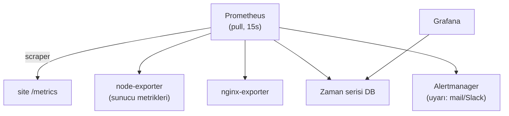

import Callout from '@components/Callout.astro';
import Quiz from '@components/Quiz.astro';
import LabBox from '@components/LabBox.astro';

## Prometheus: pull eden nabız ölçer

Prometheus, metrikleri **pull** modeliyle toplar: her servisin bir `/metrics` HTTP endpoint'i vardır; Prometheus düzenli aralıklarla (ör. 15 sn) gelip okur.



- **Exporter:** bir arayüzü `/metrics` formatına çeviren aracı — node (CPU/RAM/disk), nginx, Postgres, Redis... yüzlercesi hazır
- **TSDB:** metriklerin zaman serisi deposu
- **Alertmanager:** kurallar tetiklenince uyarıyı doğru kişiye doğru şekilde iletir

Pull modelinin pratik getirişi: metrik endpoint'ini curl ile elle görüntüleyebilirsin — hata ayıklama şeffaflığı.

<Callout type="info" title="Gerçek dünyadan: Prometheus, SoundCloud'da doğdu">
  Prometheus, 2012'de **SoundCloud** ekibinin Borgmon (Google'ın iç izleme
  sistemi) ilhamıyla geliştirdiği açık kaynak projedir; 2018'de CNCF'in ikinci
  graduated projesi oldu. Grafana ise 2014'te Torkel Ödegaard'ın tek başına
  başlattığı bir side project'ten endüstri standardına dönüştü. Bugün her ikisi
  neredeyse her observability yığınının omurgası — bu derste kurduğun compose
  yığını, sektörün fiili standardıdır.
</Callout>

## Metrik tipleri

| Tip | Ne için? | Örnek |
| --- | --- | --- |
| **Counter** | Yalnız artan sayı | toplam istek, toplam hata |
| **Gauge** | Artıp azalabilen değer | RAM kullanımı, aktif bağlantı |
| **Histogram** | Dağılım (bucket'lara) | istek süresi |

## PromQL: metriklerin sorgu dili

```promql
# Saniyedeki istek sayısı (son 5m ortalama)
rate(http_requests_total[5m])

# Hata oranı (%)
sum(rate(http_requests_total{status=~"5.."}[5m]))
  /
sum(rate(http_requests_total[5m])) * 100

# p95 istek süresi
histogram_quantile(0.95, rate(http_request_duration_seconds_bucket[5m]))
```

Kalıp ezberi: **`rate()` counter'ları per-saniye hıza çevirir** — neredeyse tüm trafik/latency sorguları bu kalıpta kurulur.

## Uyarı kuralı: semptomu, nedeni değil

```yaml
groups:
  - name: site
    rules:
      - alert: HighErrorRate
        expr: |
          sum(rate(http_requests_total{status=~"5.."}[5m]))
            / sum(rate(http_requests_total[5m])) * 100 > 2
        for: 5m
        labels:
          severity: critical
        annotations:
          summary: "Hata oranı 5 dakikadır %2'nin üstünde"
```

- `for: 5m` — geçici sapmalara alarm üretme (flaky uyarı = uyku bozma)
- **Semptom** (kullanıcı neyi hissediyor: hata oranı) ile **neden** (CPU yüksek) ayrılır: uyarının çoğu semptom bazlı olmalı — Seviye 4 SRE dersindeki SLO mantığının karşılığı.

## Grafana: sinyallerin panosu

Grafana, Prometheus (ve daha fazlasını) veri kaynağı olarak bağlar; dashboard'lar **kod gibi** sürümlenebilir (JSON export → repoya → CI). Pane'ler:

- İstek hızı (rate)
- Hata oranı (kırmızı eşiği = SLO hedefi — bir sonraki ders)
- p95/p99 latency
- Kaynak kullanımı (saturation)

**Alarm kırmızı çizgisi** olarak SLO hedefini pane üstüne koy: ekibin gözü her baktığında hedefi de görsün.

<LabBox
  id="s4-prom-grafana-lab"
  title="Compose ile izleme yığınını kur"
  verify={['docker compose ps | grep prometheus', 'curl -s localhost:9090/-/healthy | head -1']}
>
  1. Seviye 3'teki compose dosyasına `prometheus` + `grafana` servisleri ekle.
  2. `monitoring/prometheus.yml`: `scrape_interval: 15s` ve bir job ile siteyi hedefle (`site:80`).
  3. `docker compose up -d` → `localhost:9090` (Prometheus UI) → `Status → Targets`: site UP olmalı.
  4. `localhost:9090/graph` içinde `rate(http_requests_total[5m])` dene.
  5. `localhost:3000` (Grafana, admin/admin) → Prometheus data source ekle → bir pane oluştur.
  6. Bonus: nginx-exporter ekleyip sunucu metriklerini de pane'lere bağla.
</LabBox>

<Callout type="info" title="Bu sitenin izleme yığını">
  Bu sitenin compose dosyası artık 3 servis: site + prometheus + grafana. Capstone
  dersinde aynı yığını gerçek bir buluta taşıyacaksın — lokalde kurduğun yapı
  birebir ölçeklenecek.
</Callout>

<Quiz
  id="s4-prom-grafana"
  questions={[
    {
      q: 'Prometheus’un pull modeli ne demektir?',
      options: [
        'Metrikler servise elle itilir (push)',
        'Prometheus, servislerin /metrics endpoint’lerini düzenli okur',
        'Loglar çekilir',
        'Alertmanager metrik üretir',
      ],
      answer: 1,
      explain:
        'Pull modeli: hedefler /metrics sunar, Prometheus scrape eder — hata ayıklamada endpoint’i curl ile görebilirsin.',
    },
    {
      q: '`rate(http_requests_total[5m])` neyi verir?',
      options: [
        'Toplam istek sayısını',
        'Son 5 dakikada saniye başına ortalama istek hızını',
        'p99 süresini',
        'RAM kullanımını',
      ],
      answer: 1,
      explain:
        'Counter üzerinden rate = artış hızının saniye başına ortalaması; trafik sorgularının temel kalıbı.',
    },
    {
      q: 'Uyarı kurallarında `for: 5m` kullanmanın amacı?',
      options: [
        'Alarmı geciktirmek',
        'Geçici sapmalarda alarm üretmemek — sürekli koşul 5 dakika sürmeli',
        'CPU tasarrufu',
        'Log eşlemek',
      ],
      answer: 1,
      explain:
        'Kısa süreli spam/tık sesleri alarm üretmemeli; kalıcı sorun alarmdır. Flaky uyarılar güveni bitirir.',
    },
    {
      q: 'Uyarı tasarımında semptom-neden ayrımı neden önemli?',
      options: [
        'Sadece estetik',
        'Kullanıcının hissettiği semptomlar alarm üretmeli; her iç neden alarm olursa uyku bozulur',
        'Prometheus kuralı',
        'Cost çünkü',
      ],
      answer: 1,
      explain:
        '“Hata oranı %2 üstünde” (semptom) alarmdır; “CPU %80” (neden) genelde dashboard bilgisi. Pager’da semptom, planda neden.',
    },
  ]}
/>
