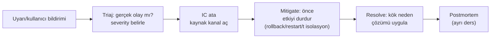

import Callout from '@components/Callout.astro';
import Quiz from '@components/Quiz.astro';
import Mermaid from '@components/Mermaid.astro';

## Olay anında ne KATILIYOR, ne katılmıyor?

Incident sırasında en pahalı şey **koordinasyon**dır: kim ne yapıyor, kim konuşuyor, hangi kanal? İyi ekipler bunu **önceden** yazılı hale getirir (runbook + roller), olay anında ezber değil liste takip eder.

## Roller

| Rol | Görevi | Kim olmalı? |
| --- | --- | --- |
| **Incident Commander (IC)** | Koordinasyon: karar verir, görev dağıtır, kayıt tutar | En deneyimli — **elle çözer değil, yönetir** |
| **Communications Lead** | Durum güncellemeleri: kanallar, müşteriler, yönetim | İletişimi güçlü biri |
| **Ops/Mitigation Lead** | Teknik aksiyon: ölçer, müdahale eder | Konu uzmanı |
| **Scribe** (büyük olaylarda) | Zaman çizelgesi kaydı | Herkes |

Kritik ilke: **IC müdahale etmez, yönetir.** En iyi teknisyenin IC olup konsola dalması, koordinasyonu kimse yapmadığı için olayı uzatır.

## Akış

**Mitigate-first** ilkesi olayın kalbidir: müşteri etkilendiyse önce **etkiyi kes** (rollback, failover, feature flag kapat); kök neden analizi olaydan SONRA gelir. “Nedenini bulmadan dönmeyelim” cümlesi, etkilenen müşterinin süresini uzatan lüksümsüzdür.

## Severity sınıflaması

| Sev | Tanım | Yanıt |
| --- | --- | --- |
| **SEV-1** | Kritik fonksiyon kapalı, tüm kullanıcılar | Acil, tüm kanallar, yönetim bilgilendirilir |
| **SEV-2** | Kritik fonksiyon bozuk/kısmi etki | Hızlı, çalışma saatleri içi ekibin tamamı |
| **SEV-3** | Yan fonksiyon bozuk, workaround var | Aynı gün planlanır |
| **SEV-4** | Kozmetik/marginal | Normal backlog |

Seviye belirsizse **bir üstten başla** — yüksekten düşürmek kolaydır; tersi müşteri süresi kaybettirir.

## İletişim ritmi

Sabitleyici bir yayın takvimi, kaosu durdurur: SEV-1'de **her 30 dakikada** durum güncellemesi (ne biliyoruz / ne yapıyoruz / ne zaman sonraki güncelleme). Bilinmiyorsa “bilmiyoruz, X'i test ediyoruz” **iyi** bir güncellemedir — sessizlik, herkesi kötüleştirmiş sayılan olaylara iter.

## On-call sürdürülebilirliği

On-call bir cezalandırma değil, **sistem**dir:

- **Vardiya en az 2 kişilik** (primary + shadow) — bilgi tek kişiye kilitlenmesin
- **Haftada bir rotasyon** başlangıç için yeterli; çok sık rotasyon öğrenmeyi engeller, çok seyrek tüketir
- **Faslıcak alarm sayısı takip edilir** (alert volume) — haftada onlarca gürültü alarmı varsa monitoring'in kendisi bug'lıdır; alarm temizliği bir reliability işi sayılır
- **Post-shift toparlanma:** zor gece sonrası ertesi gün hafif program
- **Runbook her alarm için** — alarmsız runbook olmaz, runbooksız alarm olmaz

<Callout type="warn" title="Burnout bir metrik belirtecidir">
  SRE literatüründeki pragmatik kural: on-call mühendis vardiyasında gecede 2’den
  fazla olayla uyanıyorsa alarm/arsa yükü ekibin kapasitesini aşıyor demektir —
  bu bir insan sorunu değil, sistem sorunu (alarm hijyeni, otomasyon) olarak
  backlog’a girer.
</Callout>

<Quiz
  id="s4-incident"
  questions={[
    {
      q: 'SEV-1’de Incident Commander’ın asıl görevi?',
      options: [
        'Kendi konsolunda çözümü uygulamak',
        'Koordinasyonu yönetmek: kararlar, görev dağılımı, kayıt',
        'Müşterilere tek tek mail atmak',
        'SLO raporunu hazırlamak',
      ],
      answer: 1,
      explain:
        'IC müdahale etmez, yönetir: en güçlü koordinatör en hızlı çözümü getirir; teknik eller ayrıdır.',
    },
    {
      q: 'Mitigate-first ilkesi neyi öncelikler?',
      options: [
        'Kök neden analizini',
        'Kullanıcı etkisini erken kesmeyi (rollback/failover); kök neden olaydan sonra',
        'Postmortem yazmayı',
        'Monitoring kurmayı',
      ],
      answer: 1,
      explain:
        'Etkilenen müşteri süresi en pahalı kaynaktır; “neden” sorusu postmortem’in işi — olay anı etkiyi kesme anıdır.',
    },
    {
      q: 'SEV seviyesi belirsizse doğru davranış?',
      options: [
        'En düşük seviyeden başla, yükselirsen artır',
        'Bir üst seviyeden başla — yüksekten düşürmek kolaydır',
        'Bekle ve gör',
        'Yönetim kararına bırak',
      ],
      answer: 1,
      explain:
        'Yanlış alçak seviye = gecikmiş kaynak mobilizasyonu. Asimetri: yükseltme pahalı, düşürme ucuz.',
    },
    {
      q: 'Sağlıklı on-call düzeninde “çok fazla alarm” sinyali neyi gösterir?',
      options: [
        'Ekip çalışkan',
        'Alarm hijyeni bozuk — monitoring’in kendisi backlog’lu bir iş olarak ele alınmalı',
        'SLO tutuyor',
        'On-call başarılı',
      ],
      answer: 1,
      explain:
        'Gürültü alarmlar uyku bozar ve gerçek olayın algısını köreltir; alarm temizliği sistem işidir.',
    },
  ]}
/>
