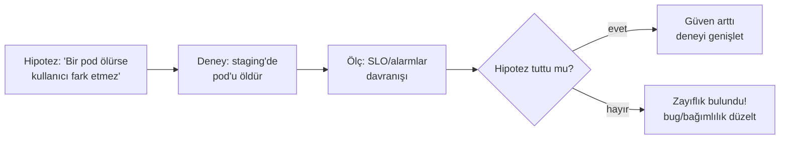

import Callout from '@components/Callout.astro';
import Quiz from '@components/Quiz.astro';

## Olaydan sonraki en kritik 48 saat

Olay kapanır kapanmaz iki yol açılır: **öğrenme** (postmortem) veya **unutma** (bir dahaki sefere kadar). Aynı olayın tekrar etmesi, postmortem'in başarısızlığıdır — olay değil, süreç.

## Blameless postmortem formatı

```markdown
# Postmortem: Ödeme servisi kesintisi — 2026-11-12

## Özet (TL;DR)
13:02–13:47 arasında ödeme API'si %100 hata verdi. Etki: ~4.100 işlem, 
~%35 error budget tüketildi.

## Zaman çizelgesi (UTC)
13:02 Alarm: HighErrorRate FIRING
13:09 IC atandı (ayşe), kanal #inc-8842 açıldı
13:21 Hipotez: upstream gateway'in yeniden dağıtımı sonrası DNS cache
13:31 Rollback uygulandı
13:40 probe_success = 1, alarm RESOLVED
13:47 Kapandı

## Kök neden
Gateway deployment'ı sırasında DNS TTL'i 300s olan eski kayıt 
yeni IP'ye senkronlanmadan trafik yendi → 5xx seli.

## Ne iyi gitti / ne gitti
✅ Alarm 30 sn içinde tetiklendi; runbook takip edildi
❌ DNS TTL ayarı deployment checklist'te yoktu
❌ Rollback komutu runbook'ta güncel değildi

## Aksiyon maddeleri
| # | Aksiyon | Sahip | Son tarih | Durum |
|---|---------|-------|-----------|-------|
| 1 | DNS TTL deployment checklist'e eklensin | ahmet | 15.11 | todo |
| 2 | Rollback runbook'u güncellensin | zeynep | 18.11 | todo |
| 3 | Staging'e DNS senkron testi | ahmet | 25.11 | todo |

## Bu olaydan öğrenilenler (lessons)
- “Uçtan uca probe” (Seviye 4 uptime lab) bu olayı 6 dk erken yakalardı.
```

İki disiplin kuralı:

1. **Blameless dil:** “Ayşe yanlış config'i deploy etti” ❌ → “Config değişikliği tek onaylı bir süreçten geçti; süreç yanlış ayarı yakalayamadı” ✅. Suçlayıcı dil → insanlar olay bilgisini saklar → aynı olay büyüyerek geri döner.
2. **Aksiyonlar takip edilir:** postmortem'in değeri, aksiyon maddelerinin **backlog'a girip kapanmasında**. Kapanmayan aksiyon postmortem'i bir tiyatro metnine çevirir.

## Chaos engineering: kötülüğü planlı davet etmek

Postmortem geçmişe bakar; chaos engineering geleceğe: **bilinçli, kontrollü, küçük dozda arıza enjekte ederek** sistemin dayanıklılığını ölç.

> Hipotez kur → kontrollü deney → dayanıklılığı ölç → öğren.



<Callout type="info" title="Gerçek dünyadan: Chaos Monkey'in doğuşu (2010-2011)">
  Netflix, AWS'in 2010-2011'deki kesintilerinden çıkan dersi şuydu: “bulutta koşan
  her şey er geç düşer — geride kalan soru, düşerken ne olacağıdır.” Cevap
  **Chaos Monkey** oldu: iş saatleri içinde, rastgele üretim instance'larını
  kapatan bir araç. Başlangıçta radikal görünen bu fikir, “güvenilirlik provasız
  kazanılamaz” tezinin endüstri standardı haline geldi. GitLab'ın 2017 canlı
  postmortem'ı da şeffaf öğrenmenin kültür tarafındaki eşdeğeridir.
</Callout>

Klasik araçlar: **Chaos Mesh, Litmus, AWS FIS**. Deneyler için üç altın kural:

1. **Staging'de başla**, prod'a yalnızca ölçüm rehberliğinde ve küçük dozda git
2. **Her deneyin hipotezi ve iptal düğmesi (abort) olsun** — SLO/monitoring kanıtına dayanır (Seviye 4'ün monitoring'i olmadan chaos olmaz)
3. **Deney günü ilan et** — sürpriz chaos, gerçek incident yaratır, öğrenme değil olay üretir

Olabildiğince ucuz başlangıçlar (bugün dene):

- `kubectl delete pod` — self-healing prova (Seviye 3'te yaptın!)
- Staging'de bir bağımlılığın portunu 2 dakika kapat
- Network gecikmesi enjekte et (chaos mesh: 200ms)
- Diski %90 doldur → uyarı süresini ölç

<Callout type="tip" title="Postmortem of the postmortem">
  Üç ayda bir ekip, postmortem’lerin kendisini gözden geçirir: aksiyonlar kapanıyor
  mu? Kök nedenler hep “insan hatası” mı çıkıyor (süreç analizi yüzeysel demektir)?
  Aynı alandan üçüncü olay mı geliyor (sistematik zayıflık)? 
</Callout>

<Quiz
  id="s4-postmortem-chaos"
  questions={[
    {
      q: 'Blameless postmortem’de kök neden dili nasıl olmalı?',
      options: [
        '“X kullanıcısı hata yaptı” — suçluyu bulup disipline et',
        '“Süreç/sistem bu hatayı production’a geçirmeye izin verdi” — sistemik analiz',
        '“Şanssız bir gün oldu”',
        'Kök neden yazılmaz',
      ],
      answer: 1,
      explain:
        'Blameless yaklaşım insan hatasını tetikleyici olarak görür; kök neden koruyucu katmanın yokluğudur.',
    },
    {
      q: 'Postmortem aksiyon maddelerinin gerçek değerini belirleyen şey?',
      options: [
        'Sayısı çok olması',
        'Backlog’a girip sorumlusu ve son tarihle KAPANMASI',
        'Uzun yazılması',
        'Yönetimin okuması',
      ],
      answer: 1,
      explain:
        'Kapanmayan aksiyon = aynı olayın tekrarını garantileyen tiyatro. Postmortem’in çıktısı değişikliktir.',
    },
    {
      q: 'Chaos deneyinin ön koşulu nedir?',
      options: [
        'Production’da denemek',
        'Ölçüm altyapısı (SLO/monitoring) + hipotez + abort düğmesi',
        'Özel lisans',
        'Büyük ekip',
      ],
      answer: 1,
      explain:
        'Ölçmediğin sistemin dayanıklılığını ölçemezsin; hipotezsiz/abort’suz chaos = plansız incident.',
    },
    {
      q: 'Mitigate-first ile chaos engineering ilişkisi?',
      options: [
        'Zıt yaklaşımlardır',
        'Chaos, mitigate stratejilerini (rollback, failover) olaydan ÖNCE prova ettirir',
        'Hiç ilişkileri yok',
        'Chaos sadece rapor üretir',
      ],
      answer: 1,
      explain:
        'Olay anında güvenle rollback yapabilmek, o yolu daha önce güvenli koşullarda denemiş olmaya bağlıdır.',
    },
  ]}
/>
