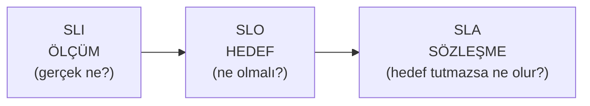

import Callout from '@components/Callout.astro';
import Quiz from '@components/Quiz.astro';
import Mermaid from '@components/Mermaid.astro';

## Neden %100 hedeflenmez?

“Daha iyi daha güvenilir” sezgisi, SRE'nin en sevdiği bulmacayı gizler: **%99.999 ile %100 arasındaki fark, kullanıcılar çoğunlukla hissetmez — ama geliştirme hızına maliyeti muazzamdır.** Artan dokuz (99 → 99.9 → 99.99) her seferinde katlanarak artan maliyet demektir: yedekli sistem, çoklu bölge, chaos testleri, daha yavaş deploy disiplini.

Google SRE'nin formülü: güvenilirliği bir **aralık** olarak tanımla ve kalan alanı geliştirmeye bırak.

## Üçlü: SLI, SLO, SLA

| Terim | Ne? | Örnek |
| --- | --- | --- |
| **SLI** (Indicator) | Ölçüm — güvenilirliğin sinyali | “200 dönen isteklerin toplam isteklere oranı” |
| **SLO** (Objective) | Hedef — iç sözleşme | “SLI ≥ %99.5, 30 günlük pencerede” |
| **SLA** (Agreement) | Dış sözleşme — ihlalde ceza/müjde | “Aylık uptime %99 — değilse iade” |

SLI ölçüm, SLO hedef, SLA ticari belge. Sıra kafa karıştırır; şöyle sabitle:



<Callout type="info" title="Gerçek dünyadan: Google Search bile 99.9 bandında hedefler">
  Google'ın SRE kitabında vurgulanan çarpıcı gerçek: dünyanın en büyük arama
  motoru bile güvenilirlik hedefini makul bir bantta (99.9+ aralığı) tutar — çünkü
  son %0.1'in peşindeki maliyet, özellik geliştirmeden çalacaktır. Error budget
  fikri, 2016'da ücretsiz yayınlanan **Google SRE kitabı**'ndan endüstriye yayıldı;
  kitap hâlâ bu disiplinin ana kaynağıdır ve çevrimiçi ücretsizdir.
</Callout>

## Error budget: başarısızlık payı

SLO %99.5 ise, 30 günde izin verilen kesinti:

```
30 gün = 43.200 dk
%0.5 budget = 216 dakika ≈ 3.6 saat
```

Bu 216 dakika **hata bütçesi** — “risk alma sermayesi”. Karar mekanizması:

| Bütçe durumu | Anlamı | Karar |
| --- | --- | --- |
| Bütçe > %50 | Sistem rahat | Yeni özellikler, hızlı deploy, riskli deneyler OK |
| Bütçe ~%25 | Dikkat | Feature işini yavaşlat, güvenilirlik işine ağırlık ver |
| Bütçe tükendi | SLO ihlali tehdidi | **Deploy dondur** (feature değil reliability işi) |

Error budget, Dev ve SRE arasındaki klasik çatışmayı (hız vs istikrar) **ortak metrikle** çözer: her iki taraf da aynı bütçeyi sayar; kimse “ben yavaşlatmak istemiyorum” diyemez — bütçe diyor.

## Sağlıklı SLO seçimi

1. **Kullanıcı perspektifinden SLI seç:** sunucu CPU'su değil; istek başarı oranı + gecikme
2. **Mütevazı başla:** %99 (ayda ~7 saat) — ölçemiyorsan önce ölç
3. **Pencere seç:** 30 gün rolling pencere standarttır
4. **Latency SLO'sunda yüzdelik kullan:** ortalama yanıltır; p95/p99 gerçek deneyimi anlatır (“ortalama 100ms ama p99 4 sn” = yarısı yavaş)

## SLO → monitoring bağlantısı

Seviye 4'ün önceki derslerindeki alarmların SLO diline çevrilmesi:

```promql
# 30 günlük availability (SLI)
sum(rate(http_requests_total{status!~"5.."}[30d]))
  / sum(rate(http_requests_total[30d]))

# hızlı yanıt SLO (p99 < 1sn)
histogram_quantile(0.99, rate(http_request_duration_seconds_bucket[30d])) < 1
```

**Burn rate alarmları** (bütçeyi hızla yakan tespit): 1 saatlik hata hızı 14.4× normalse kritik uyarı — bütçe günde değil saatte yanıyor demektir. Bu, klasik eşik alarmından çok daha akıllıdır.

<Callout type="tip" title="“Kim ne için sormuştu”">
  Error budget fikri, ekibin risk tavır tartışmasını çözer: “Bu hafta deploy açalım mı?”
  sorusunun cevabı artık tartışma değil, bütçe okumasıdır. SRE’deki ‘S’ sistem
  demektir — sadece “site” değil: pipeline’ın, işe alım sürecinin de SLO’u olabilir.
</Callout>

<Quiz
  id="s4-sli-slo"
  questions={[
    {
      q: 'SLI, SLO, SLA sırasıyla nedir?',
      options: [
        'Sözleşme, hedef, ölçüm',
        'Ölçüm, iç hedef, dış sözleşme',
        'Alarm, dashboard, rapor',
        'Aynı şeyin üç adı',
      ],
      answer: 1,
      explain:
        'SLI ölçüm (gerçek ne), SLO hedef (ne olmalı), SLA dış sözleşme (ihlal edilirse ne olur).',
    },
    {
      q: '%99.5 SLO’da 30 günlük error budget yaklaşık ne kadardır?',
      options: ['36 dakika', '216 dakika (~3.6 saat)', '43 dakika', '7 gün'],
      answer: 1,
      explain:
        '43.200 dk × %0.5 = 216 dk. Budget, güvenilirlik israfını risk sermayesine çevirir.',
    },
    {
      q: 'Error budget tükendiğinde Google SRE yaklaşımı ne önerir?',
      options: [
        'Feature deploy’larını durdurup reliability işine odaklanmak',
        'SLO’yu düşürmek',
        'Monitoring kapatmak',
        'Ekiği büyütmek',
      ],
      answer: 0,
      explain:
        'Bütçe = risk sermayesi; bittiğinde risk alma (deploy) durur, güvenilirlik işi önceliklenir.',
    },
    {
      q: 'Latency SLO’sunda ortalama yerine yüzdelik (p95/p99) kullanılmasının nedeni?',
      options: [
        'Ortalama hesaplanması kolay',
        'Ortalama, yavaş kuyruğu gizler; yüzdelik gerçek kullanıcı deneyiminin ucunu gösterir',
        'Prometheus sadece percentile destekler',
        'SLA gereği',
      ],
      answer: 1,
      explain:
        'Ortalama 100ms + p99 4s demek: kullanıcıların %1’i 4 saniye bekliyor. Ortalama bunu saklar.',
    },
  ]}
/>
