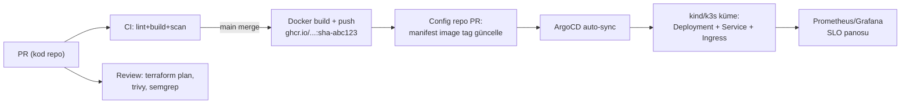

import Callout from '@components/Callout.astro';
import Quiz from '@components/Quiz.astro';
import LabBox from '@components/LabBox.astro';
import Mermaid from '@components/Mermaid.astro';

## Görev tanımı

Bu yolculuk boyunca her seviyede bu siteye bir katman ekledin. Şimdi hepsini **tek bir çalışan sistem**e bağlamanın zamanı. Hedef mimari:



## Aşama 1: CI'nin final hali

Seviye 2'deki pipeline'a eklenecekler:

```yaml
jobs:
  lint-test:      # build + içerik doğrulama (mevcut)
  security:       # trivy dosya sistemi taraması + gitleaks
  build-image:
    needs: [lint-test, security]
    if: github.ref == 'refs/heads/main'
    steps:
      - uses: docker/build-push-action@v6
        with:
          push: true
          tags: ghcr.io/${{ github.repository }}:${{ github.sha }}
  update-config:
    needs: build-image
    steps:
      # config repo'ya PR aç: k8s/deployment.yaml içinde image tag
      - run: |
          sed -i "s|image: .*|image: ghcr.io/${REPO}:${SHA}|" deployment.yaml
          # → git checkout -b deploy/${SHA} → commit → PR
```

**Kontrol listesi:** her imaj `sha` etiketli mi? Security job'ı kırıcı mı (exit-code)? Config PR otomatik açılıyor mu?

## Aşama 2: GitOps ve küme

- **ArgoCD'yi lokal kur:** `kubectl apply -n argocd -f https://raw.githubusercontent.com/argoproj/argo-cd/stable/manifests/install.yaml`
- Config repo'da `devops-site` Application'ını tanımla (Helm chart veya düz manifest)
- `automated` sync + `prune: true` — Git'ten silinen kaynak kümeden de silinir
- **Prova:** config PR merge → ArgoCD'nin senkronlamasını izle → yeni imaj kümede

## Aşama 3: Observability + SLO

- Prometheus/Grafana yığını küme içine (Helm chart'larla) kur
- **SLO tanımı:** “HTTP 200 oranı ≥ %99, 7 gün” + p99 < 1s
- Blackbox probe dışarıdan kontrol etsin
- Grafana pano: error rate, p99, probe, pod restart sayısı
- **Burn rate alarmı** kur (Seviye 4 SLO dersinin pratiği)

## Aşama 4: Dayanıklılık provası

| Deney | Beklenen | Ölçülen |
| --- | --- | --- |
| `kubectl delete pod` (canlıyken) | Kesinti ~0 sn (rolling/self-healing) | probe_success kesintisi |
| İmaj tag'ini bozuk sürüme çevir | ArgoCD degenerate → health check fail | alarm gecikmesi |
| `git revert` son commit | Küme 1-2 dk içinde eski sürüme döner | rollback süresi (MTTR provası) |
| Ingress'i 2 dk kapat | SiteDown alarmı FIRING | bildirim gecikmesi |

Bu dört provanın sonuçlarını bir tabloya yaz — bu tablo, capstone'un **teslim edilebilir kanıtıdır** (ve mülakatlarda anlatılacak hikâyenin omurgası).

<LabBox
  id="s5-capstone-lab"
  title="Zinciri kur ve kanıtla"
  verify={['argocd app get devops-site | grep -i synced', 'curl -s -o /dev/null -w "%{http_code}" http://localhost:8080']}
>
  Önerilen plan (4 oturum):

  **Oturum 1:** CI finali — security job + imaj build + config PR otomasyonu.
  **Oturum 2:** ArgoCD + küme — sync kurulur, ilk uçtan uca deploy yapılır.
  **Oturum 3:** Observability — Prometheus/Grafana + SLO + burn rate alarmı.
  **Oturum 4:** Prova — yukarıdaki 4 deney tablosu doldurulur.

  Kabul kriterleri:
  - [ ] Bir content değişikliği elle kubectl kullanmadan 15 dk içinde prod'da
  - [ ] Bozuk imaj, otomatik health check yüzünden yollanamıyor
  - [ ] Revert ile rollback süresi < 5 dk (ölçülmüş)
  - [ ] SLO panosu canlı, burn rate alarmı denendi
</LabBox>

<Callout type="tip" title="Portfolyo değeri">
  Bu capstone, bir iş görüşmesinde anlatılabilecek **en güçlü hikâyedir**: “Kendi
  bir doğruluk kaynağı Git olan, imzalı imajlarla, SLO’la yönetilen, ölçülmüş
  rollback süresi olan bir production kurulumu tasarladım ve kurdum” — çoğu junior
  adayın asla söyleyemeyeceği cümle.
</Callout>

<Quiz
  id="s5-capstone"
  questions={[
    {
      q: 'Capstone zincirinde “tek doğruluk kaynağı” hangi depodur?',
      options: [
        'Kod repo’su',
        'Config repo’su — kümenin istenen hâli Git’te yaşar, ArgoCD senkronlar',
        'CI logları',
        'Grafana panosu',
      ],
      answer: 1,
      explain:
        'GitOps modelinde kümenin hâli config repo’sundadır; kod repo’su imaj üretip oraya tek satır PR açar.',
    },
    {
      q: 'Bozuk imajın kümele yollanmasının engellenmesi hangi katmanda sağlanır?',
      options: [
        'Dockerfile yazım stiliyle',
        'Deployment health check + ArgoCD sync politikası — sağlıksız sürüm rolling tamamlanamaz',
        'Grafana tema seçimiyle',
        'DNS TTL ile',
      ],
      answer: 1,
      explain:
        'Health/readiness probe’ları sağlıksız pod’u trafiğe sokmaz; ArgoCD sync’i health koşuluyla durur.',
    },
    {
      q: 'Rollback süresini ölçmek neyin provasıdır?',
      options: [
        'CI hızının',
        'Incident yönetimindeki MTTR beklentisinin — olay anında gerçekçi geri dönüş süresi bilinmeli',
        'SLO hedefinin',
        'Image boyutunun',
      ],
      answer: 1,
      explain:
        'Ölçülmüş rollback süresi, olay anında “ne kadar sürede döneriz” sorusuna tahmin değil kanıt verir.',
    },
    {
      q: 'Kabul kriteri “elle kubectl kullanmadan 15 dk’da prod” neyi test eder?',
      options: [
        'kubectl bilgisi',
        'Uçtan uca otomasyonun gerçekten çalıştığını — push’tan prod’a insan dokunuşu sıfır olmalı',
        'Ağ hızını',
        'Dokümantasyonu',
      ],
      answer: 1,
      explain:
        'Elle adım kalan her yerde ölçek/insan hatası riski kalır; kriter otomasyon bütünlüğünün provasıdır.',
    },
  ]}
/>
