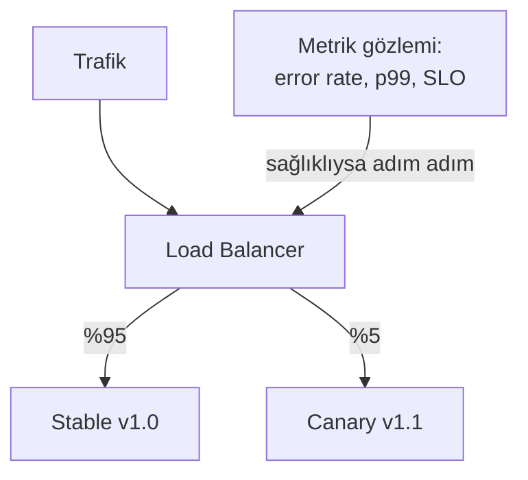

import Callout from '@components/Callout.astro';
import Quiz from '@components/Quiz.astro';
import Mermaid from '@components/Mermaid.astro';

## Deploy ≠ Release

Önce kritik ayrım: **deploy** = yeni sürümün altyapıya yerleşmesi; **release** = sürümün **kullanıcılara** açılması. Desenlerin hepsi bu ayrımın üzerinden yükselir: deploy'u sürekli ve risksiz, release'i kontrollü yapmak.

## Blue-green: iki sahne

```mermaid
flowchart LR
    U["Trafik"] -->|"%100"| B["Blue v1.0<br/>(aktif)"]
    G["Green v1.1<br/>(hazır, boşta)"]
    U -.|"değiştir: %0→%100"| G
```

- Yeni sürüm **green** ortamda paralel kurulur; test edilir
- Trafiği bir **switch** (LB/kubernetes service selector) ile green'e çevir
- Sorun olursa switch'i geri çevir — **rollback = saniyeler**

Artı: anlık geçiş ve geri dönüş. Eksi: **çift kapasite** maliyeti ve stateful sistemlerde (DB şeması, oturum) geçiş komplikasyonu.

## Canary: damla damla



Yeni sürüm önce **kullanıcıların küçük bir dilimine** (1-5%) açılır; metrikler (Seviye 4'te kurduğun!) karşılaştırılır:

- Canary stabiliyle aynı hata oranını gösteriyorsa → kademeli %5 → %25 → %50 → %100
- Bozulursa → canary'yi kes — **etkilenen kullanıcı sayısı binde birlerdedir**

Araçlar: Argo Rollouts, Flagger — canary adımlarını ve metric analizi otomatikleştirir. K8s'in kendi `maxSurge/maxUnavailable` ayarları da basit rolling-canary'dir.

| | Blue-green | Canary |
| --- | --- | --- |
| Geçiş | Tek switch | Kademeli oranlar |
| Geri dönüş | Anlık | Canary'yi kesmek anlık; %100'e geçtikten sonra klasik rollback |
| Maliyet | 2× kapasite | Neredeyse 0 ekstra |
| İdeal | Küçük sistem, hızlı geçiş isteyen | Trafikli servis, metrik takibi olan |

## Feature flags: kodu dağıt, özelliği gizle

```ts
if (featureFlags.isEnabled('new-checkout', user)) {
  return newCheckout();
}
return oldCheckout();
```

- **Kod deploy'u** her gün olabilir; **feature release** flag açıldığı an olur — deploy/release ayrımının tamamlanması
- **Kill switch:** yeni özellik sorun çıkarırsa flag kapat — deploy gerekmez, saniyeler içinde etkisiz (Seviye 4 incident dersindeki “mitigate-first”in en hızlı aleti!)
- **Beta kitleler:** %1 kullanıcılara, iç ekip üyelerine, test segmentlerine aç

Eksileri unutma: eski/yeni kod **aynı anda yaşamak zorundadır** — kod karmaşası; flag'lerin de ömrü vardır (amaçları bitince **temizlenir**; aksi halde “flag çöplüğü”).

## Desen seçimi pragmatiği

- Bu statik site (Seviye 3'te K8s'e taşınmış hali): rolling update yeterli — trafik profili basit
- Ödeme gibi kritik API: canary + SLO bazlı otomatik abort
- Büyük UI değişikliği: feature flag + iç beta → %5 → %100
- Veritabanı şeması değişen sürümler: **expand-migrate-contract** (önce geriye uyumlu ekle, sonra veriyi taşı, en son eskiyi kaldır) — desen kombinasyonu en çok burada gerekir

<Callout type="warn" title="DB’li deploy’un altın kuralı">
  Eski sürüm, yeni şemayla da çalışabilmeli (rolling update sırasında iki sürüm
  birlikte yaşar). Şema değişikliğini “kırıcı tek adım” olarak değil, geriye
  uyumlu üç adıma böl. Canary’de bile bu kural aynen geçerli.
</Callout>

<Quiz
  id="s5-deployment-desenleri"
  questions={[
    {
      q: 'Deploy ile release arasındaki fark?',
      options: [
        'Aynı şeydir',
        'Deploy altyapıya yerleşim; release kullanıcılara açılış — flag desenleri bu ayrımı sağlar',
        'Release daha yavaştır',
        'Deploy yalnızca DB',
      ],
      answer: 1,
      explain:
        'Feature flag ile deploy sürekli olur; release bağımsız kontrol edilir — risk dağıtılır.',
    },
    {
      q: 'Canary deseninin blue-green’e göre en büyük avantajı?',
      options: [
        'Daha ucuz donanım',
        'Etkiyi küçük trafik diliminde ölçerek bozulmayı binde birler seviyesinde tutması',
        'Rollback imkânsızdır',
        'DB şemasını otomatik taşır',
      ],
      answer: 1,
      explain:
        'Canary, “%5 kullanıcıda hata” ile “%100 kullanıcıda hata” arasında dev bir fark yaratır; metrikle kanıtlı adımlarla genişler.',
    },
    {
      q: 'Feature flag’in incident yönetimindeki rolü?',
      options: [
        'Hiçbir rolü yok',
        'Kill switch: sorunun kaynağı özelliği saniyeler içinde kapatmak — deploy gerekmeden mitigate',
        'Sadece A/B testi',
        'SLO ölçümü',
      ],
      answer: 1,
      explain:
        'Mitigate-first ilkesinin en hızlı aracı: kodu/altyapıyı değiştirmeden davranışı kapatırsın.',
    },
    {
      q: 'Rolling update sırasında DB şeması değişikliği için güvenli strateji?',
      options: [
        'Şemayı önce kır, sonra düzelt',
        'Expand–migrate–contract: geriye uyumlu ekle → veri taşı → eskiyi kaldır',
        'Rolling update’i iptal et',
        'Canary’yi %100 yap',
      ],
      answer: 1,
      explain:
        'İki sürüm birlikte yaşarken her ikisi de çalışabilmeli; kırıcı değişiklikler üç adıma bölünür.',
    },
  ]}
/>
