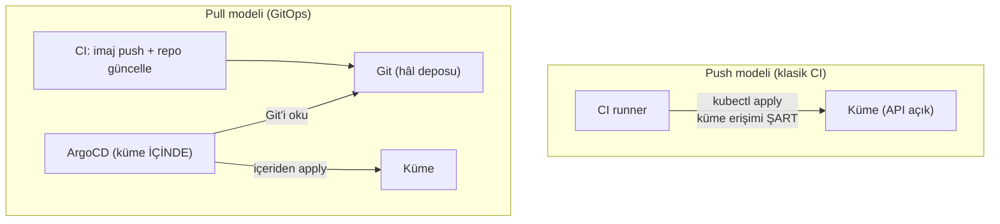

import Callout from '@components/Callout.astro';
import Quiz from '@components/Quiz.astro';
import Mermaid from '@components/Mermaid.astro';

## Problem: “kümeye kim neyi ne zaman apply etti?”

Seviye 3'te deploy'u elle `kubectl apply` ile yaptık. Bu modelin üç kötülüğü:

1. **Bilgi kaybı:** kümede ne var? Repo'da ne var? Farklar unutulur
2. **Erişim genişliği:** deploy eden herkesin kümeye yazma yetkisi gerekir
3. **Drift:** elle yapılan bir müdahale, kodla çelişir ve izi kaybolur

## GitOps: dört ilke

1. **Git = tek doğruluk kaynağı:** kümenin İSTENEN hâli repodadır
2. **Deklaratif:** her şey manifest/Helm/chart — komut script'i değil
3. **Sürekli eşitleme:** bir operator Git'teki hâli kümeye sürekli uygular
4. **Sürekli ölçüm:** drift (sapma) otomatik tespit edilir ve düzeltilir/raporlanır

## Push vs Pull: güvenlik devrimi



Pull modelinde **kümenin dışarıya açık kümeye-yazma kimlik bilgisi yoktur**: ArgoCD kümenin içinde koşar, Git'i dışarıdan (okuma izniyle) okur ve içeriden uygular. CI makinesi bir gün ele geçirilse bile kümeye doğrudan dokunamaz — saldırı yüzeyi Git'e iner.

## ArgoCD akışı

```
apps-repo (kod) --CI--> imaj --> config-repo'ya versiyon güncellemesi (PR)
config-repo (manifest'ler) <--ArgoCD sürekli izler--> küme
```

- **Config repo ayrımı:** kod repo'su ile “ne koşuyor?” repo'su ayrılır. CI, kod repo'sunda koşar ve config repo'suna **tek satır** (imaj tag) güncellemesiyle PR açar
- **Sync durumu:** `Synced` (Git = küme), `OutOfSync` (fark var — kim elle oynadı?), `Progressing`
- **Drift correction:** elle silinen pod/manifest değişikliği ArgoCD tarafından otomatik onarılır — K8s'in self-healing'i (pod düzeyi) GitOps'ta sistem düzeyine yükselir

```bash
# temel ArgoCD komutları
argocd app list
argocd app get devops-site
argocd app sync devops-site          # elle tetikleme (normalde otomatik)
argocd app diff devops-site          # Git vs küme farkı
```

**Auto-sync tartışması:** `automated` sync ile Git'e merge = küme değişir (tam GitOps); manuel sync ile ince kontrol. Prod'da yaygın orta yol: auto-sync + **sync windows** (uygulama saatleri) + canary (bir sonraki ders).

## Flux: ikinci büyük alternatif

**Flux** aynı modeli daha “K8s-native” (GitOps Toolkit API'leri ile) uygular: `Kustomization`/`HelmRelease` kaynaklarıyla deklaratif yapılandırma. ArgoCD'nin güçlü UI'si var, Flux'ın composability'si. İkisi de CNCF projesi — seçim ekip/kurum tercihine bağlı; **ilke** ikisinde aynıdır.

## GitOps'un DevOps'a katkısı

- **Audit:** “prod'a ne gitti?” → Git log. Tarihçe şeffaf, geri alınabilir (`git revert` = küme geri alınır!)
- **Erişim daralması:** geliştiricilere kümeye yazma yetkisi verilmez; PR açarlar
- **Çoklu kümeyi çoğaltmak:** aynı repo → 3 küme (dev/stage/prod) — pattern tekrarı IaC disipliniyle
- **DR (felaket kurtarma):** küme uçsa, yeni küme + aynı repo = dakikalar içinde birebir hâl

<Callout type="info" title="Bu sitenin GitOps hedefi">
  Capstone dersinde bu site için: kod repo’sunda CI → GHCR imaj → config-repo’da
  manifest update PR’ı → (lokal) ArgoCD auto-sync. Uçtan uca “commit → prod” akışını
  elle kubectl’siz kuracaksın.
</Callout>

<Quiz
  id="s5-gitops"
  questions={[
    {
      q: 'GitOps’un pull modelinin güvenlik getirisi?',
      options: [
        'CI daha hızlı çalışır',
        'Kümenin dışa açık yazma kimliği yoktur — deploy agent kümenin içinde koşup Git’i okur',
        'Yedek gerektirmez',
        'Secret’ları şifreler',
      ],
      answer: 1,
      explain:
        'Push modelinde CI küme kimliğine sahip olmalı; pull modelinde kimlik küme içindedir, dışarıdan saldırı yüzeyi Git okumasına iner.',
    },
    {
      q: '“OutOfSync” durumu neyi gösterir?',
      options: [
        'Uygulama hata veriyor',
        'Git’teki istenen hâl ile kümenin gerçek hâli farklı — elle müdahale/kayıp deploy olabilir',
        'DNS sorunlu',
        'Imaj derleniyor',
      ],
      answer: 1,
      explain:
        'GitOps’ta iki hâl arasında fark anormaldir: ya elle oynandı ya deploy eksik — operator bunu görünür kılar ve düzeltir.',
    },
    {
      q: 'Config repo ile kod repo’sunun ayrılmasının ana nedeni?',
      options: [
        'Disk tasarrufu',
        '“Ne koşuyor?” bilgisinin kod değişikliklerinden bağımsız, tek ve sürümü izlenebilir bir yerde olması',
        'CI yasakları',
        'Git sınırları',
      ],
      answer: 1,
      explain:
        'Config repo kümenin istenen hâlinin kaydıdır; CI kod’dan imaj üretip buraya tek satır (tag) günceller.',
    },
    {
      q: 'git revert’in GitOps’taki karşılığı?',
      options: [
        'Hiçbir karşılığı yok',
        'Kümenin o sürümüne geri dönme — revert otomatik senkronla kümeye yansır',
        'Pod restart',
        'Secret rotasyonu',
      ],
      answer: 1,
      explain:
        'Git = istenen hâl; revert edilen commit yeni hâl olur ve operator kümenin buna dönmesini sağlar.',
    },
  ]}
/>
