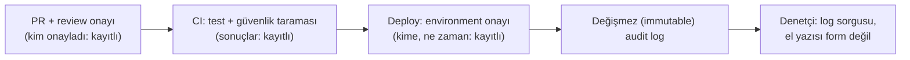

import Callout from '@components/Callout.astro';
import Quiz from '@components/Quiz.astro';

## “Bankada deploy iki haftada bir yapılır” klişesi

Klasik tablo: bankada her değişiklik **CAB (Change Advisory Board)** toplantısına girer, hafta sonu penceresinde, dört göz ilkesiyle (4-eyes: iki kişinin onayı) ve yüzlerce sayfalık değişim formuyla production’a çıkar. Bu tablo hâlâ gerçektir — ama iyi bankalar bunu **otomatikleştirilmiş kanıtla** yeniden tasarlıyor. Farkı anlamak için regülasyonların gerçekte ne istediğine bakalım:

| Regülasyon | Kapsam | DevOps’a somut etkisi |
| --- | --- | --- |
| **SOX** (ABD, 2002) | Halka açık şirketlerin finansal raporlama sistemleri | Değişiklik kaydı + onay zinciri kanıtı; “kim, ne zaman, kim onayladı” |
| **PCI-DSS** | Kart ödemeleri | Ağ segmentasyonu, secret şifreleme, trimester taramalar, en az yetki |
| **GDPR / KVKK** | Kişisel veri (AB/TR) | Veri yerleşimi, silme hakkı, erişim logları, veri minimizasyonu |
| **HIPAA** (ABD) | Sağlık verisi (PHI) | Şifreli aktarım/dinlenme, erişim denetimi, iş ortağı sözleşmeleri |
| **MAS/FTK vb.** | Sektör denetçileri | Test edilebilirlik, geri alınabilirlik, olay raporlama süreleri |

Dikkat: hiçbiri “yılda iki deploy” demiyor. **Kanıt istiyor** — ve kanıt, otomasyonun işidir.

## Compliance as code: denetim, pipeline’ın çıktısıdır

DevOps’un regüle sektördeki asıl fikri: **insan formu doldurmak yerine, pipeline otomatik olarak denetim kanıtını üretsin.**

Pratik eşleşmeler:

- **Onay zinciri** → PR review + protected branch + environment reviewer (Seviye 2’de kurduğun yapı zaten bunu üretiyor!)
- **4-eyes** → iki ayrı onay kuralı (CODEOWNERS + environment approval)
- **Değişiklik penceresi** → ArgoCD **sync windows** (Seviye 5 GitOps dersinde geçti)
- **Erişim kanıtı** → merkezi log + immutable saklama (WORM depolama)
- **Tarama zorunluluğu** → CI’da SCA/SAST gate (Seviye 4 DevSecOps dersleri)
- **Veri yerleşimi** → IaC’da region kısıtı + policy as code (OPA/Checkov ile “ABD bölgesine deploy engelle”)

<Callout type="tip" title="İyi bilinen dönüşüm örnekleri">
  Singapur’da **DBS Bank** ve Hollanda’da **ING**, 2015 sonrasında agile/DevOps dönüşümlerini
  kamuya açık şekilde anlattı: yüzlerce küçük ekip, standart pipeline’lar, otomatik
  kanıt. Sonuç olarak değişiklik sıklığı artarken denetim bulguları azaldı — çünkü
  elle toplanan dağınık kanıt yerine makine üretiği tutarlı kanıt geldi.
</Callout>

## Sağlık ve kamu: veri kısıtları farklı katmanı değiştirir

Sağlıkta (HIPAA/KVKK) ve kamu sektöründe DevOps’un araçları aynıdır ama **veri taşınmaz**:

- **Veri yerleşimi ve sınırlar:** PHI/kişisel veri, test ortamlarına bile kopyalanamaz. Çözüm: sentetik test verisi üretimi, maskeleme (data masking) pipeline’ı
- **Erişim denetimi her şeydir:** “kim hangi hastanın kaydına baktı” logu yasal gerekliliktir; prod’a doğrudan DB erişimi yok — break-glass (acil erişim) süreçleri kayıtlıdır
- **Kamuda ek kısıtlar:** veri merkezi zorunluluğu, erişilebilirlik standartları, tedarikçi kilidi (vendor lock-in) hassasiyeti — IaC + açık kaynak stack’ler burada stratejik tercihtir

<Callout type="warn" title="Regüle sektörde “test verisi = prod verisi” en büyük ihlal kaynağıdır">
  Geliştirici rahatlığı için gerçek müşteri verisinin test ortamına kopyalanması,
  denetimlerin en sık bulduğu ihlallerden biridir. KVKK/GDPR altında bu, kendi başına
  bir olaydır (data breach). Doğru desen: maskeleme/sentetik veri üreten bir pipeline
  adımı — “veri prod’dan çıkmaz” ilkesi kodda zorunlu kılınır.
</Callout>

## Pragmatik çıkarımlar

1. **Regülasyon hızı yasaklamaz; kanıtsızlığı yasaklar.** Yılda 1000 deploy’la da SOX-uyumlu olabilirsin — her deploy’un kendi kanıt zinciri varsa.
2. **Yavaş CAB’i yıkma, otomatikleştir:** CAB’ın sorusu “kim onayladı, geri alınabilir mi, test edildi mi?” — bu üçünün cevabını pipeline üretiyorsa CAB, rutin değişiklikleri standart değişiklik (pre-approved) sınıfına taşır. (Google SRE kitaplarındaki “bored auditors” bölümünün özü budur.)
3. **Kanıt da bir artifact’tır:** Seviye 2’deki “üretilen şey bir kez üretilir, kimliklenir, taşınır” ilkesi kanıtlara da uygulanır — deploy kayıtları sürümülenir, saklama süresi IaC’da tanımlıdır.

<Quiz
  id="s5-regule-sektorler"
  questions={[
    {
      q: 'Compliance as code yaklaşımında denetim kanıtı en çok nereden gelir?',
      options: [
        'Denetçinin hazırladığı formlardan',
        'Pipeline’ın otomatik ürettiği kayıtlardan (onay, tarama, deploy log)',
        'Aylık e-posta özetlerinden',
        'Elle tutulan Excel çizelgelerinden',
      ],
      answer: 1,
      explain:
        'Makine üretiği kanıt tutarlı, eksiksiz ve geriye dönük sorgulanabilirdir; elle kanıt toplanması hatalı ve pahalıdır.',
    },
    {
      q: 'Regüle sektörlerdeki “test verisi” için doğru pratik?',
      options: [
        'Prod verisinin kopyalanması — gerçekçi test için şart',
        'Maskeleme/sentetik veri üretimi — gerçek veri ortam sınırlarından çıkmaz',
        'Test verisi hiç kullanılmaz',
        'Yalnızca staging ortamında gerçek veri',
      ],
      answer: 1,
      explain:
        'Gerçek kişisel verinin test ortamlarına kopyalanması kendi başına bir ihlaldir (KVKK/GDPR/HIPAA); maskeleme ve sentetik üretim doğrudur.',
    },
    {
      q: 'CAB’in rutin değişiklikleri “standart değişiklik” sınıfına alması için ne gerekir?',
      options: [
        'Yönetim imzası',
        'Pipeline’ın CAB’ın sorularını (onay, test, geri alınabilirlik) otomatik kanıtla cevaplaması',
        'Daha az deploy',
        'Denetçinin onayı',
      ],
      answer: 1,
      explain:
        'Pre-approved (standart) değişiklik sınıfı, riski ölçülebilir şekilde azaltılmış otomatik akışlarla kazanılır.',
    },
    {
      q: 'KVKK/GDPR bağlamında “veri yerleşimi” kısıtının IaC’da doğru karşılığı?',
      options: [
        'Her şeyi kendi bilgisayarda tutmak',
        'Policy as code ile bölge kısıtı — izin verilmeyen bölgeye deploy pipeline’da engellenir',
        'Bir tablo Excel’de tutmak',
        'Denetçilere sormak',
      ],
      answer: 1,
      explain:
        'Kısıt kodla zorunlu kılınır (OPA/Checkov vb.); “yazılı kural” değil “pipeline’da engel” olan koruma gerçek korumadır.',
    },
  ]}
/>
