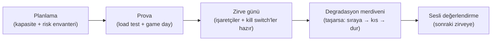

import Callout from '@components/Callout.astro';
import Quiz from '@components/Quiz.astro';
import Mermaid from '@components/Mermaid.astro';

## Ortak düşman: öngörülebilir ama acımasız zirve

Regüle sektörün düşmanı *kanıt eksikliği* ise, yüksek trafik sektörün düşmanı **zirve (peak)**: Black Friday, Singles’ Day, oyun lansmanı, canlı etkinlik. Bu zirveler sürpriz değildir — tarihleri aylar önceden bellidir. Mühendislik sorusu: *“Zirvede ne çalışacak, ne çalışmayacak ve kullanıcı ne görecek?”*

## E-ticaret: kampanya gecesi

Black Friday trafiği normal günün 5–20 katı olabilir. İyi hazırlığın adımları:

1. **Kapasite modeli:** geçen yılın gerçek trafik eğrisi + büyüme çarpanı + kampanya senaryosu; her servisin kapasite hedefi sayıya bağlanır
2. **Yük testi prod’a yakın ortamda:** “10× trafikte p99 kaç ms?” sorusunun cevabı zirve gecesinden *önce* alınır
3. **Kampanya kodu feature flag arkasında:** indirim motoru flag ile açılır; sorun olursa kampanya kapanır, satış devam eder
4. **CDN/önbellek stratejisi:** ürün görselleri ve statik sayfalar kenardan servis edilir; origin yükü minimuma iner
5. **Degradasyon merdiveni** (aşağıda)

Alibaba'nın **Singles' Day** (11.11) etkinliği, bu disiplinin en ölçekli örneğidir: ödeme ve stok sistemleri yıllık prova edilir, zirvede milyonlarca saniyede istek işlenir — bu oran, yıllık rehersiz kapasiteyle değil, **provalı kapasiteyle** karşılanır.

### Degradasyon merdiveni (ezberle)

| Basamak | Davranış | Kullanıcı görür |
| --- | --- | --- |
| 0. Normal | Tam fonksiyon | Her şey |
| 1. Özellik kısma | Öneriler/araç ipuçları kapalı | Hafif sadeleşme |
| 2. Kuyruk (queue) | Girişler kuyruğa alınır | “Sıradasınız, dakika ~2” |
| 3. Salt-okunur mod | Sepet çalışır, ödeme sıraya girer | “Yoğunluk, siparişiniz kuyrukta” |
| 4. Statik mod | CDN'den “çok yoğunuz” sayfası | Bilgi + tekrar deneme zamanı |

Kritik ilke: **basamaklar önceden kodlanmış ve provası yapılmış** olmak zorunda — zirve gecesi yazılmaz. Her basamak bir feature flag/kill switch'tir (Seviye 5 deployment desenleri).

## Oyun: live ops disiplini

Oyun sektörü, DevOps'u en sert yaşayan yerlerden biri — istemci sürümü kullanıcının elinde kalır, sunucu tarafı sürekli değişir:

- **Live ops:** oyun içi etkinlikler/ayarlar sunucu konfigürasyonu olarak yayınlanır (config as data) — mağaza fiyatı, olay takvimi, zorluk dengesi deploy'suz değişir
- **Sunucu rollout:** oyun sunucuları rolling/canary ile güncellenir; oyuncu oturumları bölünmez
- **Zirve anları:** sezon açılışları ve canlı etkinlikler trafiği dakikalar içinde katlar

Fortnite'in 2020'deki **Travis Scott canlı konseri** ~12 milyon eşzamanlı izleyiciye ulaştı — bu, etkinlik altyapısının *provalı* bölgesel ölçekleme ve kuyruklama ile mümkün olduğu klasik vaka. Oyun lansman günleri (istek: girişler + sosyal baskı) ise “doğal chaos testi” gibi davranır; hazır olmayan ekibin lansmanı and-site error sayfasına döner.

## Medya/streaming: yayın günü

- **Reyting zirveleri:** final bölümleri/büyük maçlar planlı zirvedir; Hindistan'da **Hotstar**, canlı maç yayınlarında on milyonlarca eşzamanlı izleyiciye ulaştı (2021'de ~25 milyon eşzamanlı rekor) — CDN offload + bölgesel ölçekleme + izleyici kuyruklama kombinasyonuyla
- **Lansman riski:** yeni servislerin ilk günü kayıt/oturum akışları çöker (2019 Disney+ lansman gecesi kesintileri belgelenmiştir) — neden: provalı zirve kapasitesi değil, “kayıt akışının” beklenmedik darboğazları
- **Ortak ders:** zirve sadece “video trafiği” değil; kimlik doğrulama ve ödeme akışları genelde **ilk çöken** bileşenlerdir — load test tam yolculuğu kapsamalı

<Callout type="tip" title="Game day: provanın adı">
  Seviye 4'te chaos engineering gördün — yüksek trafik sektörlerde bunun takvimi
  belli versiyonu “game day”dir: zirve senaryosu canlıya en yakın ortamda, ekiple
  beraber, ölçülerek prova edilir. Hedef iki şeyi kanıtlamaktır: kapasite sayısı
  ve **degradasyon merdiveninin gerçekten çalışması**.
</Callout>

## Pragmatik çıkarımlar

1. **Zirve planı, deploy planı gibi yönetilir:** tarihli, provalı, geri alınabilir.
2. **İlk çöken genelde “şık” bileşenlerdir:** öneri motoru, arama, sosyal akış — degrade edilebilir tasarlanırlar; ödeme ve giriş asla sessizce degrade edilmemelidir (kuyruk + açık iletişim).
3. **Kampanya = feature flag:** pazarlama takvimi ile release takvimi birbirinden ayrılır (Seviye 5 deploy/release ayrımının ticari hali).

<Quiz
  id="s5-yuksek-trafik"
  questions={[
    {
      q: 'Degradasyon merdiveninin temel ilkesi nedir?',
      options: [
        'Zirvede basamaklar canlıda yazılır',
        'Basamaklar önceden kodlanmış, flag’li ve provası yapılmış olur',
        'Her zaman tam kapasite beklenir',
        'Hata durumunda site kapatılır',
      ],
      answer: 1,
      explain:
        'Zirve gecesi kod yazmak değil, önceden yazılmış basamakları işaretlemektir — her basamak bir feature flag/kill switch’tir.',
    },
    {
      q: 'Yüksek trafik günlerinde ilk çöken bileşenler genellikle hangileridir?',
      options: [
        'Statik görseller',
        'Kimlik doğrulama ve ödeme akışları — load test çoğunlukla tam yolculuğu kapsamaz',
        'CDN kenarları',
        'DNS kayıtları',
      ],
      answer: 1,
      explain:
        'Video/ürün trafiği CDN’e offload edilirken auth/ödeme origin’e bağlı kalır; Disney+ lansmanı gibi vakalarda çöken tam bu akışlardır.',
    },
    {
      q: 'Oyun sektöründe “config as data” neyi mümkün kılar?',
      options: [
        'Oyun sunucusunun kapalı kalması',
        'Etkinlik/ekonomi/denge ayarlarının deploy’suz, sunucu konfigürasyonu olarak yayınlanması',
        'İstemci güncellemelerini zorlamak',
        'Tek sunucuda tüm oyuncuları toplamak',
      ],
      answer: 1,
      explain:
        'Live ops disiplininde mağaza fiyatı, etkinlik takvimi gibi ayarlar veri olarak yayınlanır; istemci sürümünden bağımsız değişir.',
    },
    {
      q: 'Game day provasının kanıtlaması gereken iki şey?',
      options: [
        'Sunucu fiyatı ve fatura',
        'Kapasite sayısı ve degradasyon merdiveninin gerçekten çalışması',
        'Yeni özelliklerin hazır olması',
        'Pazarlama bütçesi',
      ],
      answer: 1,
      explain:
        'Prova, sayıyı (10× trafikte p99 = ?) ve basamakları (kuyruk gerçekten devreye giriyor mu?) kanıtlar; ikisi de zirve gecesinden önce bilinmelidir.',
    },
  ]}
/>
